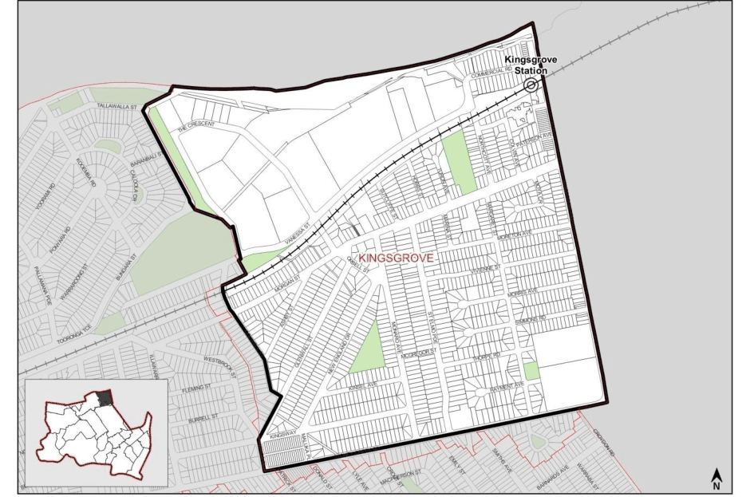

### 5.3 Kingsgrove Locality Statement

#### Map of locality

> [Picture on page 12: a picture, saved as a picture (images/part-05-residential-locality-statements-page-12-3.gif, 150 dpi).]

Figure 5: Kingsgrove

#### Existing Character

Location

The locality is bounded by the Canterbury-Bankstown LGA boundary to the north, Kingsgrove Road to the east which also acts as the boundary to the Bayside LGA, Stoney Creek Road to the South and Westbrook Street and Colwell Street to the west. The railway line divides Kingsgrove into northern and southern parts. The suburb of Kingsgrove is divided between Bayside, Canterbury-Bankstown and Georges River Councils.

Background

The Traditional Owners of the area are members of the Aboriginal Bidjigal people of the Eora Nation, part of the Dharug language group.

In 1804, the wife of Quartermaster Thomas Laycock, Mrs. Hannah Laycock was granted a 500-acre plot of land by New South Wales Governor Philip Gidley King. She gave this land the title of "King's Grove Farm" in honour of the Governor and from which the suburb of

Kingsgrove derives its name.5  The suburb began to expand and develop after the Kingsgrove Railway Station opened on 26 September 1931.6

Heritage

This locality does not contain any heritage item under Schedule 5 Environmental Heritage within GRLEP 2021.

Built Form and Setting

This locality contains a large industrial precinct, the Kingsgrove Industrial Area, to the north of the railway line.

All of the residential dwellings within this locality are located to the south of the railway line. These residential areas are predominately low density, inter-war and post-war styles consisting of single storey red brick dwellings with an increasing number of two-storey contemporary dwellings and some dual occupancies.

The terrain of the locality is generally flat with slight elevation to the north-west of Kingsgrove railway station. Blocks are relatively consistent, particularly along Glenwall Street. There are some irregular sized blocks located around cul-de-sacs at Morris Avenue, Moya Crescent, Simmons Road and Rayment Avenue. However, the subdivision patterns within this locality are generally consistent and regular.

There are several open spaces available in this locality including Peter Low Reserve, Butler Reserve, Vanessa Street Reserve and Smith Park.

Streetscape Character

The streets in the locality are generally tree-lined and present a landscaped character, especially evident on Ashby Street and St Elmo Parade. The dwellings in the locality mostly present consistent front building setbacks which achieve a sense of uniformity and openness that enhances the streetscape character.

#### Future Desired Character

• Retain and enhance the existing low density suburban residential character through articulated contemporary developments that respond to the human scale.

• Encourage tree planting within the front setback space to create a tree-lined streetscape character.

• Encourage consistent setbacks of buildings from the street and the provision of

landscaping within the front setback.

5 ‘Road grader at Morgan and Marina intersection’, Georges River Council Libraries Local Studies collection, viewed 14 April 2020, https://georgesriver.spydus.com/cgi-bin/spydus.exe/FULL/WPAC/ALLENQ/8008774/17747411,10 6 ‘Railway opened: Tempe to Kingsgrove’, The Sydney Morning Herald, 28 September 2020, pg. 6,  viewed 14 April 2020, https://trove.nla.gov.au/newspaper/article/16806673?searchTerm=Kingsgrove%20railway%20station%20ope n&searchLimits=
