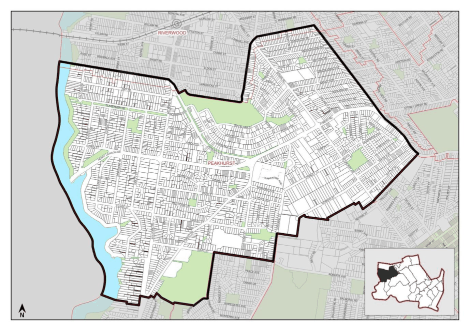

### 5.4 Peakhurst Locality Statement

#### Map of locality

> [Picture on page 14: a picture, saved as a picture (images/part-05-residential-locality-statements-page-14-3.gif, 150 dpi).]

Figure 6: Peakhurst

#### Existing Character

Location

Peakhurst is bordered by Riverwood to the north (Shenstone Road, Hardwicke St, Talbot St, Charles St), Baumans Road and Forest Road to the east, and the suburbs of Lugarno, Peakhurst Heights and Mortdale to the south, and Salt Pan Creek on the Georges River to the west.

Background

The Traditional Owners of the area are members of the Aboriginal Bidjigal people of the Eora Nation, part of the Dharug language group.

The suburb of Peakhurst was originally formed part of an 1808 land grant to Captain John Townson. In 1838, John Robert Peake bought 10 acres of land near the junction of the present Forest Road and Henry Lawson Drive and Peake's name was used to name the suburb. 7

Although many parts of the Georges River area experienced a middle-class housing boom in the 1920s and 1930s, Peakhurst remained a relatively sparsely-settled area during this time.

7 The Book of Sydney Suburbs, Frances Pollon, Angus & Robertson Publishers, 1990, p.202.

By 1943 houses dotted the landscape interspersed with large vacant land and market gardens.

Heritage

There are several heritage items in this locality that relate to the area’s social history and architecture (refer to Schedule 5 Environmental Heritage within GRLEP 2021).

Built Form and Setting

Peakhurst is a predominately low density suburban area with a precinct of residential flat buildings to the south of Peakhurst Park and some medium density developments between Forest Road, Belmore Road and Bonds Road. The low density areas consist of a mix of detached and semi-detached houses built in the inter-war and post-war periods, as well as contemporary knock down rebuilds. This has resulted in an eclectic mix of housing styles.

Due to the gradual trickle of housing development in Peakhurst up until the mid-1940s, there is a lack of uniform subdivision pattern throughout the locality. While some streets feature a grid-like pattern with varying levels of formality, others have been formed from sweeping cul-de-sacs layouts.

The largest industrial precinct in the LGA, the Peakhurst Industrial Area, is partially located within this locality at the south-eastern corner bounded by Forest Road, Lorraine Street and Boundary Road. There are also multiple small commercial centres scattered throughout the locality.

The topography of Peakhurst is fairly flat with gentle slopes towards the Georges River in the south-west and towards the south along Henry Lawson Drive. There are views of the River and bushland border in some parts of the locality. Most of these areas are located within the Foreshore Scenic Protection Area (refer to GRLEP 2021 Foreshore Scenic Protection Area Map).

Peakhurst Park and Gannons Park are the major public recreation areas in the locality. There are also a number other public parks including Harvey Dixon Park, Johnstone Reserve, Henry Lawson Drive Reserve, Madge Bagust Reserve, Oleander Reserve, Pearce Avenue Reserve, Neilson Avenue Reserve, Judd Reserve, Boundary Road Reserve, Iraga Avenue Reserve, Coreen Avenue Reserve, Ogilvy Street Reserve, Caledonia Crescent Reserve, Dawn Street Reserve, Denise Crescent Reserve, Rona Street Reserve, Beale Reserve and Pritchard Place Reserve.

Streetscape Character

The streetscape exhibits an eclectic character attributed to the variety of housing and fence materials, roof forms, driveway widths and garage styles. The front setbacks are also inconsistent in many streets. However, most dwellings provide trees and/or landscaping in the front yard.

Verges are planted in an irregular pattern with few streets showing evidence of a formalised street tree planting scheme.  Exceptions to this include Lawrence Street, Trafalgar Street,

Milford Street and Clarendon Road, which features a central strip reservation between dual carriageways planted with Australian natives, and Belmore Road.

#### Future Desired Character

• Encourage tree planting and landscaping within the front setback space to create a tree-lined streetscape character.

• Encourage consistent setbacks of buildings from the street and the provision of landscaping within the front setback.

• Encourage the retention of treetop bushland views towards the west of the locality, overlooking Georges River.
