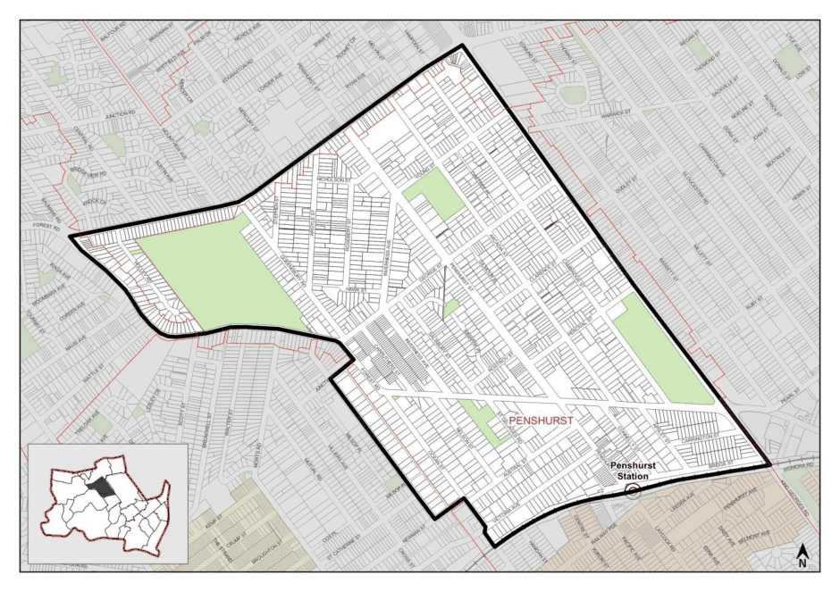

### 5.5 Penshurst

#### 5.5.1 Penshurst North Locality Statement

#### Map of locality

> [Picture on page 17: a picture, saved as a picture (images/part-05-residential-locality-statements-page-17-4.gif, 150 dpi).]

Figure 7: Penshurst North

#### Existing Character

Location

This locality is bounded by Stoney Creek Road to the north, King Georges Road to the east, the railway line to the south, Hurstville Grove to the south, and Mortdale to the west. The railway line that runs through the suburb of Penshurst exists as the boundary between the two localities of Penshurst North and Penshurst South.

Background

The Traditional Owners of the area are members of the Aboriginal Bidjigal  people of the Eora Nation, part of the Dharug language group.

The development of Penshurst occurred in multiple waves with the first wave occurring in 1885 when the railway was constructed. The second wave of development occurred in the 1920s and 1930s boom period which saw a surge in middle-class suburbanisation of the

area. This boom occurred in both the northern and southern parts of Penshurst. A third wave of development occurred during the 1960s and 1970s that saw earlier housing demolished

and replaced with apartments, particularly focused between Forest Road and the railway line, and Arcadia Street and Cambridge Street.

Heritage

There are several heritage items in this locality that relate to the area’s social history and architecture (refer to Schedule 5 Environmental Heritage within GRLEP 2021).

Built Form and Setting

The area between Forest Road and the railway line is dominated largely by 1960s and 1970s residential flat buildings and which adjoins the Penshurst local centre on Penshurst Street. A small light industrial area is split by Forest Road.  The remaining areas of this locality consist of low density residential dwellings with some villa and town house development. There is a mix of housing styles with no dominant architectural style.

The underlying subdivision pattern of Penshurst North has remained largely intact, with some large block re-subdivision and redevelopment in parts. The size of lots varies throughout. Carruthers Street and the southern side of Inverness Avenue feature very narrow blocks.  The northern side of Inverness Avenue features a range of narrow and medium-sized allotments.

Significant public recreation spaces include Penshurst Park, the Hurstville Aquatic Leisure Centre, Olds Park and Gifford Park. There are also a several smaller parks including Pole Depot Park and Immarna Place Reserve.

Streetscape Character

The streetscape exhibits an eclectic character attributed to the variety of housing and fence materials, roof forms, driveway widths and garage styles. However, the front building setbacks appear largely consistent in many streets and most dwelling houses feature landscaping within the front setback.

Street tree plantings are common throughout the locality with the most notable plantings being the mature trees along Penshurst Street and the streets between Forest Road and the railway line.

#### Future Desired Character

• Encourage appropriate medium and high density development towards the Penshurst commercial centre.

• Retain and enhance the existing low density suburban residential character through articulated contemporary developments that respond to the human scale.

• Encourage tree planting within the front setback space to create a tree-lined streetscape character.

• Encourage consistent setbacks of buildings from the street and the provision of landscaping within the front setback with uniform front fence heights.
