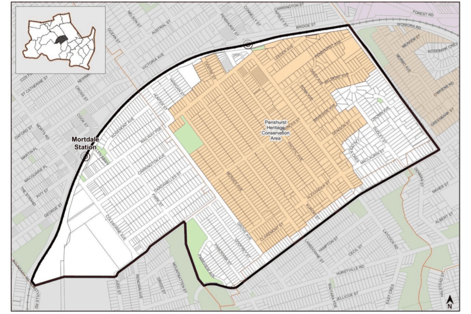

#### 5.5.2 Penshurst South Locality Statement

#### Map of locality

> [Picture on page 19: a picture, saved as a picture (images/part-05-residential-locality-statements-page-19-3.gif, 150 dpi).]

Figure 8: Penshurst South

#### Existing Character

Location

The locality is bounded by the railway line to the west and north, King Georges Road to the east, Hillcrest Avenue, Renown Park and Judd Street to the South. The railway line that runs through the suburb of Penshurst exists as the boundary between the two localities of Penshurst North and Penshurst South.

Background

The Traditional Owners of the area are members of the Aboriginal Bidjigal people of the Eora Nation, part of the Dharug language group.

The development of Penshurst occurred in multiple waves with the first wave occurring in 1885 when the railway was constructed. The second wave of development occurred in the 1920s and 1930s boom period which saw a surge in middle-class suburbanisation of the

area. This boom occurred in both the northern and southern parts of Penshurst. A third wave of development occurred during the 1960s and 1970s that saw earlier housing demolished and replaced with apartments, particularly focused between Forest Road and the railway line, and Arcadia Street and Cambridge Street.

Heritage

There are several heritage items in this locality that relate to the area’s social history and architecture (refer to GRLEP 2021 Schedule 5).  A significant portion of the locality is located within the Penshurst Heritage Conservation Area.

Built Form and Setting

The locality consists of predominately low density residential area with small commercial centres adjoining Penshurst and Mortdale railway stations. Dwelling stock within the Heritage Conservation Area consists largely of single storey dwelling houses built in the early half of the 20th century. Further information is located within Appendix 3 – Heritage Conservation Areas of this DCP.

The locality features sloping topography, in particular to the east of Laycock Street, which gives distant views to wider Sydney in several locations. Most of the locality was formed by subdivisions with medium-sized lots laid out in a regular grid pattern. To the east of Laycock Road there are slightly wider blocks from Leeder Avenue to Alexander Street. Sweeping crescents and cul-de-sacs are also present in this area, notably Havendale Avenue, Beverley Crescent and Caloola Crescent. Moore Reserve and McRaes Reserve are the main public open spaces available within this locality.

Streetscape Character

Although not all streets in the locality are tree-lined, many houses contain landscaping and/or trees in their front and rear gardens which, when combined with the views gained by the sloped topography, add to the leafy feel of the area. The desirable streetscape character of this locality is also enhanced by the presence of brick-edged kerbs and wide verges with landscaped medians.

Front boundary setbacks, fencing style and garage forms are generally consistent throughout the heritage conservation area. Outside of the heritage boundary there is a mix of housing and fence styles, garage forms and driveway widths which create a less harmonious streetscape.

#### Future Desired Character

• Retain and enhance the existing low density suburban residential character through articulated contemporary developments that respond to the human scale.

• Preserve the high quality of the existing streetscape, especially within the Heritage Conservation Area.

• Encourage tree planting within the front setback space to create a tree-lined streetscape character.

• Encourage consistent setbacks of buildings from the street and the provision of landscaping within the front setback with uniform front fence heights.

• Maintain public views to the wider Sydney cityscape on ridges.
