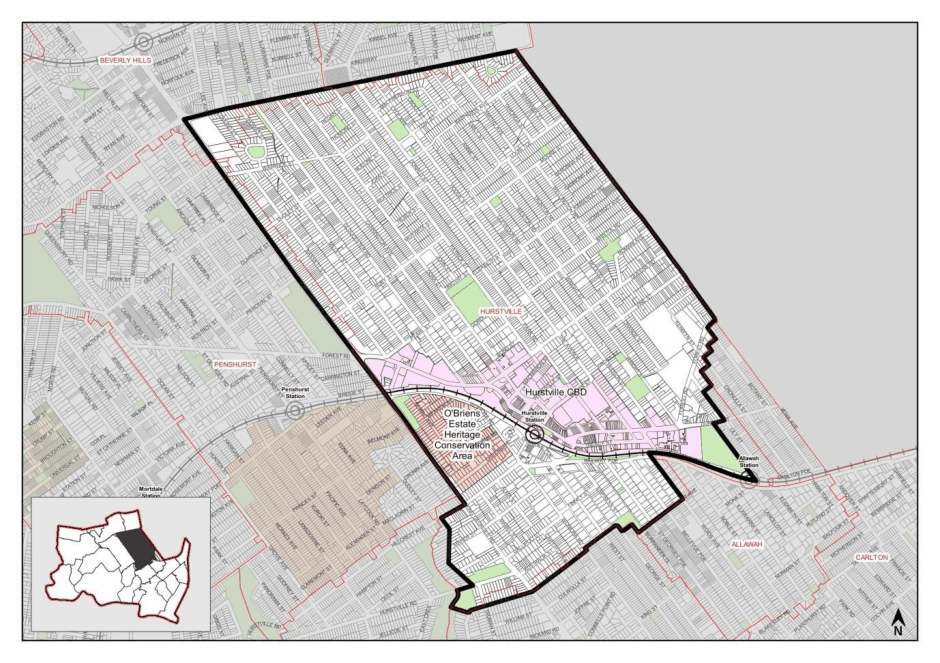

### 5.6 Hurstville (non-CBD) Locality Statement

#### Map of locality

> [Picture on page 21: a picture, saved as a picture (images/part-05-residential-locality-statements-page-21-3.gif, 150 dpi).]

Figure 9: Hurstville

#### Existing Character

Location

The locality is bounded by Stoney Creek Road to the north, Croydon Road and Lily Street to the east, Railway Parade, First Avenue, Cole Street and Salisbury Street to the south, and the King Georges Road to the west.

Background

The Traditional Owners of the area are members of the Aboriginal Bidjigal people of the Eora Nation, part of the Dharug language group.

The earliest land grant was made in 1808 to Captain John Townson for 1,950 acres in the Hurstville area. 8 The land was then sold to Simeon Lord in 1812 and became known as Lord's Bush.9 In 1850 the land was bought by Michael Gannon and renamed Gannon's

8 Joan Lawrence, St George Pictorial Memories: Rockdale, Kogarah, Hurstville (Kingsclear Books Pty Ltd: Hurstville, 1996), pg. 8. 9 Joan Lawrence, St George Pictorial Memories: Rockdale, Kogarah, Hurstville (Kingsclear Books Pty Ltd: Hurstville, 1996), pg. 8.

Forest until the public school was named Hurstville, meaning "a town on a wooded hill".10 In 1884 Hurstville railway station was opened, and this encouraged land subdivisions of the area into a low density residential suburb.

Heritage

There are several heritage items in this locality that relate to the area’s social history and architecture (refer to GRLEP 2021 Schedule 5). The O’Briens Heritage Conservation Area is also located within the locality.

Built Form and Setting

The eclectic mix of housing style is observed throughout the locality. The individual lot sizes are generally consistent, especially on the northern side of the railway line. To the south of Hurstville train station there are some instances of irregular shaped blocks.

The majority of the locality on the northern side of the railway is comprised of low density dwelling houses with the exception of the residential flat buildings located on the periphery of the Hurstville City Centre. This change in density can be witnessed on Gloucester Road, Warwick Street and Millett Street which feature a combination of single-storey federation style housing and contemporary, two storey knock down rebuilds with blocks of units adjoining them. These dwellings have a mix of fencing styles including high metal fences, low brick fences and no fencing at all.

The O’Briens Heritage Conservation Area is situated on the southern side of the railway line with dwelling stock consisting largely of single storey dwelling houses– further information is located within Appendix 3 – Heritage Conservation Areas in this DCP.

The southern side of the railway line is predominately comprised of medium and high density dwellings with varying building setbacks and built forms, including some contemporary apartments with basement parking.

There is a slight ridge that runs through the locality in a north-easterly direction but it is not steep enough to afford views for properties located in this area.

There are several public open spaces distributed throughout the area including Hurstville Oval, Kempt Field, Woodville Park, Thorpe Park, Molletts Reserve, Empress Reserve, St Georges Parade Reserve, Woniora Gardens and Hardiman Reserve.

Streetscape Character The streets are consistently wide and open throughout this locality, many feature landscaped nature strips and lined with mature trees contributing to a leafy character. The tree canopies in some areas are more abundant than others, as especially evident on Donald Street, Alma Street and Gallipoli Street. Front boundary setbacks, fencing style and garage forms are generally consistent throughout the heritage conservation area. Outside of the heritage boundary there is a mix

10 Joan Lawrence, St George Pictorial Memories: Rockdale, Kogarah, Hurstville (Kingsclear Books Pty Ltd: Hurstville, 1996), pg. 8.

of housing and fence styles, garage forms and driveway widths which create a less harmonious streetscape. Despite this, the front building setbacks appear to be consistent in the low density areas of the locality.

#### Future Desired Character

• Retain and enhance the existing low density suburban residential character through articulated contemporary developments that respond to the human scale.

• Conserve the high quality of existing streetscape within the Heritage Conservation Area.

• Encourage well-designed medium and high density residential development towards the Hurstville City Centre.

• Encourage tree planting and landscaping within the front setback space to enhance the existing leafy streetscape character.

• Encourage consistent setbacks of buildings from the street and the provision of landscaping within the front setback with uniform front fence heights.
