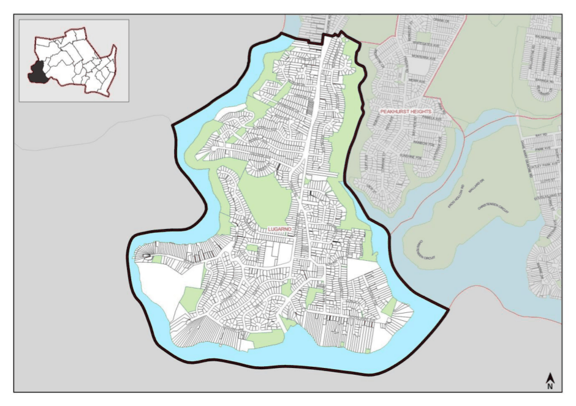

### 5.7 Lugarno Locality Statement

#### Map of locality

> [Picture on page 24: a picture, saved as a picture (images/part-05-residential-locality-statements-page-24-3.gif, 150 dpi).]

Figure 10: Lugarno

#### Existing Character

Location

Lugarno is bordered on three sides by the Georges River. Peakhurst sits to the north, Gannons Park to the east and the Georges River to the south and west.

Background

The Traditional Owners of the area are members of the Aboriginal Bidjigal people of the Eora Nation, part of the Dharug language group.

Lugarno was named in 1843 after Lake Lugano, Switzerland but was also known as Peakhurst until the late 1920s to early 1930s.11

The area was steep, rocky and sandy soils and was not suitable for farming. This led to Lugarno remaining largely undeveloped until the second half of the 20th century with the exception of a few significant houses on Lime Kiln Bay and holiday cottages on the western side accessed by the water. In the 1960s, the government released the remaining land in a

11 The Book of Sydney Suburbs, Compiled by Frances Pollon, Angus & Robertson Publishers, 1990, page 158

major subdivision which saw a second wave of development transform Lugarno into a suburban residential area.

Heritage

There are several heritage items in this locality that relate to the area’s social history and architecture (refer Schedule 5 Heritage Conservation of GRLEP 2021).

Built Form and Setting

Lugarno is a low density residential area with a small local group of shops on Forest Road typical of post-war suburban development. There are several parcels of bushland, particularly along the Georges River shoreline, and several parks and playing fields, most notably Evatt Memorial Park.

The housing stock in Lugarno predominately consists of freestanding dwelling houses built in the post-war period, as well as contemporary knock down rebuilds. This has resulted in an eclectic mix of housing styles.

The topography in Lugarno is formed by steep ridges and gullies interspersed with views over surrounding bushland and the River in places. The irregular subdivision patterns in the area have been strongly influenced by this topography where there is a predominate pattern of curved streets and sweeping cul-de-sacs layouts in response to the undulating foreshore topography. Waterfront street blocks are narrow and deep and many have been subjected to recent battle-axe subdivisions through detached, front-and-back dual occupancy developments.

With the exception of the southern headland, the remaining waterfront areas in this locality are notable for their lack of development and are now public reserves dominated by mangroves and native bushland.

Most of Lugarno is located within the Foreshore Scenic Protection Area (refer to GRLEP 2021 Foreshore Scenic Protection Area Map).

Evatt Park and Gannons Park are the major public recreation areas in the locality. There are also a number other public open space including Tallowwood Avenue Reserve, Mcgowan Reserve, Blackbutt Avenue Reserve, Ponderosa Place Reserve, Cedar Street Reserves, Moons Avenue Reserve, Beer’s Park and Taylors Reserve.

Streetscape Character

The remaining post-war weatherboard and brick cottages in the locality are situated on lots with large size areas and generous landscaped setbacks with low or no front fences. The combination of the low-impact built form and large street trees contributes to an overall character that is relaxed and informal within a bushland setting.

However, recent developments have seen the replacement of post-war dwellings with substantially larger, contemporary dwelling houses with significantly reduced setbacks and

landscaping. The emerging eclectic character of the streetscape as result of knock down rebuilds is a threat to the urban bushland character of the area.

#### Future Desired Character

• Retain and enhance the prominence of the bushland landscaped character in new development through tree planting and landscaping.

• Encourage consistent setbacks of buildings from the street and the provision of landscaping within the front setback.

• Encourage the retention of trees and sharing of water views wherever possible, including screening via vegetation rather than solid walls.

• Public views to waterways should be retained from streets and public places.
