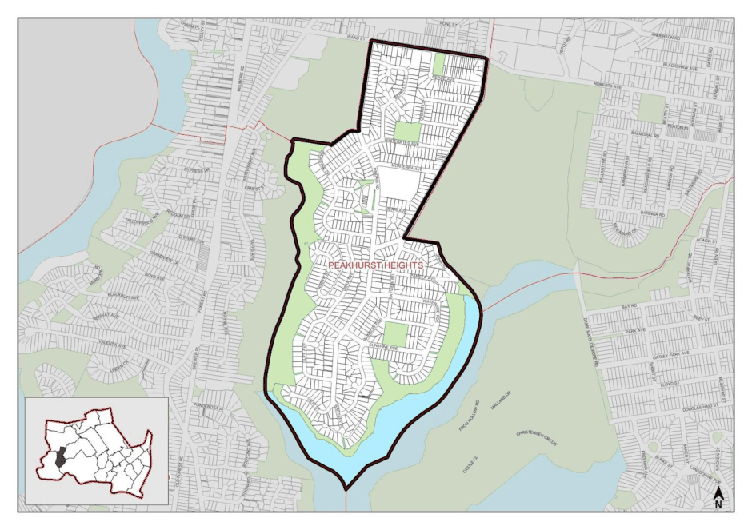

### 5.8 Peakhurst Heights Locality Statement

#### Map of locality

> [Picture on page 27: a picture, saved as a picture (images/part-05-residential-locality-statements-page-27-3.gif, 150 dpi).]

Figure 11: Peakhurst Heights

#### Existing Character

Location

Peakhurst Heights is bordered by Peakhurst to the north (Isaac St and Gannons Park), the Georges River to the south (bordered by Boggywell Creek and Lime Kiln Bay), the suburb of Mortdale to the east and Lugarno to the west.

Background

The Traditional Owners of the area are members of the Aboriginal Bidjigal people of the Eora Nation, part of the Dharug language group.

Peakhurst Heights was recognised as a separate suburb from Peakhurst in 1995.12 This area remained a relatively sparsely-settled area until the mid-1940s when houses dotted the landscape interspersed with large vacant land and market gardens.

Heritage

12 The Book of Sydney Suburbs, Compiled by Frances Pollon, Angus & Robertson Publishers, 1990, page

There are several heritage items in this locality that relate to the area’s social history and architecture (refer Schedule 5 Heritage Conservation of GRLEP 2021).

Built Form and Setting

Peakhurst Heights is a low density residential area comprising of a mix of post-war and contemporary housing styles. The subdivision patterns and lot sizes in this locality are generally uniform when compared to the adjacent suburb of Peakhurst. There is a predominate pattern of curved streets and sweeping cul-de-sacs layouts in response to the undulating foreshore topography.

Peakhurst Heights is formed by gentle slopes that culminate in a slight ridge towards the south, particularly along Waterside Parade and Rainbow Parade. There are some views of bushland treetops in the southern parts of Peakhurst Heights overlooking the Georges River.

Areas along the southern, eastern and western boundaries of Peakhurst Heights are located within the Foreshore Scenic Protection Area (refer to GRLEP 2021 Foreshore Scenic Protection Area Map).

Gannons Park is the major public recreation area in this locality. There are also several public parks including Pickering Park, Lambert Reserve and Pindari Road Reserves.

Streetscape Character

The streetscape exhibits an eclectic character attributed to the variety of housing and fence materials, roof forms, driveway widths and garage styles. Furthermore, verges are generally planted in an irregular pattern with few streets showing evidence of a formalised street tree planting scheme.

The front building line is fairly consistent in this locality; however there is minimal landscaping in the front setback which draws attention to the inconsistent streetscape character.

#### Future Desired Character

• Encourage tree planting and landscaping within the front setback space to create a tree-lined streetscape character.

• Encourage consistent setbacks of buildings from the street and the provision of landscaping within the front setback.

• Encourage the retention of treetop bushland views towards the south of the locality, over the Georges River.
