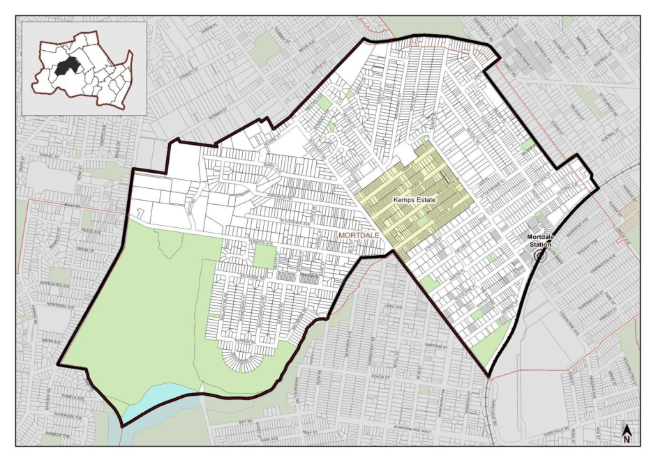
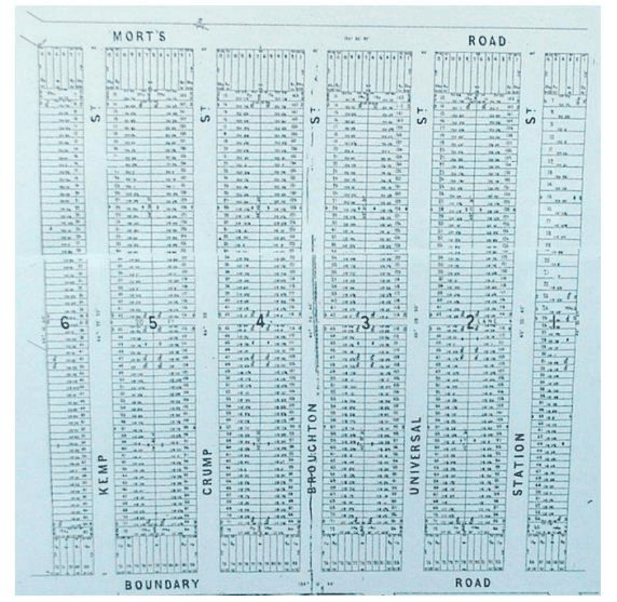

### 5.9 Mortdale Locality Statement

#### Map of locality

> [Picture on page 29: a picture, saved as a picture (images/part-05-residential-locality-statements-page-29-3.gif, 150 dpi).]

Figure 12: Mortdale

#### Existing Character

Location

This locality is bounded by the suburb of Peakhurst and Forest Road to the north; Jersey Avenue, Ocean Lane and the railway line to the east; Boundary Road, Cromdale St and Dairy Creek and Lime Kiln Bay to the south; and Lorraine Street to the west.

Background

The Traditional Owners of the area are members of the Aboriginal Bidjigal people of the Eora Nation, part of the Dharug language group.

The suburb was named after Sydney industrialist Thomas Sutcliffe Mort. The first residences were built in 1885. More land was subdivided for housing by 1894. The official title for the suburb was set as Mortdale when the railway station was opened on 20 March 1897.

Heritage

There are several heritage items in this locality that relate to the area’s social history and architecture (refer to GRLEP 2021 Schedule 5).

Built Form and Setting

This locality is suburban residential area with a mixture of building types and character that includes Mortdale Industrial Area, Mortdale Centre and Hurstville Golf Course.

The residential area is predominantly single dwellings with some contemporary dual occupancy development. There are some scattered post-war villa and townhouse developments and recent terrace style housing in Victoria and Newman Street.

Blocks to the west of Mortdale Centre, between Morts Road and Boundary Road, consist mostly of post-war two and three storey apartment buildings and include some contemporary apartments with basement parking.

The area adjoining the Hurstville Golf Course, south of Roberts Avenue, retains an intact subdivision pattern (known as Mortdale Heights) with large regular lots with deep landscaped verges.

There are several open spaces available in this locality including the Hurstville Golf Course, Mortdale Memorial Park, Beatty Street Reserve, Treloar Avenue Reserve and Ruby Wing Reserve.

Streetscape Character

The streets in the locality are generally tree-lined and present a landscaped character. A sense of openness is achieved through a consisting front setback with a landscaped setting and low fencing, which is also partially attributed to the subdivision pattern that allowed for the creation of larger lots with wide lot widths.

#### Future Desired Character

• Retain and enhance the existing low density suburban residential character through articulated contemporary developments that respond to the human scale.

• Encourage tree planting and landscaping within the front setback space to enhance the existing leafy streetscape character.

• Encourage consistent setbacks of buildings from the street and the provision of landscaping within the front setback.

#### Kemp’s Estate

Location

Kemp’s Estate is located within the Mortdale locality and is bounded by Boundary Road to the west, back of lots facing Kemp Street to the north, Morts Road to the east, and back of lots facing Universal Street to the south.

Background

The Kemp’s Estate Station, Universal, Broughton, Crump and Kemp’s Street, Mortdale (including parts of Morts and Boundary Roads) Background – from Hatton, D.J., “Mortdale in the Early Years”, Hurstville Historical Society Monograph, No 8, 1981.

There were two main farms in the district between Mortdale and Penshurst. The Kemp’s Farm, which had an orange orchard, encompassed the site of the present Mortdale township. The Parkes’ Farm was further towards Penshurst near Victoria Avenue.

The development of Mortdale township followed the establishment of the Hurstville Steam Brick Company in 1844. The brickworks were built on Kemp’s land on the eastern (Kogarah Council) side of the railway line.

The railway, constructed in 1884, cut across the farms. There was no provision for the train to stop between Penshurst and Oatley. The brickworks siding opened in 1886 and Mortdale Station was not opened until 1897. The brickworks brought families to live in the area, and they originally settled on the eastern (Kogarah) side of the railway line.

The present business side of Mortdale, on the western side of the railway, was known as Newman’s Paddock in the 1880s. Mr Newman was the only resident on that side of the railway line. His estate was subdivided and sold in 1893-94 as the Morts Township Estate, and in 1895 as Kemp’s Estate.

Mort’s Township Estate was bound by Morts Road, the railway line, Boundary Road and Station Street. It also included Oxford Street, Martin Place, Macquarie Street, Pitt Street, George Street and the Strand.

Kemp’s Estate, to the west of Mort’s Township Estate, was sold by the Universal Land and Deposit Bank Ltd., whose directors were Messrs. Crump and Broughton. Hence, the naming of Universal, Broughton, Crump and Kemp’s Streets.

The Kemp’s Estate Subdivision

A copy of the original subdivision is attached. The residential lots were available under Torrens Title. The majority of the sites had a 20 feet frontage with a depth of 120 feet. Each block was cut in half by a laneway, now called The Strand.

Typical of the subdivisions of the time, the layout of the Kemp’s Estate bore no relationship to the terrain or to existing dwellings or structures, or for the provision of services.

Remaining pre subdivision structures and possibly the first houses constructed on the subdivision include: 41 Crump Street, 13 Broughton Street, and the brick building on The Strand between Station and Universal Street. 35 Kemp’s Street is typical of a number of weatherboard cottages of this early period which remain in good condition.

Some substantial brick houses were constructed in the 1910-20s; a good example is 30 Kemp’s Street.

The rate notices of 1926 indicate that although the subdivision had been sold, very few houses had been constructed. Landowners had bought two, three, or four adjoining lots and consolidated them for building sites. Many of the consolidated lots were listed as “vacant”. Some owners were possibly purely investors, listed as living, for example, in Maitland and Gunnedah. The rate notices indicate that the consolidation of the lots were not accompanied by newly deposited plans, thereby retaining the original subdivision layout.

The 20’ lots that were isolated under single ownership were listed as “vacant”. The rate building on a 20’ lot was listed as “humpy”. An aerial photograph of 1932 shows Kemp’s Estate to be partially developed. It is believed that the Estate was not fully developed until after World War II. The small dwellings that are now located on the 20’ lots are possibly of post World War II construction. Fibro, although available from 1913 onwards, was not used as a major building material until the building boom following the building shortage of the late 1940’s. The consolidated lots were then developed as individual lots and sold, possibly to veterans. Rate notices of 1926 show that 12A – 18 Crump Street were two larger lots that were broken up to regain the original narrow 20’ lots that are now in existence.

Kemp’s Estate Today

An examination of Council’s orthographic maps No’s 33, 34, 43, 44 and 54 show that the original lots of the Kemp’s Estate subdivision are largely intact, except for Station Street, which has been re-developed as residential flats under Strata Title. Site investigation reveals that the small lots are popular with small families. Kemp’s Estate has many retired occupants and young couples that do not require large sites or large dwellings.

Kemp’s Estate can be considered significant as it:

• Illustrates the history of residential settlement in the area;

• Has rare 6 metre residential lots under torrens title;

• Has good examples of pre WWII dwellings;

• Has good examples of post WWII dwellings, and;

• Encapsulates the character of Mortdale.

There are currently 21 dwellings that are built on single narrow lots. Some of these are in original condition. There are a number of additional dwellings that were built for individual narrow lots that were later re-consolidated into double lots. These dwellings, although altered, retain the character of the Estate and the streetscape. All these buildings are worthy of further examination to determine that significance, and to use as a basis for planning controls. A photograph based on the original Deposited Plan from 1895 is attached highlighting the subdivision pattern.

A photograph based on the original Deposited Plan from 1895 highlights the subdivision pattern (refer Figure 13).

> [Picture on page 33: a picture, saved as a picture (images/part-05-residential-locality-statements-page-33-3.gif, 150 dpi).]

Figure 13: Photograph of the original Deposited Plan from 1895.

Built Form and Setting

The eclectic mix of housing style is observed throughout the locality attributed to the variety of housing and fence materials, roof forms, driveway widths and garage styles. The narrow lot width of the subdivision pattern has enabled contemporary development in the form of attached dual occupancies and terraces. This is interspersed between single and two storey dwelling houses that are built over multiple lots.

Streetscape Character

Due to the narrow subdivision lot widths, most of the spaces in front of the building line are dominated by driveways and hardstand areas. There is minimal provision of landscaping within the front setback, despite the uniformity of the building setback and fence height. The street verges are also narrow and street trees are provided infrequently.

#### Future Desired Character

• Encourage tree planting and landscaping within the front setback space to create a tree-lined streetscape character.

• Encourage landscaping in front gardens of dwellings to improve streetscape character and reduce excessive paving and hardstand areas.

• Encourage a mix of building designs to reflect the diversity of form and mass.
