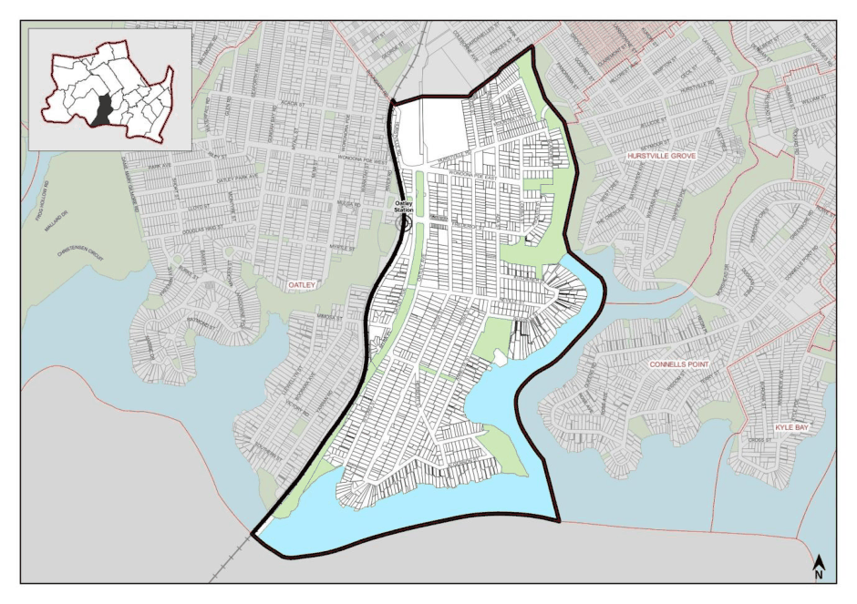

### 5.10 Oatley

#### 5.10.1 Oatley East Locality Statement

#### Map of locality

> [Picture on page 35: a picture, saved as a picture (images/part-05-residential-locality-statements-page-35-4.gif, 150 dpi).]

Figure 14: Oatley East

#### Existing Character

Location

This locality is bounded by the railway line to the west, the suburbs of Mortdale and Penshurst to the north, Hurstville Grove and Oatley Bay to the east and Neverfail Bay to the south. The railway line that runs through the suburb of Oatley exists as the boundary between the two localities of Oatley East and Oatley West.

Background

The Traditional Owners of the area are members of the Aboriginal Kameygal people of the Eora Nation, part of the Dharug language group.13

The suburb of Oatley was named after James Oatley, a convict clockmaker who designed the clock in Hyde Park Barracks and was later pardoned in 1821. The suburb was originally named the land ‘Needwood Forest’ after woodlands in his native home in England. A subdivision plan for 1,400 residential blocks was issued in 1884 but Oatley remained

13 Grellis, Alison, Oatley, Dictionary of Sydney, 2008, http://dictionaryofsydney.org/entry/oatley, viewed 13 Jul 2020

isolated and was, for a long time, considered too remote to encourage many land sales despite the opening of the railway line in 1886. Various stages of development occurred in Oatley in the 1900s, 1910s and 1920s.14

Heritage

There are several heritage items in this locality that relate to the area’s social history and architecture (refer to GRLEP 2021 Schedule 5 Heritage Conservation).

Built Form and Setting

The locality features three distinct areas of low, medium and high density residential with the residential flat buildings located towards the Oatley commercial centre and railway station, the medium density area acting as the transitional buffer to the low density area at the eastern portion of the locality.

Oatley East consists of a wide mix of building styles, with no particular style predominant. Recent contemporary dwelling styles, predominantly two-storey cement rendered with flat roofs, are increasingly common throughout the area. A number of inter-war and post-war dwellings remain, as well as a small number of Federation-era dwellings.

The subdivision pattern of Oatley East shows two major development phases. Development in the first half of the 20th century generally spanned from Hurstville Road to Charles Street and Herbert Street. There was a small collection of inter-war houses built north of Hurstville Road on Judd Street and Renown Avenue. There was also sporadic development further south along the foreshore and Wyong Street.

The second phase of development occurred in the later half of the 20th century with a wide mix of housing styles occupying the vacant land. The north-western cluster of medium-density development largely replaced the earlier buildings between Oatley Avenue and Rosa Street.

There are numerous pockets of remnant bushland along the foreshore interspersed with residential development, and wide vistas to the Georges River from several southern areas, although views are obscured in parts by development.

All of the waterfront street blocks in this locality are located within the Foreshore Scenic Protection Area (refer to GRLEP 2021 Foreshore Scenic Protection Area Map).

There are a number of small pockets of public recreation space including Oatley Memorial Park, Oatley Point, Oatley Pleasure Grounds and part of Moore and Renown Reserves.

Streetscape Character

The streetscape exhibits an eclectic character attributed to the variety of housing and fence materials, roof forms, driveway widths and garage styles.  There is a general lack of consistency in housing and fence materials, and numerous properties that do not have front

14 Grellis, Alison, Oatley, Dictionary of Sydney, 2008, http://dictionaryofsydney.org/entry/oatley, viewed 13 Jul 2020

fencing at all. There is also a lack of consistency in setbacks from the street, roof forms, driveway widths and garage styles throughout the area.

Most dwellings have trees and/or landscaping in the front and back yards. The street widths, and many verges, are very wide. Many of the streets have retained mature trees which have added to the leafy feel of the locality, however a distinction can be made between the trees planted in formal street patterns, for example the northern end of Letitia Street, Oatley Avenue and Frederick Street, and the bushland feel in the southern and western parts of the locality, for example Asquith Street, Herbert Street and the southern end of Letitia Street.

#### Future Desired Character

• Retain and enhance the prominence of the bushland landscaped character in new development through tree planting and landscaping.

• Encourage consistent setbacks of buildings from the street and the provision of landscaping within the front setback, alongside low fencing to enhance visual permeability.

• Encourage the retention of trees and sharing of water views wherever possible, including screening via vegetation rather than solid walls.

• Public views to waterways should be retained from streets and public places.
