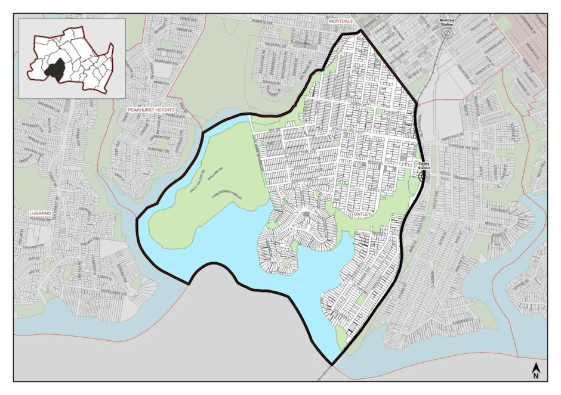

#### 5.10.2 Oatley West Locality Statement

#### Map of locality

> [Picture on page 38: a picture, saved as a picture (images/part-05-residential-locality-statements-page-38-3.gif, 150 dpi).]

Figure 15: Oatley West

#### Existing Character

Location

This locality is bounded by the suburb of Mortdale to the north, the railway line to the east, the Georges River to the south and the suburb of Peakhurst Heights to the west. The railway line that runs through the suburb of Oatley exists as the boundary between the two localities of Oatley East and Oatley West.

Background

The Traditional Owners of the area are members of the Aboriginal Kameygal people of the Eora Nation, part of the Dharug language group.15

The suburb of Oatley was named after James Oatley, a convict clockmaker who designed the clock in Hyde Park Barracks and was later pardoned in 1821. The suburb was originally named the land ‘Needwood Forest’ after woodlands in his native home in England. A subdivision plan for 1,400 residential blocks was issued in 1884 but Oatley remained isolated and was, for a long time, considered too remote to encourage many land sales

15 Grellis, Alison, Oatley, Dictionary of Sydney, 2008, http://dictionaryofsydney.org/entry/oatley, viewed 13 Jul 2020

despite the opening of the railway line in 1886. Various stages of development occurred in Oatley in the 1900s, 1910s and 1920s. 16

Heritage

There are several heritage items in this locality that relate to the area’s social history and architecture (refer to GRLEP 2021 Schedule 5 Heritage Conservation).

Built Form and Setting

The locality is a predominantly low-density residential locality and includes a small local set of shops on Mulga Road.

The housing stock in Oatley West predominately consists of freestanding dwelling houses built in the post-war period. Recent contemporary dwelling styles, including dual occupancies are predominantly two-storey cement rendered with flat roofs, are increasingly common throughout the area.

The subdivision pattern shows two major development phases, which is distinctly evident in the lot sizes and subdivision patterns.  Development in the first half of the 20th century was focused largely in the eastern portion of the locality between Boundary Road and Myrtle Street with some additional housing on Yarran Road. The subdivision pattern throughout the area shows regular medium-sized lots laid out in a grid-like pattern with generous allotment sizes. There are also a number of curved street patterns to the south of Douglas Haig Street in response to the undulating foreshore topography.

The rest of the locality, namely the western portion, remained mostly undeveloped until the later half of the 20th century, particularly in the 1960s and 1970s, when development spread further south to the foreshore and north-west towards Mortdale. Street blocks are arranged in grid-like patterns with smaller allotment sizes compared to the earlier developments.

There are numerous pockets of remnant bushland along the foreshore interspersed with residential development, and wide vistas to the Georges River from several southern areas (although views are obscured in parts by development). Waterfront street blocks are narrow and deep and many have been subjected to recent battle-axe subdivisions through detached, front-and-back dual occupancy developments.

Most of the land in this locality is located within the Foreshore Scenic Protection Area (refer to GRLEP 2021 Foreshore Scenic Protection Area Map).

Within this locality are several public green spaces including Oatley Park, Myles Dunphy Reserve, Yarran Road Reserve and Simpson Reserve.

Streetscape Character

The remaining post-war weatherboard and brick cottages in the locality are situated on lots with large size areas and generous landscaped setbacks with low or no front fences. The combination of the low-impact built form and large street trees contributes to an overall character that is relaxed and informal within a bushland setting. Woronora Parade and

16 Grellis, Alison, Oatley, Dictionary of Sydney, 2008, http://dictionaryofsydney.org/entry/oatley, viewed 13 Jul 2020

Waratah Street have generally retained the historic street tree plantings which add to a leafy feel.

Although contemporary development has occurred, the consistent setback of dwellings behind the verge trees aides in the overall reading of consistency in these streets, for example Woronora Parade is notably wide and has wider verges with considerable street tree plantings.

Most dwellings have trees and/or landscaping in the front setback and often read as a continuation of the public street verge as many properties have very low or no front fencing. This is especially evident in the streets leading to Oatley Park including Oatley Park Avenue and Lloyd Street.

The street widths, and many verges, are very wide. Many of the streets have retained mature trees which have added to the desirable leafy feel of the locality and contribute to the urban bushland character of the area. However, the emerging eclectic character of the streetscape as result of knock down rebuilds is a threat to this character.

#### Future Desired Character

• Retain and enhance the prominence of the bushland landscaped character in new development through tree planting and landscaping.

• Encourage consistent setbacks of buildings from the street and the provision of landscaping within the front setback.

• Encourage the retention of trees and sharing of water views wherever possible, including screening via vegetation rather than solid walls.

• Public views to waterways should be retained from streets and public places.
