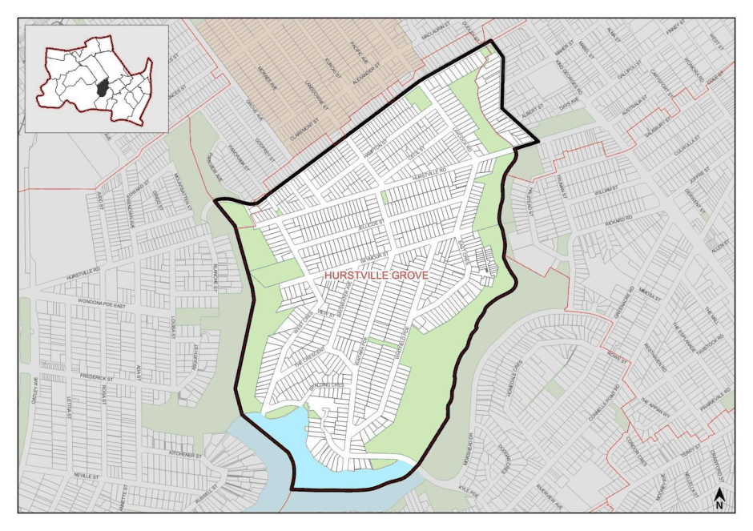

### 5.11 Hurstville Grove Locality Statement

#### Map of locality

> [Picture on page 41: a picture, saved as a picture (images/part-05-residential-locality-statements-page-41-3.gif, 150 dpi).]

Figure 16: Hurstville Grove

#### Existing Character

Location

Hurstville Grove is bounded by the suburb of Penshurst and Hillcrest Avenue to the north, Poulton Creek, as well as a block of land that adjoins King Georges Road to the east, Morshead Drive to the south, and Moore Reserve to the west.

Background

The Traditional Owners of the area are members of the Aboriginal Bidjigal people of the Eora Nation, part of the Dharug language group.

The earliest land grant was made in 1808 to Captain John Townson for 1,950 acres in the Hurstville area.17 The land was then sold to Simeon Lord in 1812 and became known as Lord's Bush. In 1850 the land was bought by Michael Gannon and renamed Gannon's Forest until the public school was named Hurstville, meaning "a town on a wooded hill".18  In

17 Joan Lawrence, St George Pictorial Memories: Rockdale, Kogarah, Hurstville (Kingsclear Books Pty Ltd: Hurstville, 1996), pg. 8. 18 Joan Lawrence, St George Pictorial Memories: Rockdale, Kogarah, Hurstville (Kingsclear Books Pty Ltd: Hurstville, 1996), pg. 8.

1884 Hurstville railway station was opened, and this encouraged land subdivisions. The Hurstville Grove subdivision began in the late 1880s to early 1890s.19

Heritage

There are several heritage items in this locality that relate to the area’s social history and architecture (refer to GRLEP 2021 Schedule 5 Heritage Conservation).

Built Form and Setting

Hurstville Grove is a predominately low density suburban area with a diverse range of dwelling houses including single-storey Federation, inter-war and post-war style cottages and two storey contemporary styles. Some areas possess more contemporary styles than others, which is evident on Laycock Road.

Hurstville Grove is formed by a spur ridge running north-south to Oatley Bay with the southern portion falling steeply to the water. Poulton Park flanks the eastern side of the area while Moore Reserve flanks the western side. As result of the undulating landform, some bushland and water views are afforded to properties located at the top of The Crescent.

The subdivision patterns in this locality are relatively consistent with uniform lot sizes. However, there are some irregularly sized blocks along The Crescent and Spalding Crescent in response to the foreshore topography.

The waterfront areas of this locality are located within the Foreshore Scenic Protection Area (refer to GRLEP 2021 Foreshore Scenic Protection Area Map).

There are several public recreation areas in this locality, including Moore Reserve, Morshead Drive Reserve, Whitfield Parade Reserve, Poulton Park, Quarry Reserve, Denman Street Reserve, Grove Park, Panorama Street Reserve and Waitara Parade Reserve.

Streetscape Character

There is consistency throughout the locality achieved by the provision of landscaping within the front building setbacks with low or no fences which contributes to an overall character that is relaxed and informal within a bushland setting. This is particularly evident in Hampton Street. Furthermore, the streets are generally tree-lined and present as a ‘green corridor’.

However, recent developments have seen the replacement of single storey dwellings with generous landscaped building setbacks with substantially larger, contemporary dwelling houses with significantly reduced setbacks and landscaping. The emerging eclectic character of the streetscape as result of knock down rebuilds is a threat to the urban bushland character of the area.

19 ‘Advertising - Hurstville Grove’, The Sydney Morning Herald, 28 November 1885, pg. 21, viewed 21 April 2020, https://trove.nla.gov.au/newspaper/article/13605001?searchTerm=%22Hurstville%20Grove%22&searchLimits =sortby=dateAsc

#### Future Desired Character

• Retain and enhance the prominence of the bushland landscaped character in new development through tree planting and landscaping.

• Encourage tree planting and landscaping within the front setback space to enhance the existing leafy streetscape character.

• Encourage the retention of trees and sharing of water views wherever possible, including screening via vegetation rather than solid walls.

• Public views to waterways should be retained from streets and public places.
