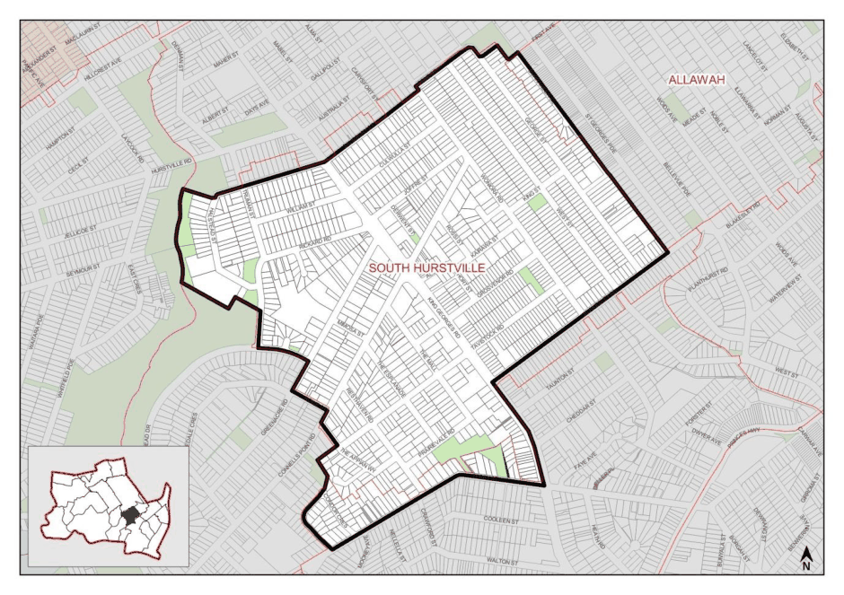

### 5.12 South Hurstville Locality Statement

#### Map of locality

> [Picture on page 44: a picture, saved as a picture (images/part-05-residential-locality-statements-page-44-3.gif, 150 dpi).]

Figure 17: South Hurstville

#### Existing Character

Location

South Hurstville is bounded by the suburbs of Hurstville and Allawah, as well as Salisbury Street to the north, Hardiman Place to the east, Blakesley Road and Terry Street to the south and Rickard Road, Halstead Street and Quarry Reserve to the west. King Georges Road runs through the middle of this locality and splits the South Hurstville commercial centre.

Background

The Traditional Owners of the area are members of the Aboriginal Bidjigal people of the Eora Nation, part of the Dharug language group.

The earliest land grant was made to Captain John Townson for 1,950 acres in the Hurstville area in 1808. The land was then sold to Simeon Lord in 1812 and became known as Lord's Bush.20 In 1850 the land was bought by Michael Gannon and renamed Gannon's Forest until

20 Joan Lawrence, St George Pictorial Memories: Rockdale, Kogarah, Hurstville (Kingsclear Books Pty Ltd: Hurstville, 1996), pg. 8.

the public school was named Hurstville, meaning "a town on a wooded hill".21 In 1884 Hurstville railway station was opened, and this encouraged land subdivisions.

Heritage

There are several heritage items in this locality that relate to the area’s social history and architecture (refer to GRLEP 2021 Schedule 5).

Built Form and Setting

South Hurstville is suburban residential area with a mixture of dwelling types, from single dwelling houses on standard lots, transitioning to villas and town houses and apartments surrounding the commercial centre of South Hurstville.

There is not one defined character for the area, with architectural styles that range from single-storey federation style homes to post-war apartment blocks to large contemporary designs.

There are several public green spaces distributed throughout the area including Quarry Reserve, Pogson Park, Young Place Reserve, Derwent Street Reserve, Maanshan Friendship Park, Grosvenor Street Reserve and Terry Street Reserve.

Streetscape Character

The streets are consistently wide and open throughout this locality with landscaped verges. Throughout the locality there are medium sized to mature street trees which provide a green and leafy character to the area, but the streets retain a wide and spacious atmosphere. Despite a lack of cohesion regarding fencing, there are consistent front building setbacks on lots throughout the locality even on uneven/diagonal streets such as Connells Point Road.

#### Future Desired Character

• Retain and enhance the existing low density suburban residential character through articulated contemporary developments that respond to the human scale.

• Encourage well-designed medium and high-density residential development towards the South Hurstville commercial centre.

• Encourage tree planting and landscaping within the front setback space to enhance the existing leafy streetscape character.

21 Joan Lawrence, St George Pictorial Memories: Rockdale, Kogarah, Hurstville (Kingsclear Books Pty Ltd: Hurstville, 1996), pg. 8.
