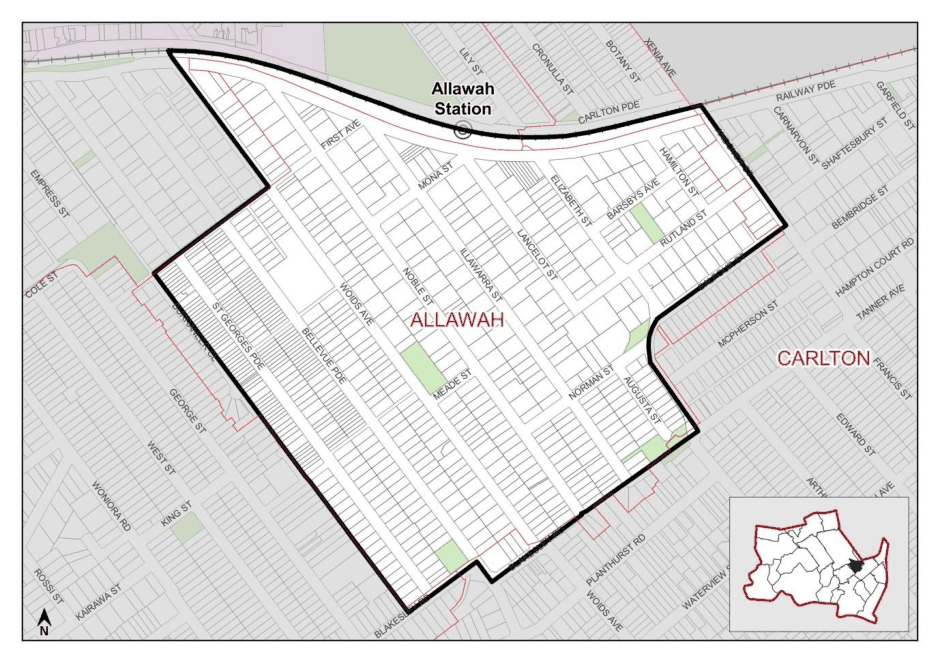

### 5.13 Allawah Locality Statement

#### Map of locality

> [Picture on page 46: a picture, saved as a picture (images/part-05-residential-locality-statements-page-46-3.gif, 150 dpi).]

Figure 18: Allawah

#### Existing Character

Location

Allawah is bounded by the railway line/Railway Parade to the north, the suburb of Carlton to the east, Blakesley Road to the south and the suburbs of Hurstville and South Hurstville to the west.

Background

The name Allawah comes from the local Aboriginal term for 'make your abode here' or 'remain here'. It is thought that the Aboriginal clan most prominent in the St George area, the Gameygal or Kameygal – the people of Kamay (Botany Bay), lived in and around the area now known as Allawah.22 The suburb was named after Allawah railway station which opened on 23 October 1925.23 The opening of the railway station sparked a housing boom in the

area. Estate agents gave subdivisions enticing names and people flocked to the suburb

22 Alison Grellis, ‘Allawah’, The Dictionary of Sydney, 2008, viewed 28 April 2020, https://dictionaryofsydney.org/entry/allawah 23 Alison Grellis, ‘Allawah’, The Dictionary of Sydney, 2008, viewed 28 April 2020, https://dictionaryofsydney.org/entry/allawah

during this period. Modest California bungalows and single-storey Federation-style houses were built throughout the area.24

Heritage

There are some heritage items in this locality that relate to the area’s social history and architecture (refer to GRLEP 2021 Schedule 5).

Built Form and Setting

The majority of this locality is comprised of three to four storey walk up units that were developed towards the end of the 20th Century, enabled by the rezonings that occurred from 1976.25

There is also small area of narrow-lot housing towards the eastern side of this locality bounded by Bellevue Parade, First Avenue, Burraneer Close/Hardiman Place and Russell Lane. Some of the original lots have been consolidated to enable the construction of larger dwellings but most of the narrow-lot housing subdivision pattern was retained though many single dwellings have been constructed over two lots. Most of these dwellings are single storey dwellings constructed in the post-war era. However, recent development activities have seen an increase in two storey semi-detached dwellings replacing these freestanding houses.

Streetscape Character

In the high density residential areas, the streets are lined with large trees creating a green and leafy streetscape. There are consistent setbacks throughout the locality though most of the front setback is dedicated to driveways and at grade garages for the walk up units.

The narrow-lot housing area has landscaped verges but the street trees are provided infrequently. Due to the narrow subdivision lot widths, most of the spaces in front of the building line are dominated by driveways and hardstand areas. There is minimal provision of landscaping within the front setback, despite the uniformity of the building setback and fence height, which is especially evident in recent developments.

#### Future Desired Character

• Encourage tree planting and landscaping within the front setback space to create a tree-lined streetscape character.

• Encourage landscaping in front gardens of dwelling to improve streetscape character and reduce excessive paving and hardstand areas.

• Encourage a mix of building designs to reflect the diversity of form and mass.

24 Alison Grellis, ‘Allawah’, The Dictionary of Sydney, 2008, viewed 28 April 2020, https://dictionaryofsydney.org/entry/allawah 25 Alison Grellis, ‘Allawah’, The Dictionary of Sydney, 2008, viewed 28 April 2020, https://dictionaryofsydney.org/entry/allawah
