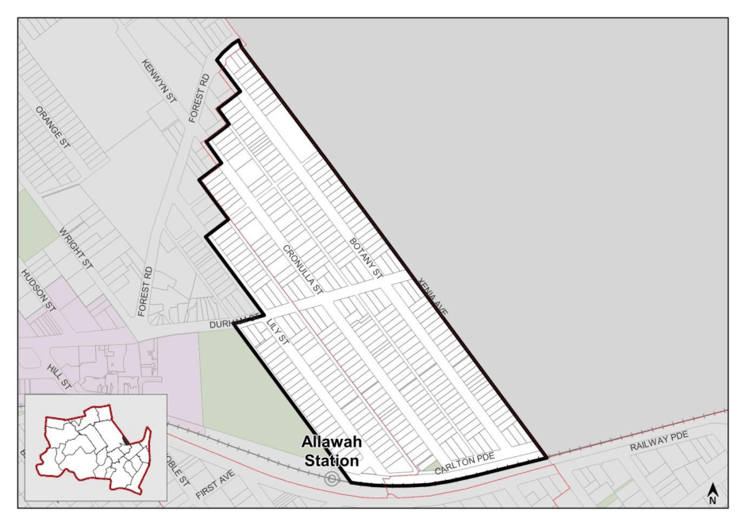

### 5.14 Carlton

#### 5.14.1 Carlton North Locality Statement

#### Map of locality

> [Picture on page 48: a picture, saved as a picture (images/part-05-residential-locality-statements-page-48-4.gif, 150 dpi).]

Figure 19: Carlton North

#### Existing Character

Location

This locality is bounded by the railway line to the south, Xenia Avenue to the east which also acts as the boundary to the Bayside LGA, the unnamed laneway at the rear of the Hurstville East (Forest Road) commercial centre to north, and Lily Street and Roberts Lane to the

west. The railway line that runs through the suburb of Carlton exists as the boundary between the two localities of Carlton North and Carlton South.

Background

The Traditional Owners of the area are members of the Aboriginal Bidjigal people of the Eora Nation, part of the Dharug language group.

The suburb of Carlton was named after a suburb of Nottingham in England. The name, which means village of free men, was given as part of a large land grant made in 1808 to Captain John Townson. Growth in the area was spurred by the opening of the lllawarra line

in 1884, although Carlton did not have its own platform until 1887. By the 1920s the area was comfortably settled.26

Heritage

There are several heritage items in this locality that relate to the area’s social history and architecture (refer to GRLEP 2021 Schedule 5).

Built Form and Setting

This locality is predominately comprised of low density dwellings with a few medium density developments, namely on Cronulla Street. The housing styles are mixed, with no particular style predominating. There are numerous properties dating to the post-war era with a varying degree of alterations and large contemporary houses becoming increasingly common throughout the area.

The street blocks are rectilinear and are all serviced by a rear lane. The individual allotments are consistent in shape and width throughout the locality. The subdivision of this area, known as the Hurstville Hill Estate, occurred towards the end of the 19th Century. There is a small number of remnant Federation style housing left in this locality.

The Cronulla Street Reserve is the only park located within this locality. However, Kempt Field immediately adjoins the locality at the western boundary.

Streetscape Character

The streets are relatively wide and have landscaped verges. However, street trees are provided infrequently which contributes to a sense of openness in the streetscape. Nonetheless, a harmonious streetscape is created by the continuation of landscaping into the front setback space and the consistent usage of low fencing at the front boundary. This is further enhanced by the absence of driveways in the front setback space of most dwellings as enabled by the provision of service laneways at the rear.

#### Future Desired Character

• Retain and enhance the existing low density suburban residential character through articulated contemporary developments that respond to the human scale.

• Encourage tree planting and landscaping within the front setback space to enhance the existing leafy streetscape character.

• Encourage consistent setbacks of buildings from the street and the provision of landscaping within the front setback with uniform front fence heights.

26 26 The Book of Sydney Suburbs, Compiled by Frances Pollon, Angus & Robertson Publishers, 1990, Published in Australia ISBN 0-207-14495-8, page 52
