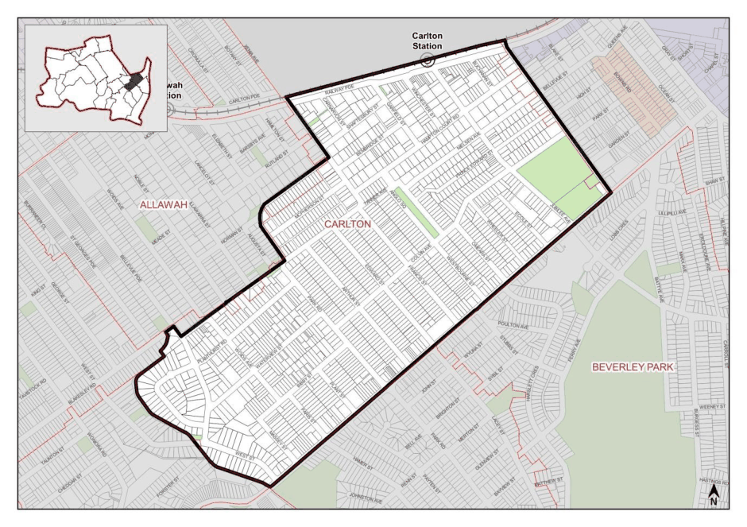

#### 5.14.2 Carlton South Locality Statement

#### Map of locality

> [Picture on page 50: a picture, saved as a picture (images/part-05-residential-locality-statements-page-50-3.gif, 150 dpi).]

Figure 20: Carlton South

#### Existing Character

Location

This locality is bounded by the railway line/Railway Parade to the north, English Street to the east, Princes Highway to the south and the suburbs of Allawah and Blakehurst to the west. The railway line that runs through the suburb of Carlton exists as the boundary between the two localities of Carlton North and Carlton South.

Background

The Traditional Owners of the area are members of the Aboriginal Bidjigal people of the Eora Nation, part of the Dharug language group.

The suburb of Carlton was named after a suburb of Nottingham in England. The name, which means village of free men, was given as part of a large land grant made in 1808 to Captain John Townson. Growth in the area was spurred by the opening of the lllawarra line in 1884, although Carlton did not have its own platform until 1887. By the 1920s the area was comfortably settled.27

Heritage

27 The Book of Sydney Suburbs, Compiled by Frances Pollon, Angus & Robertson Publishers, 1990, Published in Australia ISBN 0-207-14495-8, page 52

There are several heritage items in this locality that relate to the area’s social history and architecture (refer to GRLEP 2021 Schedule 5).

Built Form and Setting

This locality contains a small industrial precinct at the south-western corner of the precinct and a number of commercial centres, including the business zoned lands located along Princes Highway, the Enterprise Corridor on Princes Highway, the row of shops fronting Railway Parade and two small groups of corner shops.

There is a combination of high and low density residential dwellings within this locality. The high density areas are predominately comprised of three to four storey walk up units that were developed towards the end of the 20th Century. These are located between the railway line and Nelson Avenue. There is also a small pocket of high density residential zoned area along Princes Highway between Plant Street and Paris Street.

The remainder of the locality feature predominately detached single storey and two storey dwellings. The housing styles are mixed, with no particular style predominating. However, the areas around Nielsen Avenue and Anglo Square has retained a distinct architectural style of Federation style bungalows.  There are also numerous properties dating to the post-war era with a varying degree of alterations and large contemporary houses becoming increasingly common throughout the area.

The landscape in this locality is relatively flat, the land falls relatively evenly towards the south and, accordingly, there are frequent views towards Botany Bay.

The subdivision patterns of the street blocks are rectilinear which has resulted in individual allotments that are fairly consistent in shape and size. However, there are some irregularities found along Planthurst Road, Waterview Street and Bibby Street.

Anglo Square, Augusta Park, Kogarah Park and West Street Reserve, are the main public green spaces in this area.

Streetscape Character

The streets are relatively wide and have landscaped verges. However, street trees are provided infrequently in most areas which contribute to a sense of openness in the streetscape. Nonetheless, a harmonious streetscape is created by the continuation of landscaping into the front setback space and the consistent usage of low fencing at the front boundary.

Some streets like Anglo Square feature a high level of landscaping and are lined with large trees creating a green and leafy streetscape.

The streetscape exhibits an eclectic character attributed to the variety of housing and fence materials, roof forms, driveway widths and garage styles. However, the front building setbacks appear largely consistent in many streets and most dwelling houses feature landscaping within the front setback and low fences heights.

#### Future Desired Character

• Retain and enhance the existing low density suburban residential character through articulated contemporary developments that respond to the human scale.

• Encourage well-designed high density residential development where applicable.

• Encourage tree planting and landscaping within the front setback space to enhance the existing leafy streetscape character.

• Encourage consistent setbacks of buildings from the street and the provision of landscaping within the front setback with uniform front fence heights.
