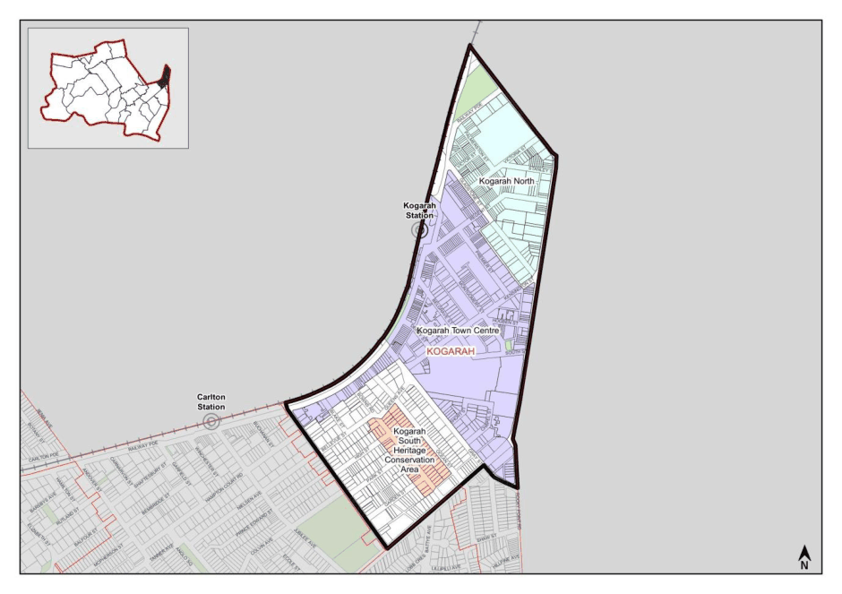

### 5.15 Kogarah South Locality Statement

#### Map of locality

> [Picture on page 53: a picture, saved as a picture (images/part-05-residential-locality-statements-page-53-3.gif, 150 dpi).]

Figure 21: Kogarah South

#### Existing Character

Location

Kogarah South is bounded by Gray Street to the north, Princes Highway to the east, English Street to the south and Railway Parade to the west.

Note: Controls relating to the adjoining Kogarah North precinct is located within Part 10 – Precincts of this DCP. Controls relating to Kogarah Town Centre are located within Part 8 – Kogarah Town Centre of this DCP.

Background

The Traditional Owners of the area are members of the Aboriginal Bidjigal people of the Eora Nation, part of the Dharug language group.

‘Kogarah’ comes from an Aboriginal word meaning ‘rushes’ or ‘place of reeds’. The suburb originally stretched to the bay but has since been divided up to form the separate suburbs of Kogarah Bay and Beverley Park.

The earliest land grant was made to Captain John Townson for 1,950 acres of land in the Hurstville area in 1808. John’s brother, Dr Robert Townson received 1,925 acres which

adjoined his brother’s land.28 This and a neighbouring grant made to James Chandler extended into what is now Kogarah. Subdivision of the area began in 1848, and the railway link was built in the 1884.29

Heritage

There are several heritage items in this locality that relate to the area’s social history and architecture (refer to GRLEP 2021 Schedule 5).  A notable portion of the locality is located within the Kogarah South Heritage Conservation Area.

Built form and land uses

The locality consists of predominately low density residential area with some medium density dwelling scattered throughout the precinct in the forms of terraces and two storey walk up flats. Federation-style bungalows and inter-war cottages are the predominant building type for houses while multi-unit buildings tend to be post-war or of more recent construction.

There are also a number of high density developments located around the outer edges of the locality notably along Gray Street, Ocean Street, and streets adjoining the commercial area along Railway Parade such as English Street and Blake Street.

Dwelling stock within the Heritage Conservation Area consists largely of single storey dwelling houses built in the early half of the 20th century – further information is located within Appendix 3 – Heritage Conservation Areas of this DCP.

The subdivision pattern is quite inconsistent throughout the locality with a mix of wide and narrow blocks, this can be seen particularly along Garden Street. Ocean Street does have blocks with similar shapes and sizes.

Streetscape Character

The streets are relatively wide and have landscaped verges, contributing to a sense of openness in the streetscape. A variety of trees have been planted sporadically throughout the locality, with some streets, like Bellevue Street, being more tree-lined and leafy than others.

Nonetheless, a harmonious streetscape is created by the continuation of landscaping into the front setback space and the consistent usage of low fencing at the front boundary. The quality of landscape in the area is generally high. Examples of this include the regularly spaced street trees in Ocean Street and the planted verges in Bellevue Street.

#### Future Desired Character

• Retain and enhance the existing low density suburban residential character through articulated contemporary developments that respond to the human scale.

28 Joan Lawrence, St George Pictorial Memories: Rockdale, Kogarah, Hurstville (Kingsclear Books Pty Ltd: Hurstville, 1996), pg. 8. 29 Joan Lawrence, St George Pictorial Memories: Rockdale, Kogarah, Hurstville (Kingsclear Books Pty Ltd: Hurstville, 1996), pg. 8.

• Encourage well-designed high density residential development where applicable.

• Preserve the high quality of the existing streetscape, especially within the Heritage Conservation Area.

• Encourage tree planting and landscaping within the front setback space to enhance the existing leafy streetscape character.

• Encourage consistent setbacks of buildings from the street and the provision of landscaping within the front setback with uniform front fence heights.
