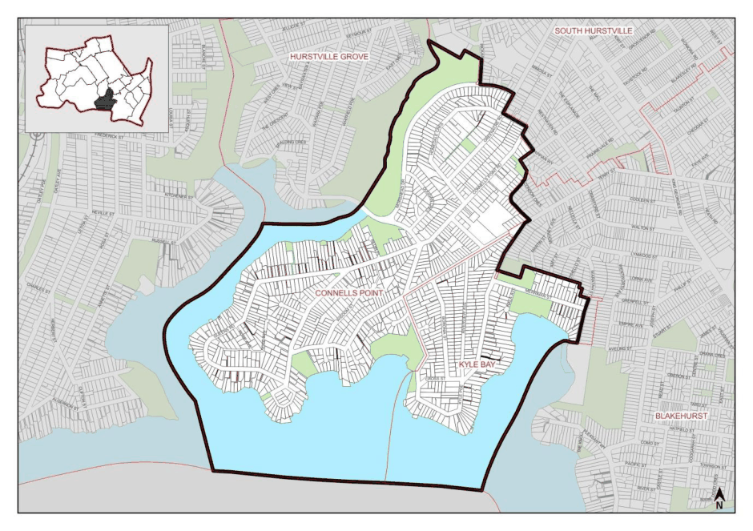

### 5.16 Connells Point and Kyle Bay Locality Statement

#### Map of locality

> [Picture on page 56: a picture, saved as a picture (images/part-05-residential-locality-statements-page-56-3.gif, 150 dpi).]

Figure 22: Connells Point and Kyle Bay

#### Existing Character

Location

This locality is bounded by Morshead Drive and Poulton Park to the north, the suburb of South Hurstville to the east (Rowe Street and Condor Crescent), Terry Street and Merriman Street to the south and Georges River in the west. Curved streets in this locality follow the steep undulating land form towards the water.

Background

The Traditional Owners of the area are members of the Aboriginal Bidjigal people of the Eora Nation, part of the Dharug language group.

Connells Point was named after Charles O'Connell who bought 475 acres in the vicinity in

1857.30 Kyle Bay is named after the Kyle family who were boat builders. The land around Kyle Bay was originally granted by the Crown to Robert Kyle and James Merriman in 1853.31

30 The Book of Sydney Suburbs, Compiled by Frances Pollon, Angus & Robertson Publishers, 1990, Published in Australia ISBN 0-207-14495-8, page 70 31 The Book of Sydney Suburbs, Compiled by Frances Pollon, Angus & Robertson Publishers, 1990, Published in Australia ISBN 0-207-14495-8, page 146

Heritage

There are several heritage items in this locality that relate to the area’s social history and architecture (refer to GRLEP 2021 Schedule 5).

Built Form and Setting

This locality is predominately a low scale suburban residential area with a variety of architectural styles including Federation, Inter-war, Post-war and large two storey contemporary dwellings, particularly those with waterfront access or water views.  There is a group of villas and townhouses towards South Hurstville on Homedale Crescent and Greenacre Road.

In this locality, waterfront lots have been subdivided into multiple lots with access handles to the street. The waterfront areas of this locality are located within the Foreshore Scenic Protection Area (refer to GRLEP 2021 Foreshore Scenic Protection Area Map).

Connells Point Reserve, Lookout Reserve, Merriman Reserve, Morshead Drive Reserve, and Poulton Park are the public green spaces in this locality.

Streetscape Character

The streets in this locality are generally well-proportioned tree lined streets, with a high standard of landscaping creating an open garden character. The built form does not dominate the streetscape, mostly due to generous front and side setbacks.

#### Future Desired Character

• Retain and enhance the prominence of the bushland landscaped character in new development through tree planting and landscaping.

• Encourage tree planting and landscaping within the front setback space to enhance the existing leafy streetscape character.

• Encourage the retention of trees and sharing of water views wherever possible, including screening via vegetation rather than solid walls.

• Public views to waterways should be retained from streets and public places.
