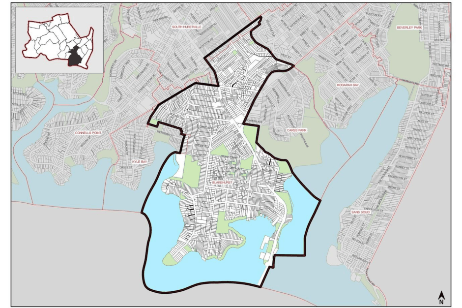

### 5.17 Blakehurst Locality Statement

#### Map of locality

> [Picture on page 58: a picture, saved as a picture (images/part-05-residential-locality-statements-page-58-3.gif, 150 dpi).]

Figure 23: Blakehurst

#### Existing Character

Location

This locality is bounded by West Street and Blakesley Road to the north, the suburbs of Carlton and Carss Park to the east, Georges River to the south and Kyle Bay to the west.

Background

The Traditional Owners of the area are members of the Aboriginal Bidjigal people of the Eora Nation, part of the Dharug language group.

The area of Blakehurst was mostly contained in four vast land grants given to the Townson brothers, John and Robert, between 1808 and 1810.32 Blakehurst takes its name from William Blake, who was appointed postmaster for Kogarah in 1863. Blakehurst's population increased after the railway line was put through to the Illawarra in 1884.33

Heritage

There are several heritage items in this locality that relate to the area’s social history and architecture (refer to GRLEP 2021 Schedule 5).

32 ‘Blakehurst’, Dictionary of Sydney, viewed 29 April 2020, https://dictionaryofsydney.org/entry/blakehurst 33 ‘Blakehurst’, Dictionary of Sydney, viewed 29 April 2020, https://dictionaryofsydney.org/entry/blakehurst

Built Form and Setting

Blakehurst contains predominately low scale residential area which includes the Blakehurst Industrial area, and Blakehurst local centre. This locality includes a diverse range of architectural styles including single-storey Federation bungalows, and two-storey contemporary dwellings. There are some pockets of villas and town houses within this locality, and waterfront apartments along Princes Highway towards Tom Ugly’s point.

Blakehurst is located on a ridge, which extends in a southerly direction into Kogarah Bay. The northern section of Blakehurst is located on hilly land adjacent to Carss Bush Park. The southern section of Blakehurst has a foreshore bushland setting and many of the homes have wide vistas to Kogarah Bay or the Georges River. The southern areas of the locality have steep flanks, which fall to Shipwrights Bay and Kyle Bay. There is a steep descent that runs to the Georges River along Stuart Crescent.

This locality has good access to public green spaces including Bald Face Point Reserve, Centre Street Reserve, Church Street Reserve, Dover Park, East Street Reserve, The Knoll Reserve, Kyle Williams Reserve, Ray Street Reserve, Shipwrights Bay Reserve, Stuart Park, Taro Reserve, Taunton Street Reserve, West Street Reserve and Woniora Road Reserve.

Streetscape Character

The streetscape exhibits an eclectic character attributed to the variety of housing and fence materials, roof forms, driveway widths and garage styles. The tree lined streets are consistently wide with a high standard of landscaping. There are consistent front building setbacks. Due to the different architectural styles throughout the locality, there is lack of consistency in fencing as there are different heights and materials used.

However, the treatments of the front setback spaces are also inconsistent in many streets as the contemporary two storey dwellings have little to no landscaping and are often dominated by hardscaping and driveways.

#### Future Desired Character

• Retain and enhance the existing low density suburban residential character through articulated contemporary developments that respond to the human scale.

• Encourage well-designed high density residential development towards the Blakehurst commercial centre and Tom Ugly’s Point where applicable.

• Encourage the prominence of the bushland landscaped character in new development through tree planting and landscaping.

• Encourage consistent setbacks of buildings from the street and the provision of landscaping within the front setback.

• Encourage the retention of trees and sharing of water views wherever possible, including screening via vegetation rather than solid walls.

• Public views to waterways should be retained from streets and public places.
