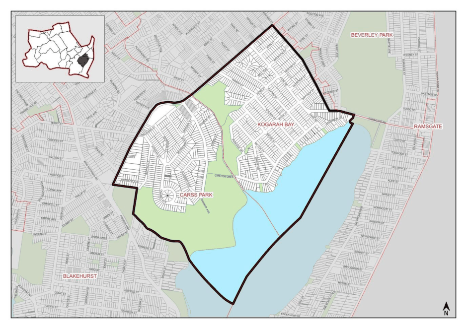

### 5.18 Carss Park and Kogarah Bay Locality Statement

#### Map of locality

> [Picture on page 60: a picture, saved as a picture (images/part-05-residential-locality-statements-page-60-3.gif, 150 dpi).]

Figure 24: Carss Park and Kogarah Bay

#### Existing Character

Location

This locality is bounded by Princes Highway to the north and west, Lacey Street and Ramsgate Road to the east, Kogarah Bay and Todd Park to the south.

Background

The Traditional Owners of the area are members of the Aboriginal Bidjigal people of the Eora Nation, part of the Dharug language group.

Kogarah Bay takes its name from the small bay on the northern shore of the Georges River. The suburb of Kogarah Bay was formed in 1993 when it was formally separated from Kogarah. ‘Kogarah’ comes from an Aboriginal word meaning ‘rushes’ or ‘place of reeds’. Much of the area of Kogarah Bay was once a residential subdivision known as the Carlton Park Estate.

Carss Park was created on land granted to Jonathon Croft in 1853 and subsequently purchased by emigrant cabinetmaker William Carss in 1863.34 Carss had a sandstone

34 ‘William Carss’, Monument Australia, viewed 14 April 2020, http://monumentaustralia.org.au/themes/people/settlement/display/106243-william-carss

cottage built on the headland of Kogarah Bay and later acquired additional land around it. At her father’s request, Carss’ daughter bequeathed the property after her death, to the Sydney Sailors home which was later purchased by Kogarah Council in 1924.35 The Council subdivided the estate into areas for parkland and a residential ‘garden suburb’, being the first local government in NSW to do so.36

Heritage

There are several heritage items in this locality that relate to the area’s social history and architecture (refer to GRLEP 2021 Schedule 5 Heritage Conservation).

Built Form and Setting

Carss Park neighbourhood shops and part of Carlton local shops are within this locality.

The locality has an even cross fall towards Kogarah Bay, with a distinct bluff at the top of Wyee Street and Mayor Street. There are steep falls to Parkside Drive adjoining Harold Fraser Reserve. The area has some public vistas towards the water from highpoints in the locality, predominantly Wyee Street and Carlton Crescent.

The majority of the locality is low scale residential housing, with some recent residential flat building developments fronting the Princes Highway between Lacey Street and Park Road. Within this locality, single detached dwellings range from inter-war and post-war architectural styles to larger contemporary dwellings. Older dwellings have established garden settings and contribute to the leafy garden character. This has resulted in an eclectic mix of housing styles.

Carss Park is located adjacent to extensive parkland with waterfront views. Blocks are consistent in shape and size on straight streets; however, there are some irregular blocks on curved streets, particularly in Gnarbo Avenue, reminiscent of the ‘garden suburb’ subdivision pattern.

Kogarah Bay has more rectilinear subdivision pattern with consistent lot sizes, especially between Renn Street and the waterfront.

There are several public green spaces within the locality including Carss Bush Park, Harold Fraser Reserve, Parkside Drive Reserve, Elizabeth Corry Reserve and Leighton Park.

Streetscape Character

The streets are wide and open generally. With exception to the western end of Payten Street to Bell Avenue, the streets in Kogarah Bay and Carss Park lack a formalised pattern of verge trees. Verge trees appear to be planted irregularly throughout the locality and are a mix of species. The lack of street trees contributes to the feeling of width and openness to the streets and draws more attention to facades, driveways, fences along the streetscape.

35 ‘William Carss’, Monument Australia, viewed 14 April 2020, http://monumentaustralia.org.au/themes/people/settlement/display/106243-william-carss 36 ‘William Carss’, Monument Australia, viewed 14 April 2020, http://monumentaustralia.org.au/themes/people/settlement/display/106243-william-carss

However, the streetscape exhibits an eclectic character attributed to the variety of housing and fence materials, roof forms, driveway widths and garage styles. The treatments of the front setback spaces are also inconsistent in many streets as the contemporary two storey dwellings have little to no landscaping and are often dominated by hardscaping and driveways.

#### Future Desired Character

• Retain and enhance the existing low density suburban residential character through articulated contemporary developments that respond to the human scale.

• Encourage well-designed high density residential development in designated areas along Princes Highway.

• Facilitate urban renewal in appropriate locations, allowing substantial change to the streetscape character while resulting in a high quality public domain.

• Encourage consistent setbacks of buildings from the street and the provision of landscaping within the front setback.

• Encourage the retention of trees and sharing of water views wherever possible, including screening via vegetation rather than solid walls.

• Public views to waterways should be retained from streets and public places.
