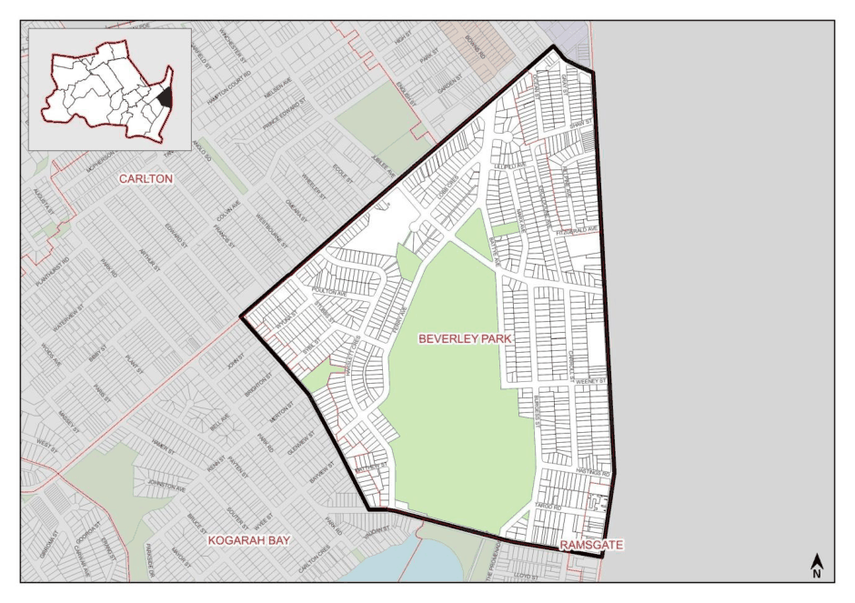

### 5.19 Beverley Park and Ramsgate Locality Statement

#### Map of locality

> [Picture on page 63: a picture, saved as a picture (images/part-05-residential-locality-statements-page-63-3.gif, 150 dpi).]

Figure 25: Beverley Park and Ramsgate

#### Existing Character

Location

This locality is bounded by the suburbs of Carlton and Kogarah along Princes Highway to the north and Rocky Point Road to the east, Ramsgate Road, Hillview Street and Dalkieth Street to the south, and properties located in between Lacey Street and Harslett Crescent in the west. The suburbs of Kogarah and Ramsgate are divided between Bayside and Georges River Councils.

Background

The Traditional land owners of this area are the members of the Aboriginal Bidjigal people of the Eora Nation, part of the Dharug language group.

The southern tip of Beverley Park runs into Kogarah Bay. Due to the low-lying topography of Beverley Park, the area is prone to flooding and remained undeveloped and was used mainly for market gardening.37 Much of the area now making up Beverley Park was crown land or originally granted to Matthew Carroll, one of the first settlers to take up land in the

37 Alison Grellis, ‘Beverley Park’, The Dictionary of Sydney, 2008, viewed 24 April 2020, https://dictionaryofsydney.org/entry/beverley_park

Kogarah area.38 The suburb was created as part of a land reclamation scheme introduced during the Depression to gain suitable land for development and to make use of available labour. Funding for the project began in 1937, and the reclamation, drainage and subdivision were completed by the start of the Second World War.

Heritage

There are several heritage items in this locality that relate to the area’s social history and architecture (refer to GRLEP 2021 Schedule 5).

Built Form and Setting

Part of the Ramsgate commercial centre and is located within this locality, which is adjoined by a small area of contemporary residential flat buildings. There are also two smaller commercial centres with one located at the intersection of Princes Highway and Rocky Point Road and the other along Rocky Point Road.

The locality is generally low density residential with some high density developments between Jubilee Avenue and Weeney Street along Rocky Point Road.

The built form is predominantly detached single dwelling houses with landscaped settings and a strong presence of interwar Californian bungalows. There is varying degree of alterations with a gradual increase in large contemporary houses, particularly those benefitting from vista to the Beverley Park Golf Course.

The subdivision pattern features a combination of rectilinear street blocks, curvilinear streets and short cul-de-sacs which is reflective of the 1930s subdivision pattern.

In this locality there are several reserves and parks, including the Beverley Park Golf Course, Leighton Park, Stevens Park and Spooner Park.

Streetscape Character

The streets of Beverley Park are consistent throughout the locality having deep verges / nature strips with a high level of landscaping. However, most of the streets are not lined with mature street trees. The lack of street trees contributes to the feeling of width and openness to the streets and draws more attention to facades, driveways, fences along the streetscape.

The front fences are generally low and the front setbacks feature consistent landscaping. However, the more recent developments have little to no landscaping and are often dominated by hardscaping and driveways.

#### Future Desired Character

• Retain and enhance the existing low density suburban residential character through articulated contemporary developments that respond to the human scale.

• Encourage well-designed high density residential development in designated areas along Rocky Point Road.

38 Alison Grellis, ‘Beverley Park’, The Dictionary of Sydney, 2008, viewed 24 April 2020, https://dictionaryofsydney.org/entry/beverley_park

• Encourage tree planting and landscaping within the front setback space to create a tree-lined streetscape character.

• Encourage consistent setbacks of buildings from the street and the provision of landscaping within the front setback.

• Encourage development that provides a suitable transition between low scale residential areas and high density residential character towards Princes Highway where applicable.
