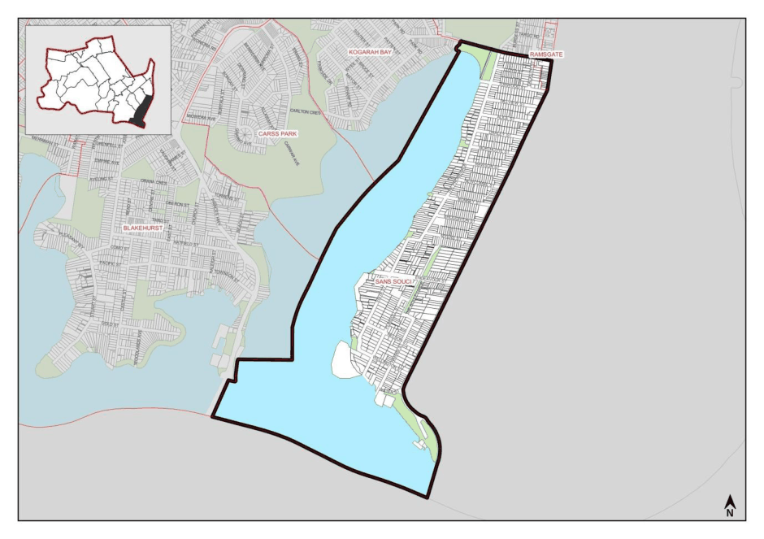

### 5.20 Sans Souci and Ramsgate Locality Statement

#### Map of locality

> [Picture on page 66: a picture, saved as a picture (images/part-05-residential-locality-statements-page-66-3.gif, 150 dpi).]

Figure 26: Sans Souci and Ramsgate

#### Existing Character

Location

This locality is bounded by Ramsgate Road to the north, Rocky Point Road to the east which also acts as the boundary to the Bayside LGA, and Kogarah Bay to the west and south. The suburbs of Ramsgate and Sans Souci are divided between Bayside and Georges River Councils.

Background

The Traditional land owners of this area are the members of the Aboriginal Bidjigal people of the Eora Nation, part of the Dharug language group.

Sans Souci was named after a grand house built on Rocky Point Road by Thomas Holt. Sans Souci remained still quite isolated from Sydney and in the 1860s, Holt sold his Sans Souci property to William Rust. Rust transformed the property into the Sans Souci Hotel which became a pleasure grounds and a popular destination for picnickers from Sydney.  In 1887 a steam tramway opened which allowed people to travel between Sans Souci and

Kogarah via Riverside Drive at Rocky Point which allowed for wider opportunities to settle the area for suburban development. 39

Heritage

There are several heritage items in this locality that relate to the area’s social history and architecture (refer to GRLEP 2021 Schedule 5).

Built Form and Setting

Part of the Ramsgate commercial centre and is located within this locality, which is adjoined by a small area of contemporary residential flat buildings. There are also two smaller commercial centres with one located along Rocky Point Road and the other at the end of the headland at the corner of Water Street. The latter is flanked by a high density residential area.

The locality is generally low density residential with some villa and town house developments between Endeavour Street and Nelson Street along Rocky Point Road. The wider area consists mostly of detached and semi-detached houses.

The housing styles are mixed, with no particular style predominating. There are numerous properties dating to the post-war era with a varying degree of alterations and large contemporary houses becoming increasingly common throughout the area, particularly towards the Kogarah Bay waterfront.

The subdivision pattern shows largely medium sized lots laid out in a regular grid-like pattern which is typical of the post-war era. Several lots (along the foreshore in particular) have been subdivided into battle-axe lots.

The land is relatively low lying with only a gentle slope on the western side. This slope allows a view overlooking the Georges River towards Kogarah Bay, particularly along Vista Street. The view of the bay is obscured in places due to development along the foreshore. The waterfront areas of this locality are located within the Foreshore Scenic Protection Area (refer to GRLEP 2021 Foreshore Scenic Protection Area Map).

In this locality there are several reserves and parks with direct waterfront access and vistas including Anderson Park, Bonney Street Reserve, The Boulevarde Reserve, Claydon Reserve, Endeavour St Reserve, Len Reynolds Reserve, Northcote Street Reserve and Sans Souci Park (including Sans Souci Leisure Centre).

Streetscape Character

Some streets within this locality have mature street trees, such as Alice Street, Torwood Street and The Boulevarde. In particular, the Phoenix Canariensis on The Boulevarde are recognised as street trees with heritage significance. Other streets like Rocky Point Road, Vista Street and the Promenade are characterised by a noticeably lack of planned tree-scapes on the verges. The lack of street trees on the residential streets contributes to the

39 The Book of Sydney Suburbs, Compiled by Frances Pollon, Angus & Robertson Publishers, 1990, Published in Australia ISBN 0-207-14495-8, page 240

feeling of width and openness to the streets and draws more attention to facades, driveways, fences along the streetscape.

However, the streetscape exhibits an eclectic character attributed to the variety of housing and fence materials, roof forms, driveway widths and garage styles. The treatments of the front setback spaces are also inconsistent in many streets as the contemporary two storey dwellings have little to no landscaping and are often dominated by hardscaping and driveways. There are also varying heights for front fences, including a range of visually permeable to solid fencing materials and fence heights of up to 1.6m in height.

#### Future Desired Character

• Retain and enhance the existing low density suburban residential character through articulated contemporary developments that respond to the human scale.

• Encourage well-designed high density residential development in designated areas along Rocky Point Road.

• Encourage consistent setbacks of buildings from the street and the provision of landscaping within the front setback, alongside low fencing to enhance visual permeability.

• Encourage the retention of trees and sharing of water views wherever possible, including screening via vegetation rather than solid walls.

• Protect public vistas over Georges River towards Kogarah Bay from Vista Street.
