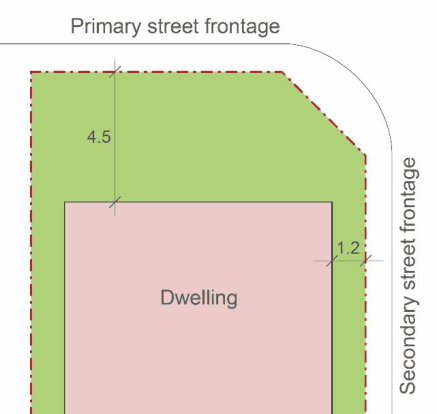
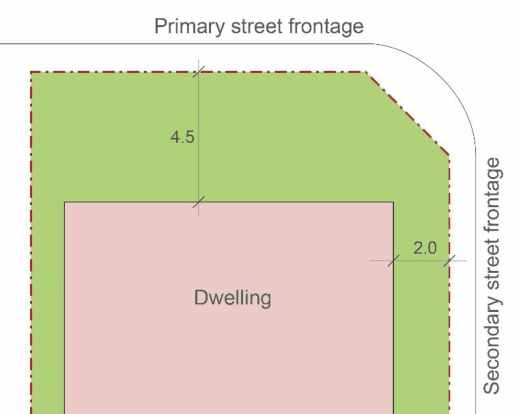
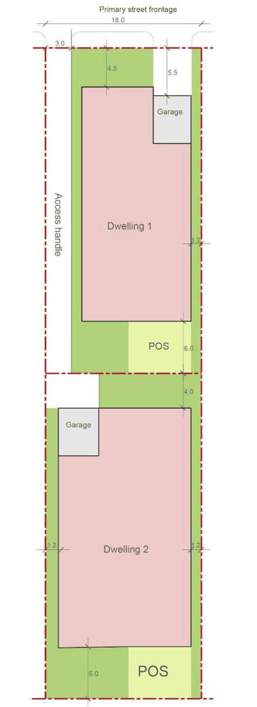

## 3. Setbacks

#### Objectives

a) Preserve significant vegetation, which contributes to the public domain, and allows for street landscape character to be maintained.

b) Integrate new development with the established setback character of the street by ensuring front setbacks are not inconsistent with adjoining buildings.

c) Provide opportunities for landscape planting and private open space.

d) Maintain a reasonable level of privacy and amenity for neighbours together with adequate access to sunlight.

e) Ensure adequate separation between buildings, consistent with the desired character and rhythm of built elements in the street.

#### Controls

Front Setbacks

1\. The minimum setback from the primary street boundary is:

i. 4.5m to the main building wall / façade;

ii. 5.5m to the front facade of a garage or carport, or at least 1m behind the main building wall / façade, whichever is the greater;

iii. Where the prevailing street setback is greater than the minimum, the average setback of dwellings on adjoining lots is to be applied.

Note: The “Prevailing Street Setback” is the setback calculated by averaging the setback of two (2) adjoining residential properties on both sides of the development.

2\. Balconies cannot encroach into the front setback space.

3\. For corner lots, the setback from the secondary street boundary is to be at least:

i. 1.2m to the building line if the site is less than 15m in width (see Figure 1); or

ii. 2.0m to the building line if the site is 15m or greater in width (see Figure 2).

> [Picture on page 6: a picture, saved as a picture (images/part-06-1-low-density-residential-controls-page-6-17.gif, 150 dpi).]

> [Picture on page 6: a picture, saved as a picture (images/part-06-1-low-density-residential-controls-page-6-18.gif, 150 dpi).]

Figure 1: Setback from secondary street boundary for sites less than 15m in width

Figure 2: Setback from secondary street boundary for sites 15m or greater in width

Side and Rear Setbacks

4\. Buildings are to have a minimum rear setback of 15% of the average site length, or 6m, whichever is the greater (excluding detached secondary dwellings – see Point 12 in Section 6.1.2.12- Secondary Dwellings of this DCP).

5\. The minimum side setbacks for ground and first floor are:

i. 900mm for lots up to 12.5m in width measured at the front building line for the length of the development.

ii. 1.2m for lots greater than 12.5m in width measured at the front building line for the length of the development.

iii. 1.5m for all lots within the Foreshore Scenic Protection Area measured at the front building line for the length of the development.

6\. Where alterations and additions (ground and first floor) to an existing dwelling are proposed, an existing side setback less than the setback required in Control 2 can be maintained, provided the reduced setback does not adversely affect compliance with the solar access and landscaped area controls or adversely impact upon the visual and acoustic amenity of neighbouring dwellings.

7\. For battle-axe lots, minimum side and rear boundary setbacks apply, except the front setback of the battle-axe lot without a street frontage, where a minimum setback of 4.0m is to be provided as illustrated in Figure 3.

8\. Any garages or parking structures fronting rear lanes may encroach upon the rear setback areas but are still to provide a minimum setback of 1m from the lane. Note: The definition of “building line or setback” is provided in the Georges River Local Environmental Plan 2021 (GRLEP 2021).

> [Picture on page 8: a picture, saved as a picture (images/part-06-1-low-density-residential-controls-page-8-1.gif, 150 dpi).]

Figure 3: Single dwelling battle-axe street facing (Note: dimensions are in metres)
