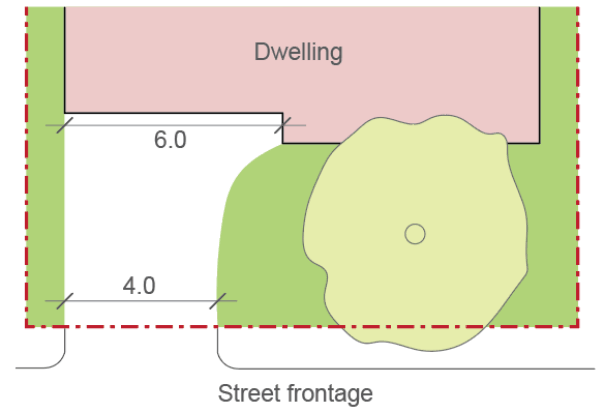

## 7. Vehicular Access, Parking and Circulation

#### Objectives

a) Ensure car parking is provided to meet the requirements of Council.

b) Ensure vehicular access routes and parking areas are easily accessible and visible to motorists.

c) Ensure car access areas and garages/carports do not visually dominate either the development or the streetscape.

d) Ensure car parking spaces are designed to ensure ease of access, egress and on-site manoeuvring.

#### Controls

1\. Car parking is to be provided in accordance with the requirements in Part 3 of this DCP.

2\. A dwelling is to provide one (1) garage and one (1) tandem driveway parking space forward of the garage (unless otherwise accommodated within the building envelope).

3\. Driveways, garages and basements should be accessed from a secondary street or rear lane where this is available.

4\. Entry to parking facilities off the rear lane must be setback a minimum of 1m from the lane.

5\. Driveway crossings are to be positioned so that on-street parking and landscaping on the site are maximised, and removal or damage to existing street trees is avoided.

6\. The maximum driveway width at the street boundary is 4.0m. The driveway width may increase to a maximum of 6.0m to accommodate double garages at the front building line in accordance with Figure 4 below to the extent required for a B99 vehicle entry and exit from the garage in accordance with AS2890.1 Parking Facilities (Note: forward entry and exit from a site is not required unless the development is on a major road or as advised by Council). This does not apply to rear lanes.

7\. Basements are permitted where the LEP height development standard is not exceeded, and it is demonstrated that there will be no adverse environmental impacts (e.g. affectation of watercourses and geological structure).

i. Basements on land where the average grade is less than 12.5% are permitted only where they are not considered a storey (see definition in the LEP) and the overall development presents as two (2) storeys to the street.

8\. Car parking layout and vehicular access requirements and design are to be in accordance with the Australian Standards, in particular AS 2890.1 (latest edition).

9\. The maximum width of a garage opening is 6.0m.

> [Picture on page 12: a picture, saved as a picture (images/part-06-1-low-density-residential-controls-page-12-4.gif, 150 dpi).]

Figure 4: Maximum width of driveways at the street boundary and front building line
