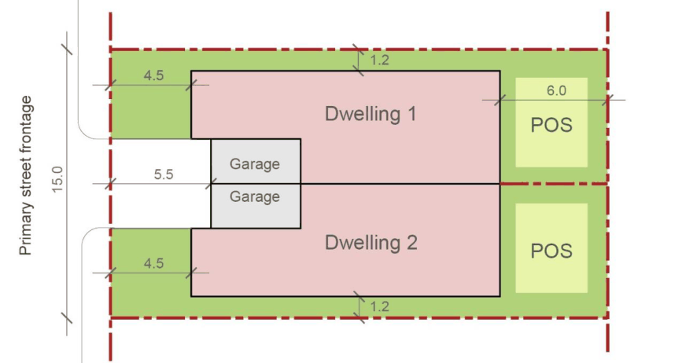
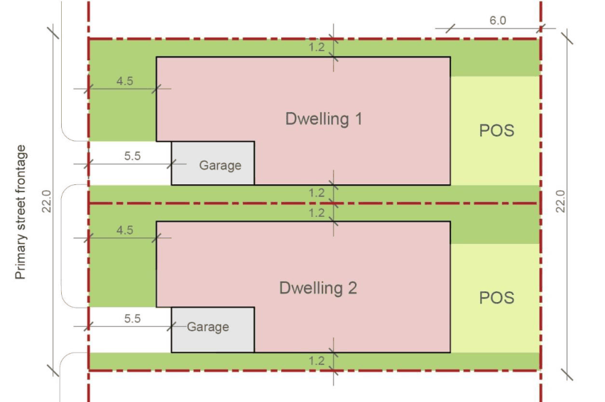
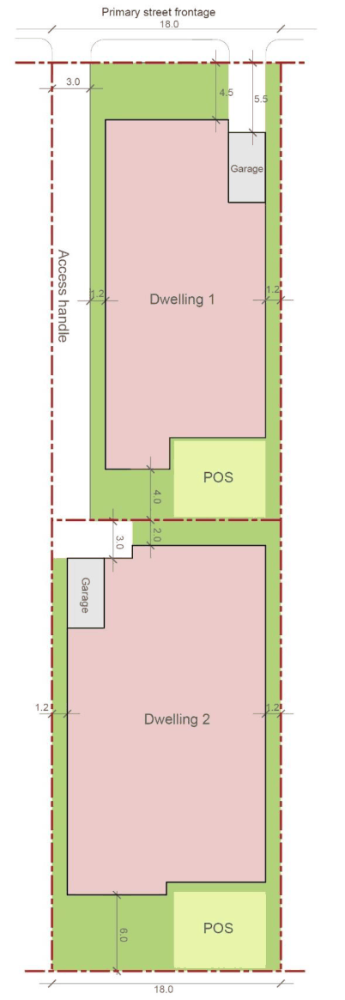
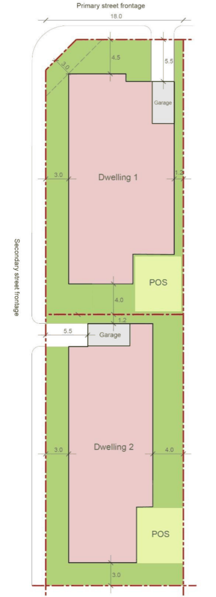
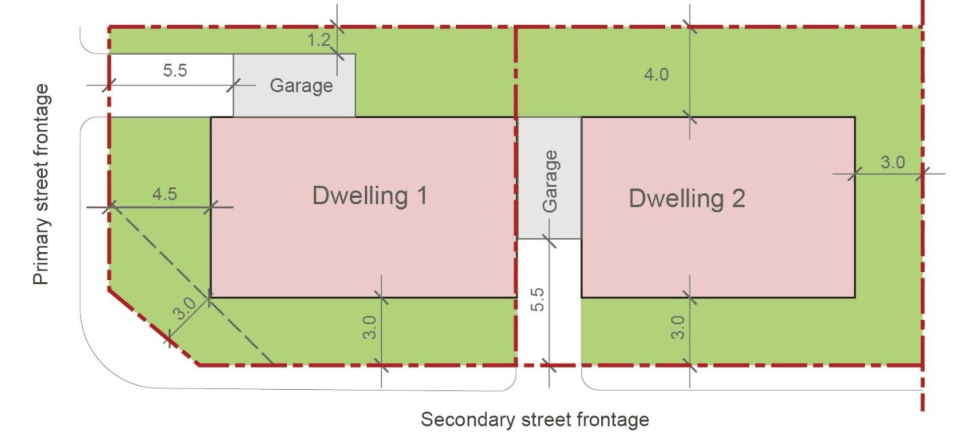
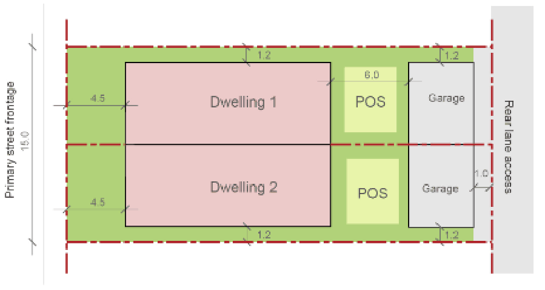

## 3. Setbacks

#### Objectives

a) Preserve significant vegetation, which contributes to the public domain, and allows for street landscape character to be enhanced.

b) Integrate new development with the desired setback character of the street by ensuring front setbacks are consistent with adjoining buildings.

c) Provide opportunities for landscape planting and private open space.

d) Maintain a reasonable level of privacy and amenity for neighbours and adequate access to sunlight.

e) Ensure adequate separation between buildings, consistent with the desired character and rhythm of built elements in the street.

#### Controls

Front Setbacks (all street facing dual occupancies)

1\. Minimum setback from the primary street boundary for ground and first floor is:

i. 4.5m to the main building wall / facade;

ii. 5.5m to the front wall or door of the garage, carport or on-site parking space;

iii. Where the prevailing street setback is greater than the minimum, the average setback of dwellings on adjoining lots is to be applied.

Note: The “Prevailing Street Setback” is the setback calculated by averaging the setback of the two (2) adjoining residential properties on either side of the development.

Side setbacks (attached dual occupancy)

2\. The minimum side setbacks for ground and first floor are:

i. 1.2m for development outside the Foreshore Scenic Protection Area; and

ii. 1.5m for lots within the Foreshore Scenic Protection Area.

> [Picture on page 19: a picture, saved as a picture (images/part-06-1-low-density-residential-controls-page-19-1.gif, 150 dpi).]

Figure 5: Attached dual occupancy in a ‘side by side’ configuration. Note: all dimensions are in metres

Side setbacks (detached dual occupancy)

3\. For detached dual occupancies in a ‘side-by-side’ configuration where both dwellings address the primary street, the minimum side setback (ground and first floor) to the external side boundaries and the internal allotment boundary is to be a minimum 1.2m for lots outside a Foreshore Scenic Protection Area (creating a separation of 2.4m between dwellings).

For lots within a Foreshore Scenic Protection Area, side setbacks for a detached dual occupancy are to be a minimum of 1.5m (creating a separation of 3m between dwellings).

> [Picture on page 20: a picture, saved as a picture (images/part-06-1-low-density-residential-controls-page-20-1.gif, 150 dpi).]

Figure 6: Detached dual occupancy in a ‘side by side’ configuration. Note: all dimensions are in metres

Rear setbacks (attached and detached dual occupancy in ‘side by side’ configuration)

4\. For attached and detached dual occupancies in a ‘side-by-side’ configuration where both dwellings address the street, each dwelling is to have a minimum rear setback (ground and first floor) of 15% of the average site length, or 6.0m, whichever is greater.

Side and Rear Setbacks – (detached dual occupancy in a battle axe configuration)

5\. The minimum rear setback (ground and first floor) is 4m to the rear boundary of the lot fronting the primary street. The minimum rear setback for the rear lot is 6m.

6\. The minimum front setback (ground and first floor) of any building on the non-primary street fronting lot is to be 2.0m, creating a minimum separation of 6.0m between the dual occupancy dwellings.

7\. Minimum side boundary setbacks of 1.2m (for lots outside a Foreshore Scenic Protection Area) are to be provided. Within Foreshore Scenic Protection Area zone, minimum side setbacks of 1.5m are to be provided. See Figure 7.

8\. The minimum side setback of the dwelling with frontage to a primary street to the access handle is to be 1.2m.

> [Picture on page 21: a picture, saved as a picture (images/part-06-1-low-density-residential-controls-page-21-1.gif, 150 dpi).]

Figure 7: Detached dual occupancy in a battle axe configuration. Note: all dimensions are in metres.

Corner site setbacks (dual frontage) – detached dual occupancy

9\. The minimum setback (ground and first floor) to a secondary street is 3m. Garages accessible from the secondary street must be setback a minimum of 5.5m.

10\. A minimum side setback (ground and first floor) of 1.2m is required from the internal allotment boundary for the dwelling addressing the secondary frontage for lots outside

the Foreshore Scenic Protection Area. A minimum side setback of 1.5m is to be provided for lots within a Foreshore Scenic Protection Area.

11\. The minimum side setback of the dual occupancy dwelling addressing the secondary frontage is 3m, while the minimum rear setback of the dual occupancy dwelling addressing the secondary frontage is 4m. See Figure 8.

> [Picture on page 22: a picture, saved as a picture (images/part-06-1-low-density-residential-controls-page-22-6.gif, 150 dpi).]

Figure 8: Detached dual occupancy - Corner site (dual frontage). Note: all dimensions are in metres.

12\. The minimum rear setback of the dwelling fronting the primary street to the proposed internal allotment boundary is 4m. The front and side setbacks in accordance with Points 1 and 2 in Sections 6.1.3.3 (1) and 6.1.3.3 (2) of this DCP will apply to this dwelling. See Figure 8.

13\. The minimum front setback of the dwelling fronting the primary street (ground and first floor) is:

i. 4.5m to the main building wall / façade.

ii. 5.5m to the front facade of a garage or carport; or on-site parking space.

14\. The minimum side setback of the dwelling fronting the primary street (ground and first floor) are:

i. 1.2m for development outside the Foreshore Scenic Protection Area.

ii. 1.5m for lots within the Foreshore Scenic Protection Area.

Corner site setbacks (dual frontage) – attached dual occupancy

15\. The minimum setback (ground and first floor) to a secondary street is 3.0m. Garages accessible from the secondary street must be setback a minimum of 5.5m.

16\. The minimum side setback of the dwelling addressing the secondary frontage is to be 3m, while the rear setback of the dwelling addressing the secondary frontage requires a minimum setback of 4.0m. See Figure 9.

> [Picture on page 23: a picture, saved as a picture (images/part-06-1-low-density-residential-controls-page-23-19.gif, 150 dpi).]

Figure 9: Attached dual occupancy – Corner Site (dual frontage). Note: all dimensions are in metres.

17\. The minimum front setback of the dwelling fronting the primary street (ground and first floor) is:

i. 4.5m to the main building wall / façade.

ii. 5.5m to the front wall or door of the garage, carport or on-site parking space.

18\. The minimum side setbacks of the dwelling fronting the primary street (ground and first floor) are:

i. 1.2m for development outside the Foreshore Scenic Protection Area.

ii. 1.5m for lots within the Foreshore Scenic Protection Area.

Attached dual occupancy - duplex configuration (one dwelling above another) – single frontage

19\. Front, side and rear setbacks for an attached dual occupancy will apply, including setbacks of the garage/s behind the street facing building line.

Attached dual occupancy - duplex configuration (one dwelling above another) – corner site

20\. Front, secondary, side and rear setbacks for an attached dual occupancy will apply, including setbacks of the garage/s behind the street facing building line.

Dual frontage (laneway) - Attached or Detached Dual Occupancy

21\. A side by side configuration is recommended with parking to be accessed from the laneway. The dwellings are to address the primary frontage. See Figure 10.

> [Picture on page 24: a picture, saved as a picture (images/part-06-1-low-density-residential-controls-page-24-16.gif, 150 dpi).]

Figure 10: Attached or Detached Dual Occupancy Dual frontage (laneway). Note: all dimensions are in metres

22\. Front and side setbacks for an attached or detached dual occupancy as outlined in Points 1 and 2 in Sections 6.1.3.3 (1) and 6.1.3.3 (2) of this DCP apply.

23\. Any garages or parking structures fronting rear lanes must be setback a minimum 1m from the lane. However, where a dwelling addresses the laneway, front setbacks of 4.5m to the wall of the dwelling and 5.5m to any garage, will apply.

24\. A separation of at least 6m must be provided between the rear wall of a dwelling and the wall of any garage addressing the laneway.
