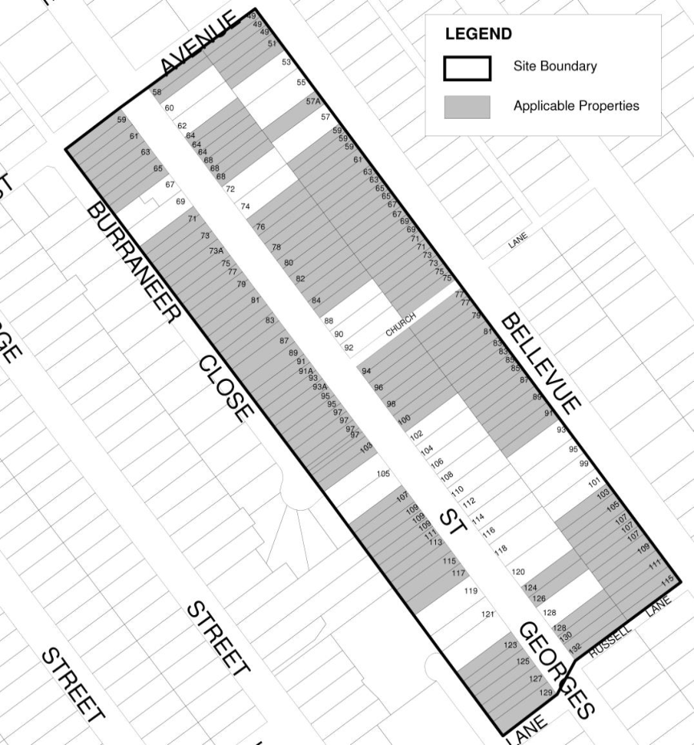

## 13. Site Facilities

#### Objectives

a) Ensure adequate provision is made for site facilities to support residential occupation of dual occupancy development.

b) Ensure that services do not detract from the amenity of neighbourhoods and streets.

c) Facilitate a safe, efficient and comfortable living environment.

d) Ensure site utilities are accessible, visually unobtrusive and require minimal maintenance.

#### Controls

1\. All dwellings are to be provided with adequate and practical internal and external storage (garage, garden sheds, etc.).

2\. Provision for water, sewerage and stormwater drainage for the site shall be nominated on the plans to Council’s satisfaction.

3\. Each dwelling must provide adequate space for the storage of garbage and recycling bins (a space of at least 3m x 1m per dwelling must be provided) and are not to be located within the front setback.

4\. Letterboxes are to be located on the frontage where the address has been allocated in accordance with Australia Post requirements.

#### 6.1.4 Narrow Lot Housing – Bellevue Estate

The following provisions apply to nominated sites within Bellevue Estate, which is bounded by Bellevue Parade, Russell Lane, Buraneer Close and First Avenue. The nominated Narrow Lot sites are shown on the following plan:

> [Picture on page 32: a picture, saved as a picture (images/part-06-1-low-density-residential-controls-page-32-5.gif, 150 dpi).]

Figure 11: Map of nominated narrow lot sites

Where applicable, the specific controls of this Part override any other similar provisions of the DCP. Where this section is silent on a matter, the general controls within Section 6.1.2 - Single Dwellings of this DCP will apply.

#### Purpose

This estate contains lots that are significantly smaller than the average allotment in the Georges River LGA (previously Kogarah LGA). Some sites within this estate consist of older dwellings that currently straddle multiple lots. Legally these sites (predominantly only 6m

wide) can be redeveloped individually. These controls aim to recognise such constraints and to enable development that is contextually appropriate to the scale and character of the existing subdivision pattern and improve the quality and amenity of housing stock within this area.

#### Objectives

Ensure that good design outcomes and a high level of residential, for both future residents and adjoining neighbours, is achieved.
