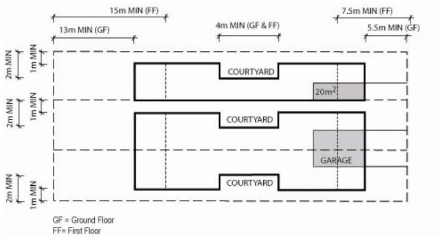

## 5. Courtyards

#### Objectives

a) Create courtyards that provide light and ventilation whilst maintaining privacy.

#### Controls

1\. Courtyards are to be incorporated to break up continuous side elevations, provide light wells, ventilation and alternative opportunities for glazing.

2\. The maximum length of any wall is 10m. Walls longer than 10m should be articulated by a minimum 300mm projection or indentation in the elevation.

3\. For individual dwellings, a courtyard must be located along the setback elevation (see Figure 12).

4\. For attached dwellings, courtyards are to be provided along both setback elevations (see Figure 12).

5\. The minimum size required for courtyards is 2m (deep) x 4m (wide).

6\. Courtyards are to be offset from courtyards / open space on adjoining properties to maximise privacy.

> [Picture on page 35: a picture, saved as a picture (images/part-06-1-low-density-residential-controls-page-35-19.gif, 150 dpi).]

Figure 12: Narrow lot housing setbacks
