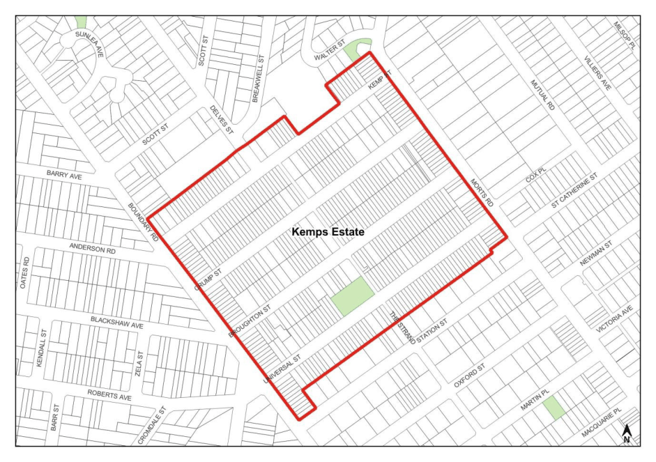

## 7. Common Walls

#### Objectives

a) Ensure that developments with a common wall are structurally sound.

#### Controls

1\. Where it is proposed that dwellings share a common wall, a reciprocating easement for support must be placed on each property title adjacent to the position of a common boundary at the common wall.

#### 6.1.5 Narrow Lot Housing – Kemps Estate (6.5m or less)

This Part applies to development for the purposes of a Dwelling House on a small lot (having a width of less than 6.5m), including alterations or additions, including all Dwelling Houses within Kemps Estate, Mortdale (refer Figure 13 below). Appendix 7 provides a history of Kemps Estate and its significance to the Georges River Local Government Area.

> [Picture on page 37: a picture, saved as a picture (images/part-06-1-low-density-residential-controls-page-37-6.gif, 150 dpi).]

Figure 13: Kemps Estate

Houses on standard lots (having a width of 6.5m or greater) or outside Kemps Estate, Mortdale will be assessed against the requirements of Section 6.1.2 – Single Dwellings of this DCP.

#### Objectives

a) Ensure consistency with low density, suburban environments.

b) Ensure dwelling houses have proportioned facades that are appropriately scaled for narrow allotments and emphasise vertical elements.

c) Protect the natural scenic landscape qualities of sensitive areas such as the Georges River foreshore.

d) Contribute to the creation of attractive, human scale streetscapes.

e) Promote an attractive, comfortable, safe and active public domain.

f) Maintain a high level of amenity for adjoining residential development.

g) Create a high amenity living environment.

h) Achieve a high level of environmental performance.
