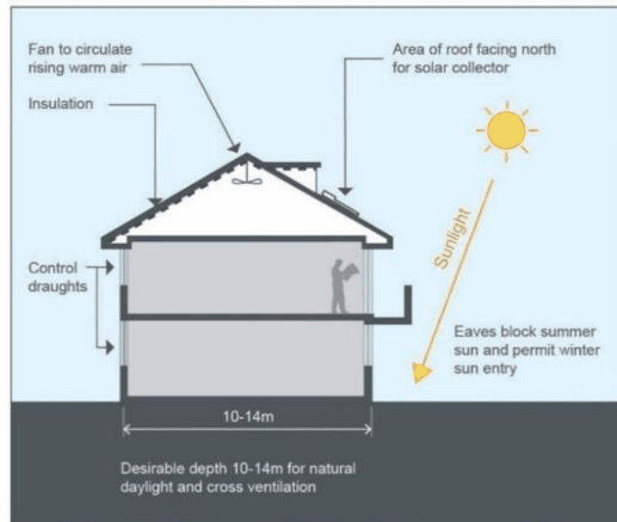

## 5. Solar Access

#### Objectives

a) Development ensures an appropriate amount of solar access to main living areas and areas of principal private open space within the site and adjoining sites.

1\. Development allows for at least 3 hours of sunlight on the windows of main living areas and adjoining principal private open space of adjacent dwellings between 9:00am and 3:00pm on 22 June.

Note: Variations will be considered for developments that comply with all other requirements but are located on sites with an east-west orientation or steeply sloping sites with a southerly orientation away from the street.

2\. Development to comply with BASIX requirements.

3\. Buildings are encouraged to incorporate window shading devices where necessary to minimise exposure to direct summer sun. Alternatively, windows may be shaded by the planting of large trees, including deciduous species. Refer to Figure 14 below.

> [Picture on page 41: a picture, saved as a picture (images/part-06-1-low-density-residential-controls-page-41-11.gif, 150 dpi).]

Figure 14: Passive solar design

4\. Consider and minimise overshadowing impacts on the solar photovoltaic panels of neighbouring buildings where a variation to the building setbacks or number of storeys is sought.
