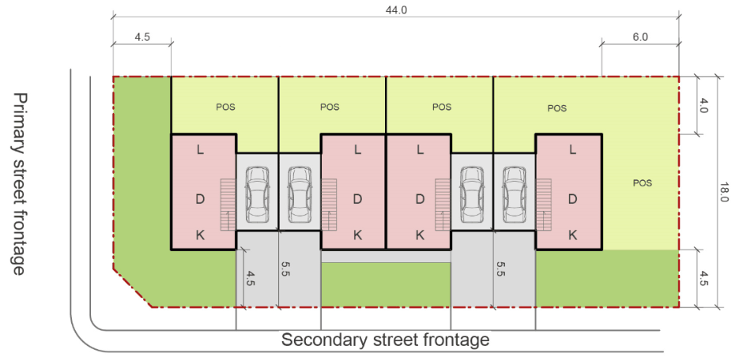
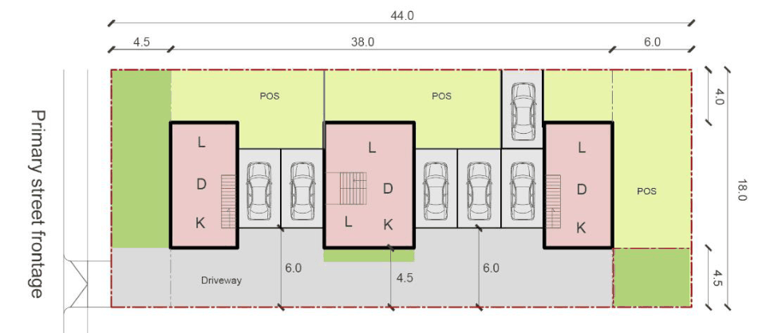
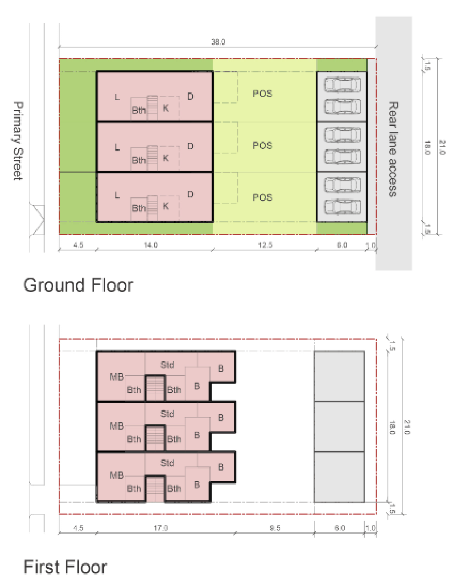
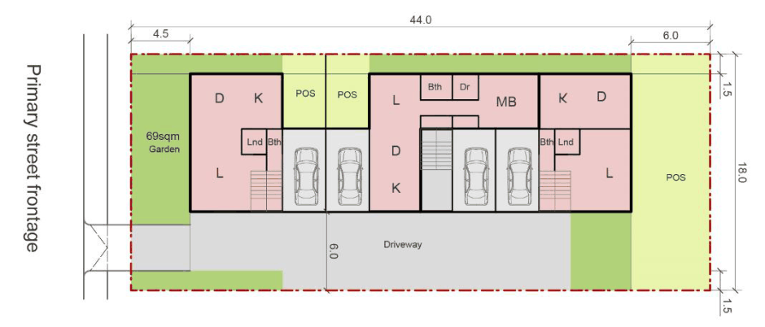
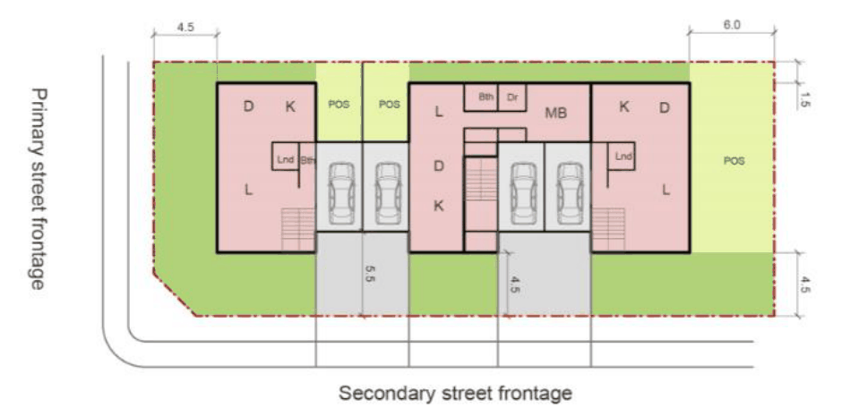

#### 6.2.19 Neighbourhood Shops in R3 Zones

The R3 Medium Density Residential zone permits neighbourhood shops to facilitate the creation of active places and to support residential areas.

The management and control of these non-residential land uses is required to protect the residential amenity of dwellings within the R3 Medium Density Residential zone and which adjoin the R3 Medium Density Residential zones, and to protect the hierarchy of Council’s business zones.

#### Objectives

a) Protect the hierarchy of the designated business zones in the Georges River Local Government Area.

b) Limit the potential adverse amenity impacts of neighbourhood shops on residential dwellings and adjoining residential areas.

#### Controls

1\. The maximum gross floor area of any single tenancy to be used as a neighbourhood shop, in the R3 Medium Density Residential zone is 100m2.

2\. The car parking required for a non-residential land use must be provided on-site in accordance with the requirements of this DCP.

3\. Any application for a neighbourhood shop in R3 Medium Density Residential zone must be supported by a Plan of Management detailing the hours of operation, waste removal and goods delivery methods.

4\. The maximum hours of operation for non-residential uses in the in R3 Medium Density Residential zone are 7.00am to 10.00pm seven days per week.

Indicative Building Envelopes for building footprints, location of POS,

#### landscaping and car parking

> [Picture on page 22: a picture, saved as a picture (images/part-06-2-medium-density-residential-controls-page-22-3.gif, 150 dpi).]

Figure 1: Multi Dwelling Housing and Multi Dwelling Housing (terraces) – Dual frontage

> [Picture on page 22: a picture, saved as a picture (images/part-06-2-medium-density-residential-controls-page-22-5.gif, 150 dpi).]

Figure 2: Multi Dwelling Housing – Midblock

> [Picture on page 23: a picture, saved as a picture (images/part-06-2-medium-density-residential-controls-page-23-1.gif, 150 dpi).]

Figure 3: Multi Dwelling Housing (terraces)

> [Picture on page 24: a picture, saved as a picture (images/part-06-2-medium-density-residential-controls-page-24-1.gif, 150 dpi).]

Figure 4: Manor House (mid-block)

> [Picture on page 24: a picture, saved as a picture (images/part-06-2-medium-density-residential-controls-page-24-3.gif, 150 dpi).]

Figure 5: Manor House (dual frontage)

Note: All dimensions are in metres.
