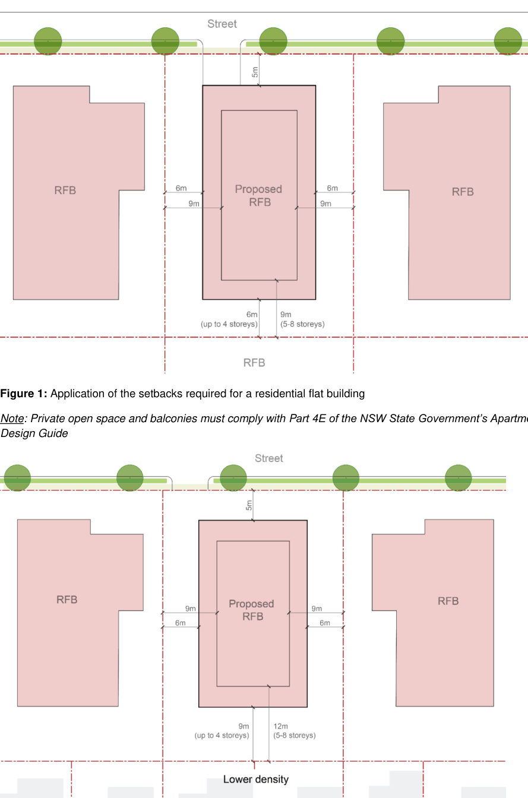
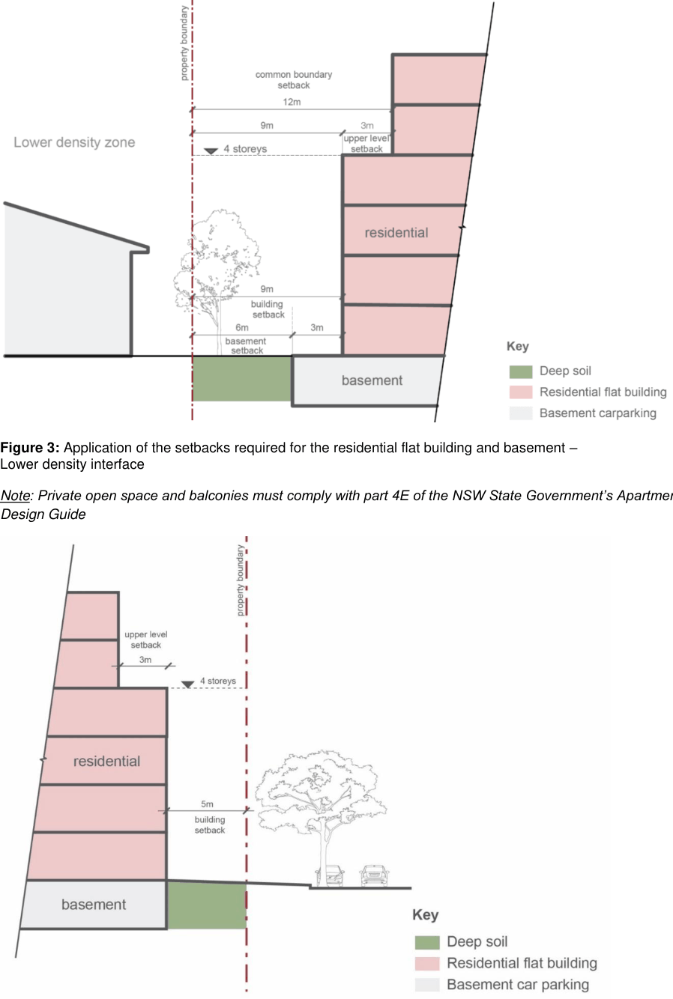

#### 6.3.3 Building Setbacks and Street Interface

Building setbacks establish the minimum separation distances between buildings, site boundaries and the public domain. The setbacks provide opportunities for the provision of private and communal areas of open space, landscaping, view sharing and opportunities to manage visual and acoustic privacy.

The building setbacks are important requirements which contribute to the streetscape and control the footprint and bulk of a building as well as the impact the building will have on the environment, neighbouring properties and the public domain.

Setbacks define the overall footprint of a building and the outer extremities of that building in relation to the location and orientation of balconies, windows/doors and solid elements.

The separation between buildings is also important and determines the urban form of the building, the rhythm of buildings in the streetscape and the character.

Appropriate building setback controls can contribute to the public domain by enhancing the streetscape character and the continuity of street facades. Building setbacks can also be used to enhance the setting of the building.

Building setbacks are measured from the site boundaries to the facade of the building.

#### Objectives

a) Maintain and create a high level of amenity for neighbours with adequate access to sunlight, privacy and outlook.

b) Establish the appropriate spatial separation of the built form to the public domain and adjoining development.

c) Support opportunities to preserve existing vegetation including street trees.

d) Accommodate deep soil landscaping that will enable existing plantings to be retained and augmented with new canopy trees to assist with improving the visual impacts in and around the development.

e) Integrate new development with the desired setback and rhythm of built elements that comprise the character of the street.

f) Provide increased building separation where there is a transition to a lower density residential zone or a heritage item.

#### Controls

1\. Front setbacks:

i. Street setback: up to a building height of four storeys, a minimum setback of 5m is to be provided.

ii. Corner sites: up to a building height of four storeys, a minimum setback of 5m to both street frontages is to be provided.

iii. Above four storeys, the front setback of the upper building levels is to be increased to a minimum of 8m to the street. The minimum 8m setback also applies to balconies, terraces and balustrades and must be accommodated behind the setback.

iv. On a corner site, both frontages are to provide the increased setback above four storeys.

v. Above level four (ground plus 3 storeys); an increased setback of the upper levels/s may be required depending on the width of the street. The required additional upper level setback for sites fronting a road with a reservation width less than 20m will be determined based on their visual impact in the specific context of the development. If the assessment determines that an additional setback is required, the minimum additional setback will be 2m and up to 3m based on the assessment.

vi. The street setback area needs to be predominantly landscaped and is to accommodate a minimum of two (2) canopy trees to a mature height of at least 6m.

2\. Side boundary setbacks:

i. Minimum setback of 6m from side boundary between ground floor level and up to four storeys.

ii. Upper level setbacks are 9m above four storeys.

3\. Rear boundary setbacks:

i. Minimum 6m setback from a rear boundary between ground floor level and up to four storeys.

ii. Upper level setbacks are 9m above four storeys.

Notes:

1\. A reduced side or rear setback may be permitted where permitted by Part 3F of the NSW State Government’s Apartment Design Guide.

2\. Private open space and balconies must comply with part 4E of the NSW State Government’s Apartment Design Guide.

4\. Side and rear boundary setbacks adjacent to a lower density residential zone or heritage item/conservation area for the purposes of visual separation, privacy and transition:

i. Minimum setback of 9m from the boundary between ground level and up to four storeys.

ii. Upper level setbacks are 12m above four storeys.

Note: Private open space and balconies must comply with Part 4E of the NSW State Government’s Apartment Design Guide.

5\. Encroachments into boundary setbacks:

i. Ground floor private open space may encroach up to 2m into the 5m front setback leaving a minimum 3m of deep soil area to the street.

ii. Ground floor private open space may encroach up to 3m into the side and rear setbacks leaving a minimum 3m of landscaped buffer.

6\. The setback areas, other than any permitted ground floor private open space, are to be landscaped and be retained as part of the common property of the development.

7\. For improved streetscape, reduction in visual clutter and to provide above ground space for street tree canopy, powerlines in the street verge in front of new development to which this part applies will be undergrounded. This includes the connection of power supply from the road reservation into the development site.

8\. Sub-stations, fire booster assemblies and waste bin storage structures need to be integrated into the development and identified at the DA stage.

9\. Setbacks may need to be increased to maintain the required levels of solar access to adjoining development as per the DCP requirement for that particular type of development or where the site is in a Heritage Conservation Area or in the vicinity of a Heritage Item to provide an appropriate buffer or curtilage to the Heritage Conservation Area or Heritage Item.

Application of setbacks is demonstrated in Figures 1, 2, 3 and 4.

> [Picture on page 8: a picture, saved as a picture (images/part-06-3-high-density-residential-controls-page-8-1.gif, 150 dpi).]

Figure 1: Application of the setbacks required for a residential flat building

Note: Private open space and balconies must comply with Part 4E of the NSW State Government’s Apartment Design Guide

Figure 2: Application of the setbacks required for a residential flat building - with lower density interface (rear)

Note: Private open space and balconies must comply with part 4E of the NSW State Government’s Apartment Design Guide

> [Picture on page 9: a picture, saved as a picture (images/part-06-3-high-density-residential-controls-page-9-1.gif, 150 dpi).]

Figure 3: Application of the setbacks required for the residential flat building and basement – Lower density interface

Note: Private open space and balconies must comply with part 4E of the NSW State Government’s Apartment Design Guide

Figure 4: Application of the setbacks required for the residential flat building and basement – Street

Note: Private open space and balconies must comply with part 4E of the NSW State Government’s Apartment Design Guide
