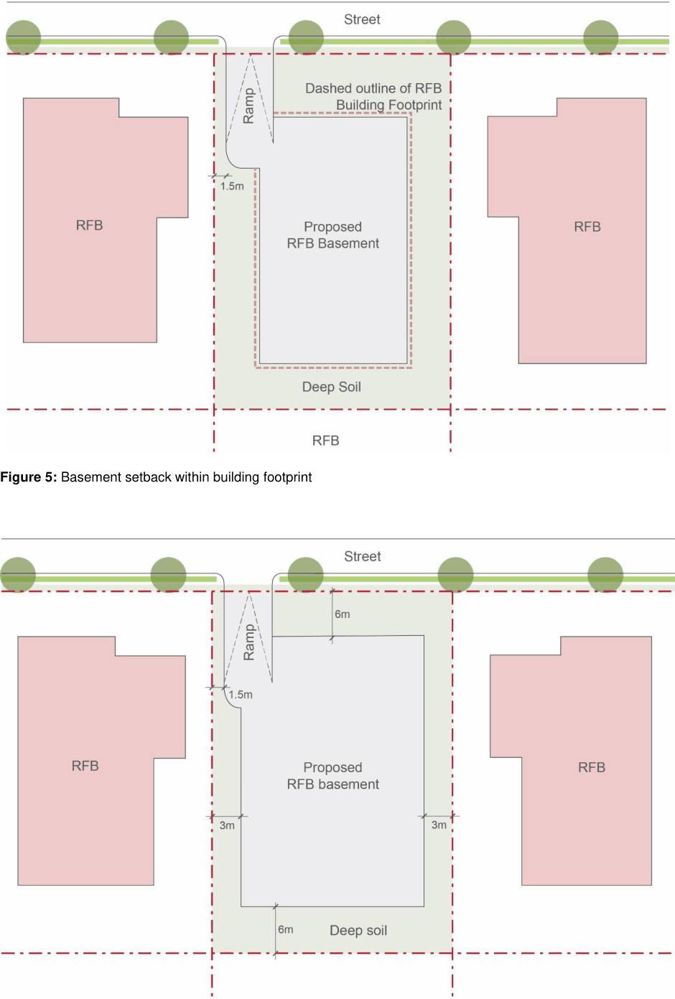

#### 6.3.4 Basement Setbacks

Basement setbacks have been established to limit the extent of site excavation, to provide opportunities for deep soil landscape planting around and between buildings and to provide a buffer to adjoining existing and future development. The provision of deep soil landscaping zones will assist in providing opportunities for planting to contribute to the tree canopy of Georges River.

#### Objectives

a) Limit the extent of excavation in the proximity of the site boundaries.

b) Provide opportunities for deep soil landscaping and new tree planting.

c) Accommodate opportunities for on-site infiltration of stormwater.

d) Accommodate landscaping that will contribute to the tree canopy of Georges River and provide shade and screening for residential development and reinforce a landscaped street character.

e) Provide capacity to protect existing trees on site and provide capacity for new tree planting.

#### Controls

1\. Basements are to be:

i. Located within the building footprint (refer to Figure 5), or

ii. Set back a minimum of 6m from the front and rear boundaries and 3m from the side boundaries (refer to Figure 6).

2\. The basement setback areas are to be deep soil zones as defined in the Apartment Design Guide.

3\. Driveways and driveway crossings are to be located a minimum of 1.5m from a side boundary.

4\. Where a development site shares a boundary with a lower density zone (i.e. R2 or R3 zones), the minimum setback of the basement is to be 6m from the boundary with the lower density zone (refer to Figure 3).

5\. The 6m basement setback at a zone boundary is to be planted to provide a vegetated landscape buffer between the development and adjoining lower density development. Planting is to include trees that achieve a minimum mature height of 6.0m. Under canopy planting is to include lower scale planting that provides a visual buffer between developments and creates the desired landscape buffer.

6\. Basements fronting the primary street address are not to project above ground level (existing) at the street setback alignment.

> [Picture on page 11: a picture, saved as a picture (images/part-06-3-high-density-residential-controls-page-11-1.gif, 150 dpi).]

Figure 5: Basement setback within building footprint

Figure 6: Alternative basement setback requirements
