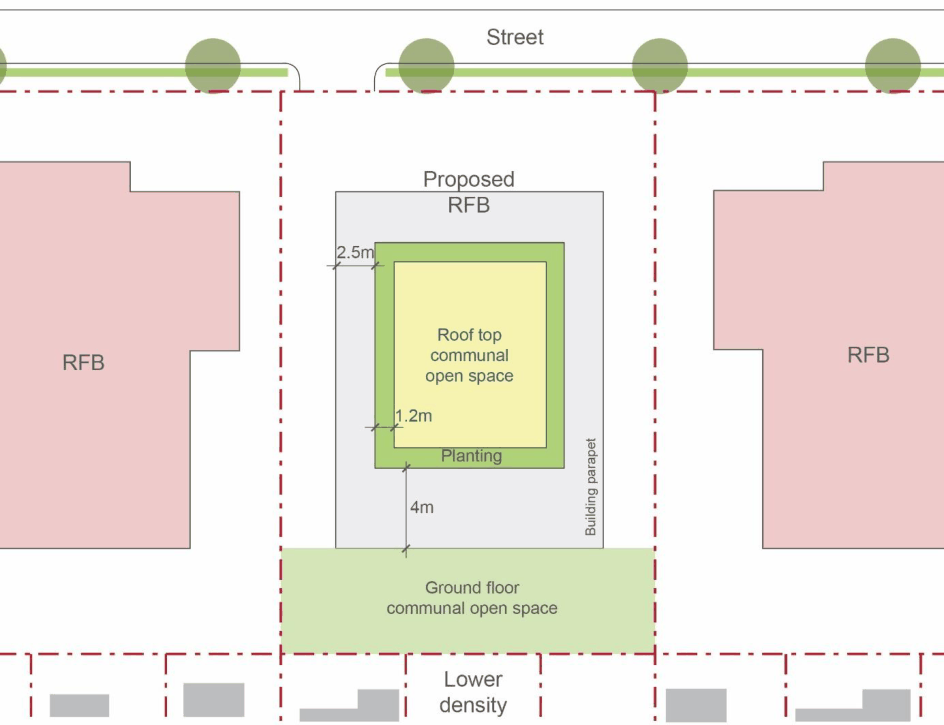

#### 6.3.7 Communal Open Space

Well designed and high quality communal open space can provide benefits to all residents by meeting recreational requirements communal open space should preferably be located on ground level and should have good amenity and accessibility.

Communal open space when proposed needs to carefully consider amenity impacts upon adjoining development, particularly where the development site adjoins residential areas of a lower density.

#### Objectives

a) Ensure communal open space enhances residential amenity and provides opportunities for landscaping.

b) Ensure communal open space is designed to avoid acoustic and visual privacy impacts upon adjoining development, and on dwellings within the subject development.

c) Provide opportunities for a range of recreational activities for people of all ages.

#### Controls

1\. Communal open space to a minimum area of 25% of the site area, with a minimum dimension of 5m is to be provided and must be designed with consideration of the user’s thermal comfort throughout the year and may include smaller areas with designated functions such as a shaded garden for summer and an open courtyard for winter.

2\. Communal open space may be provided above ground level where:

i. The proposed elevated communal open space will provide a high level of amenity to supplement the communal open space provided at ground level of the site; and

ii. There will be no significant impact on surrounding properties with respect to the loss of privacy; and

iii. The above ground communal open space does not exceed 40% of the required communal open space area.

3\. At least 50% of the required communal open space area is to receive 2 hours of direct sunlight between 9am and 3pm on 21 June.

4\. At least 50% of the ground level communal open space is to comprise unpaved landscaped area.

5\. The useable and trafficable area of any roof top communal open space is to be set back a minimum of 2.5m from the edge of the roof of the floor immediately below with landscape planters (minimum 1.2m wide) provided to prevent close and direct views into adjoining properties.

6\. Roof top communal open space areas, amenities and common (non-private) rooms should include equitable access for all residents, and must be designed to ensure that noise and overlooking will be avoided, by way of screening and setbacks from boundaries as detailed.

7\. Where roof top communal open space is proposed on a site adjoining lower density zone, any communal open space is to be setback a minimum of 4m from the edge of the

roof of the floor immediately below adjacent to a lower density residential zone (refer to Figure 6).

8\. Ancillary structures on the roof such as lift overruns and staircases should be located where their impact is minimised to reduce their visual dominance. Balustrades should be visually recessive.

Note: Ground level and roof top common open space to be provided in accordance with Part 3D of the Apartment Design Guide.

> [Picture on page 16: a picture, saved as a picture (images/part-06-3-high-density-residential-controls-page-16-8.gif, 150 dpi).]

Figure 6: Application of the setbacks required for the location of communal open space zone interface
