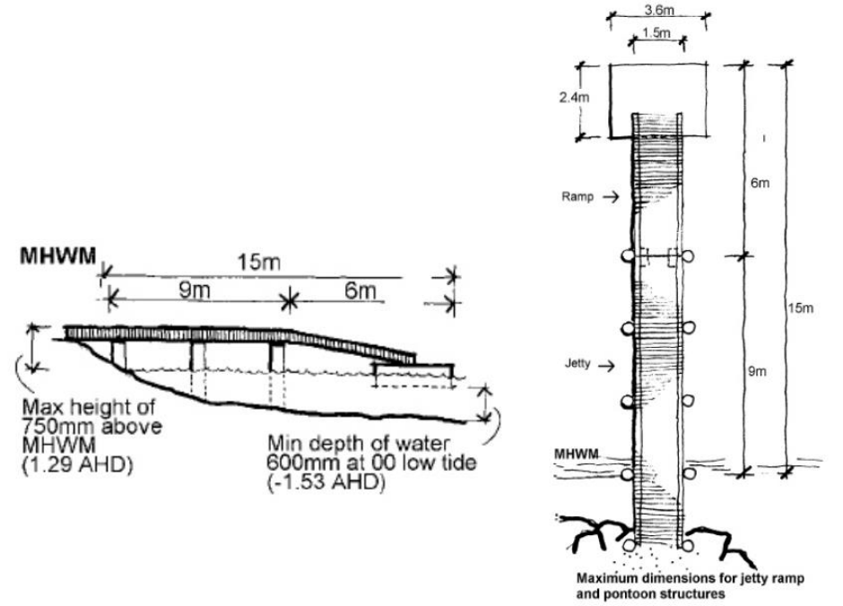

## 1. Jetty, Ramp and Pontoon Structures

#### Objectives

a) Ensure structures do not obstruct or interfere with navigation within the waterway and public access along the foreshore is not restricted.

b) Ensure structures are designed to integrate into the natural environment.

c) Ensure the cumulative effect of waterfront structures is reduced, particularly in areas where it is difficult to attain reasonable water depths or adequate riparian rights.

#### Controls

1\. The jetty, ramp and pontoon structures must not exceed the maximum dimensions as illustrated in Figure 1.

2\. The construction of “L” or “T” ends or other types of elongations or steps at right angles to jetties are not permitted.

3\. These structures are to be treated in brown or dark tones to reduce the visual impact of the structure.

4\. Materials used for construction must not be deleterious to marine life, e.g. antifouling paints.

5\. No foreshore structures will be permitted over Posidonia australis (Shapweed seagrass).

6\. Railings will not be permitted on jetties, ramps or pontoons.

7\. Council strongly supports the use of shared facilities for 2 or more adjoining residential waterfront properties. This particularly applies in confined bays and/or bays characterised by shallow water, which would otherwise tend to create a demand for long structures to attain reasonable water depths.

8\. The proposed development: (i) will not result in any adverse damage to the existing marine environment, which may include seagrass vegetation, regenerating mangroves and fish breeding/fish feeding grounds; and (ii) retains and protects the mud/sand flats, reef and scattered rock.

> [Picture on page 5: a picture, saved as a picture (images/part-06-5-foreshore-locality-controls-page-5-20.gif, 150 dpi).]

Figure 1: Jetty, ramp and pontoon structures maximum dimensions
