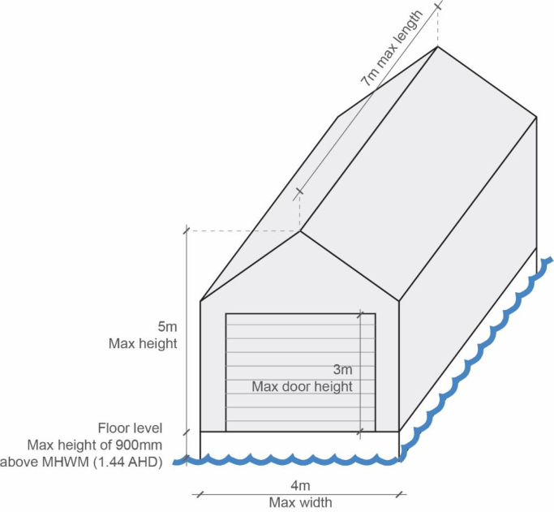

## 3. Boatsheds

#### Objectives

a) To provide storage and / or maintenance of small boats and boating equipment.

b) To ensure that the visual impact of a boatshed is minimised when viewed from the waterway, adjoining properties and public spaces.

c) To ensure that the scale and character of a boatshed is sympathetic to the natural landform and topographical features.

#### Controls

1\. Boatsheds have a specific form and dimensions as shown in Figure 2. They must be single storey with a maximum floor level 900mm above MHWM and a maximum length of 7m. Flat roof with a slope of less than 15% is not permitted.

2\. Boatsheds are to be designed to minimise excavation and constructed of timber, stone, brick or other material satisfactory to Council.

3\. Boatsheds should be sited so as to minimise the removal of remnant native vegetation and the excavation of sandstone rock shelves and outcrops.

4\. Boatsheds are setback a minimum 1.5m from the side boundary. Council may consider a variation where there is:

i. No detrimental impact on the view from the waterway

ii. No loss of an existing view to the water from the adjoining lands to the waterway

iii. A need to accommodate any significant vegetation, natural rock formations or other site features.

> [Picture on page 7: a picture, saved as a picture (images/part-06-5-foreshore-locality-controls-page-7-1.gif, 150 dpi).]

Figure 2: Boatsheds must have specific form and dimensions

Note: The definition of “boat shed” is provided in the Georges River Local Environmental Plan 2021 (GRLEP 2021). It cannot include any habitable space.
