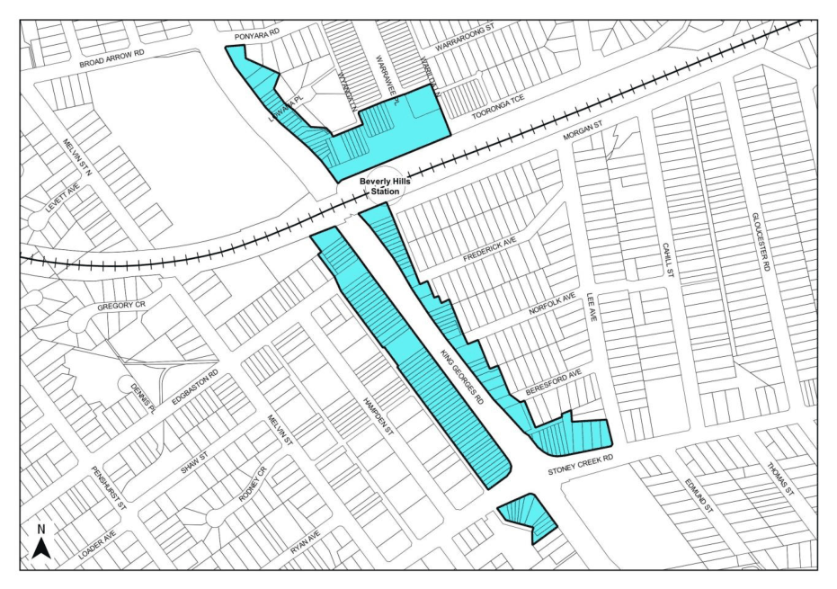
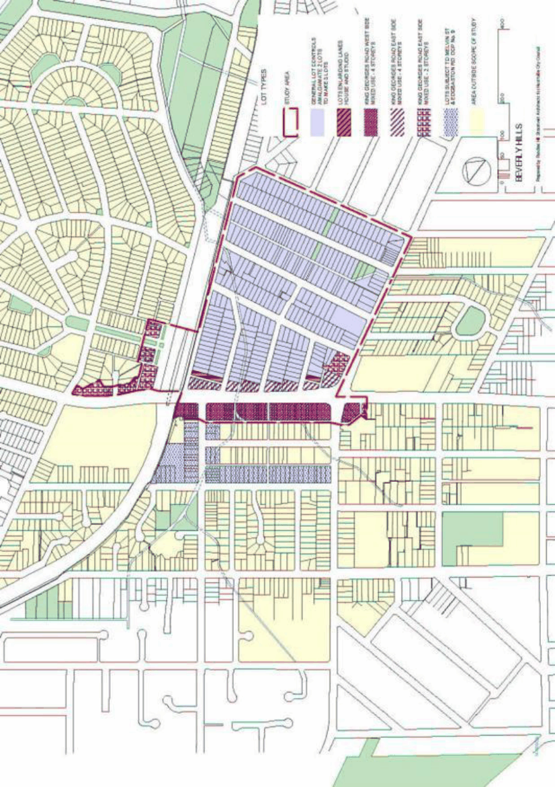
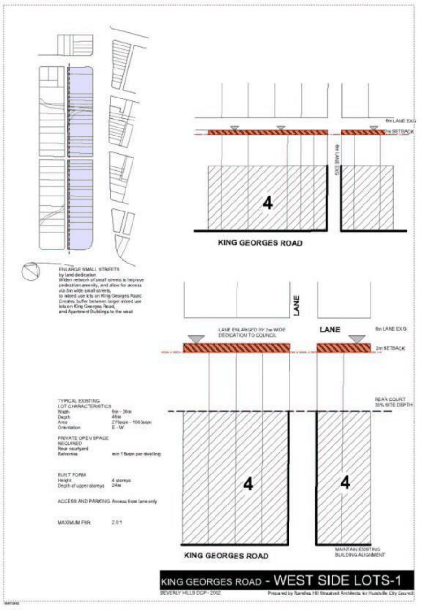
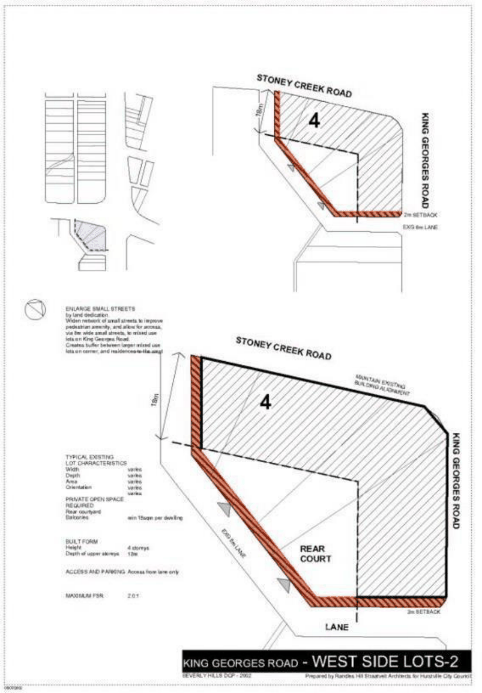
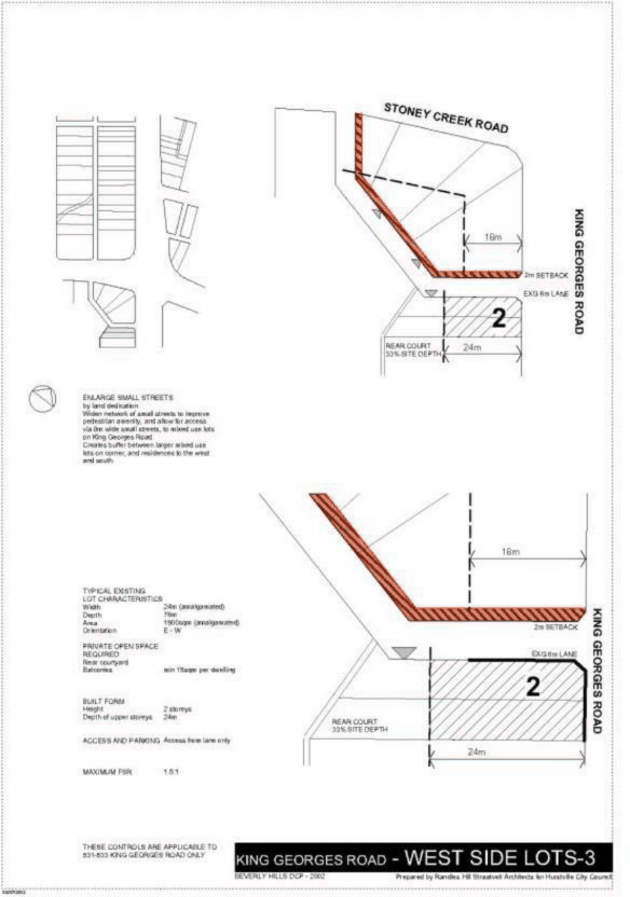
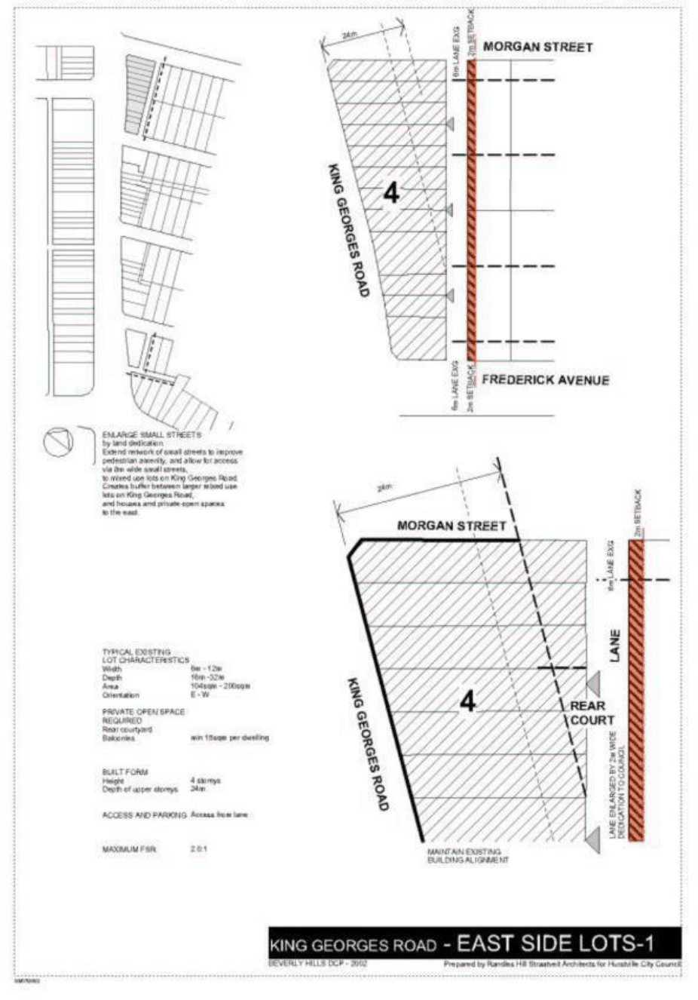
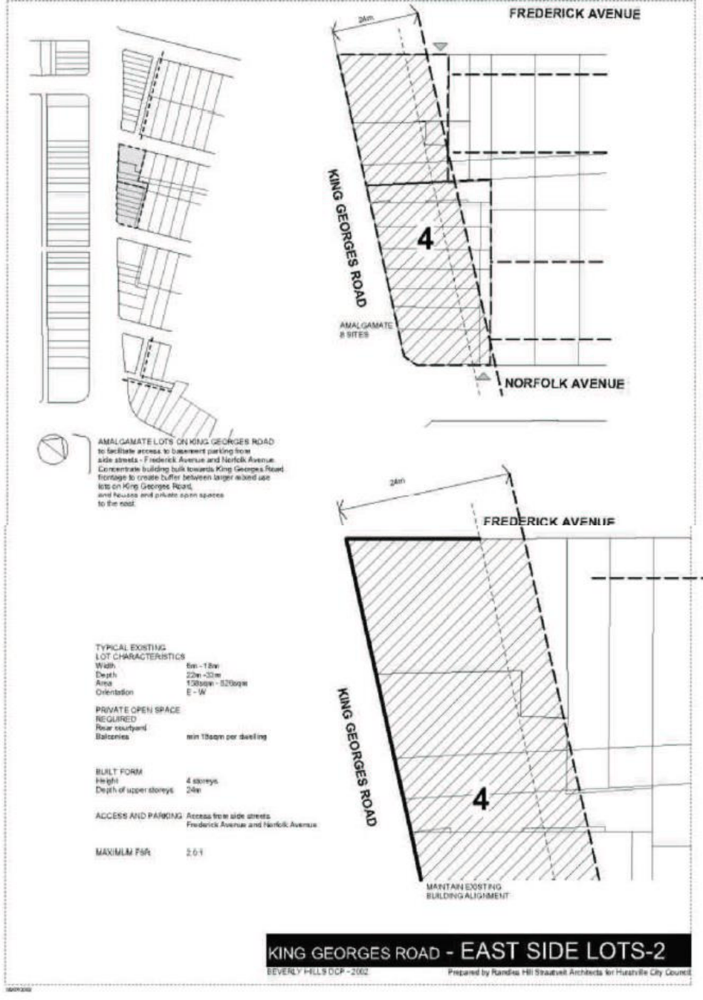
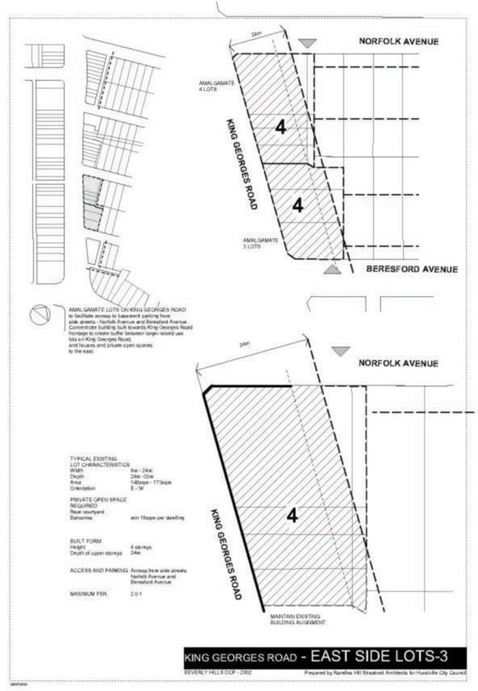
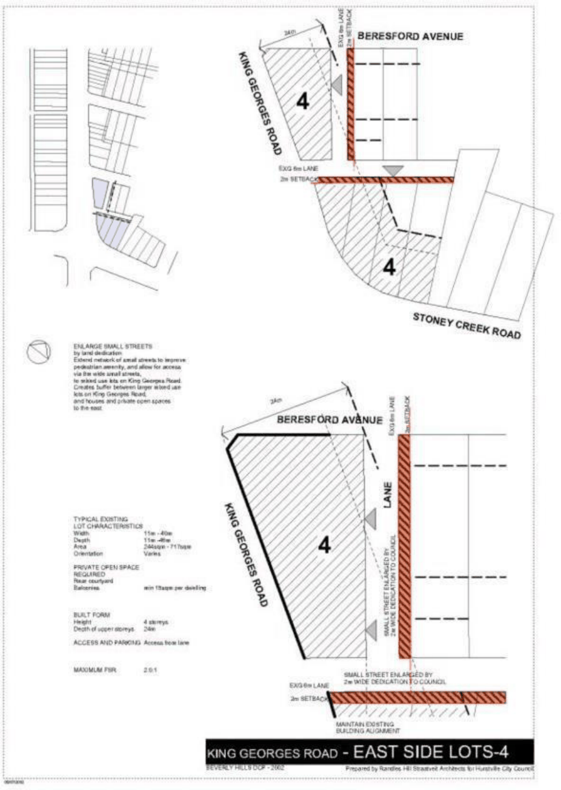
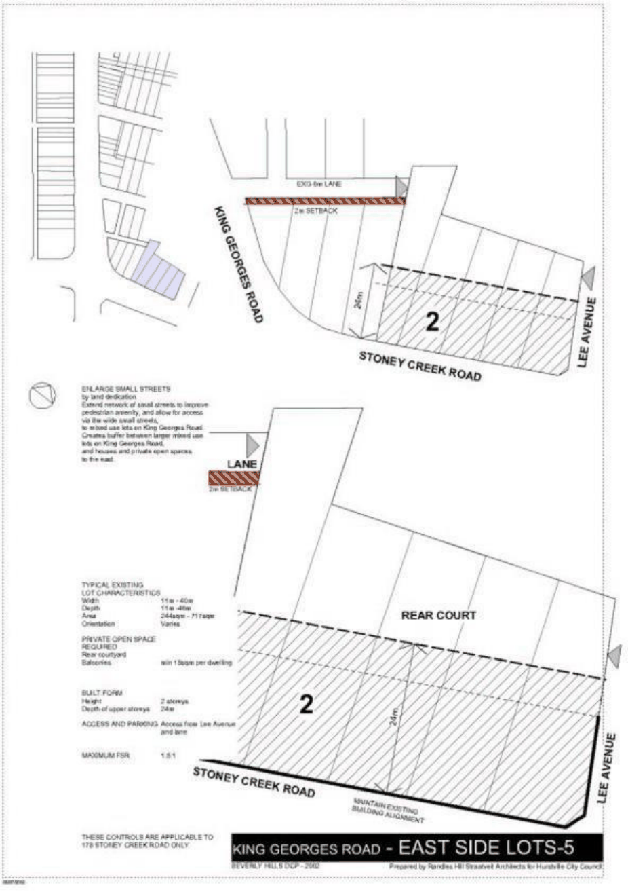

### Part 7.2 Character Statements for Local Centres

#### 7.2.1 Beverly Hills Local Centre (King Georges Road)

> [Picture on page 23: a picture, saved as a picture (images/part-07-business-precincts-page-23-4.gif, 150 dpi).]

Figure 1: Location Map

#### Character Statement

Beverly Hills is a well-known entertainment precinct with a high proportion of restaurants and cafes, and is noted for its cinema. This local centre draws on a wide catchment of patrons across southern Sydney and beyond. King Georges Road is the major north south road defining areas east and west, with the Beverly Hills Centre comprising a commercial/retail strip along this road.

The provisions in the DCP for future development along King Georges Road:

• Ensures commercial and retail uses are located at ground level and housing above.

• Requires car parking for new development to be provided underground.

• Limits development in the core commercial area to a maximum of four storeys, with specific sites adjoining residential development restricted to two storeys.

• Facilitates a high amenity for workers and residents in new development through excellent design, solar access, and a consistent street scale.

#### Desired Future Character

A Master Plan for Beverly Hills Town Centre is being developed to facilitate urban renewal and revitalisation of the centre and surrounding residential area (June 2020). The following controls are taken from Hurstville DCP No.1 (repealed) and will be updated when the Masterplan is endorsed by Council.

#### Objectives/Future Desired Character

a) Beverly Hills should develop as a high quality commercial and retail centre catering for the needs of the local community and visitors.

b) Create a memorable identity for King Georges Road, as the focus of Beverly Hills, and enhance its atmosphere and commercial viability as a local service centre by:

i. Fostering an improved mix of uses

ii. Retaining the important role of public transport

iii. Enhancing pedestrian amenity

c) Strengthen the quality of Beverly Hills’ public open space systems, including public open space in the Centre and parks along drainage lines by:

i. Encouraging buildings to overlook parks to improve safety

ii. Orientating commercial uses to public plazas and spaces

d) Protect and enhance the landscape quality of Beverly Hills in both the public and private domain.

e) Ensuring a high standard of architectural, environmental and landscape quality by promoting high quality architectural design throughout Beverly Hills:

i. Encouraging buildings that optimise sun access to streets and parks

ii. Protecting the amenity of existing residential areas and parks

iii. Creating private internal and external environments that achieve a high level of amenity for occupants and neighbours

f) Ensure that new development is compatible with the existing built form and streetscape by:

Providing direction and certainty of outcome to ensure:

i. A consistent street scale

ii. Compatibility with existing built form

iii. A variety of building types

iv. A high level of environmental amenity

g) Integrate principles of environmental sustainability in the design of both the public and private domain of Beverly Hills by:

i. Ensuring that the new dwellings receive adequate sun and ventilation

ii. Requiring the use of materials that maximise energy efficiency

iii. Providing backyards for new residential development to maintain green space corridors throughout the suburb.

#### Overall Design Principles

1\. General

• Provide for commercial and residential development of an appropriate scale and mass.

• Assume optimum lot amalgamation to ensure flexible uses i.e. retail/ commercial/ residential.

• Extend existing public spaces through access and urban design strategies.

• Establish building depth controls to ensure high quality building and external spaces.

• Establish new rear lane widening and easements to improve public amenity and access.

• Emphasise particular characteristics of the different parts of the Centre.

• Integrate new parking strategies with incremental and large-scale developments.

• Improve amenity for users of new and refurbished buildings by requiring a lift in buildings exceeding 2 storeys.

2\. Pedestrian and Traffic Amenity

• Improve lane system to provide an alternative pedestrian network to footpaths along King Georges Road and improve traffic flows. Restaurants and retail along King Georges Road to be encouraged to open to both the front and back of a site.

3\. Public Space

• Create small parks and squares where possible to enhance amenity for patrons of restaurants and cafes, and shoppers.

• Create a system of public spaces linking the railway station to a square on King Georges Road in the vicinity of the Sydney Water drain, via improvements to the lane between Morgan Street and Frederick Avenue.

4\. Landscape and Public Spaces

a) Landscape Quality

• Spacing and siting of residential buildings creates a landscape corridor, which ensures significant trees are retained and the drainage system is rationalised.

• Retain and supplement significant trees on private land, particularly on major ridgelines and drainage lines.

b) Public Landscape Amenity

• Increase recreation opportunities by providing a diverse range of landscape types in public spaces, from urban squares in the main street to passive ‘natural’ spaces and active open spaces in parks.

• Improve connections to public spaces.

c) Drainage Systems

• Integrate stormwater detention systems for new developments into consolidated landscape areas.

• Investigate the potential of upgrading the main drainage line where it passes through private land.

#### Development Requirements

The development requirements for this Section are provided below.

Controls

1\. New development takes the form of one of the options illustrated in the Development Control Drawings – refer to Figures 2 to 10.

2\. Maximum street frontage for individual commercial sites along King Georges Road is 25m.

3\. All ground floor levels in buildings are to incorporate retail and/or commercial uses to activate the street.

4\. Access to residential uses above ground floor is permitted on street level but must not occupy more than 20% of the frontage.

5\. The maximum retail frontage for individual tenancies is 25 metres.

Height

6\. Maximum Height of buildings is contained within Clause 4.3 and the associated Height of Buildings Map of the Georges River LEP 2021.

7\. Building Heights and Indicative Storeys in Appendix 6 of this DCP identifies the maximum number of storeys for development.

8\. Commercial storeys are set at a maximum 3.3m floor to ceiling.

9\. Residential storeys are set at a maximum 3m and a minimum 2.7m floor to ceiling.

Arcades

10\. Arcades should be located in mid-block locations and provide a clear sightline from one end to the other, for surveillance and accessibility.

11\. Arcades are to have a minimum width of 3m, clear of any obstruction, except for connections through shops.

12\. Retail frontages are to be maximised along arcades.

13\. Natural lighting and ventilation of arcades is highly desirable.

14\. Pedestrian safety and the security of adjacent businesses, particularly at night, should be considered in the design of through block connections.

15\. Public use of through block connections is to be available at least between the hours of 6.00am and 10pm daily.

16\. Arcades must have a minimum floor to ceiling height of 4m.

Shopfront

17\. Shop fronts must be glazed.

18\. Solid roller shutter doors of any kind are not permitted on shop fronts.

Landscaping and open space

19\. Lower level rooftop areas and courtyards in the centre of blocks are to be landscaped.

20\. A minimum of 600 mm of soil is to be provided above basement structures for landscaping.

21\. Courtyards should be integrated into the design of a building to allow solar access and ventilation, particularly for residential uses.

22\. Where direct access to ground level private open space is not available, provide at least one balcony, terrace, verandah, or deck for each dwelling.

23\. The primary above ground open space area should be accessible from a family room, lounge, dining room or kitchen, and be predominantly north, east or west facing, to ensure it is useable as an outdoor living space.

24\. Smaller secondary above ground open space area are also encouraged, such as balconies adjacent bedrooms, screened external clothes drying balconies adjacent laundries and bathrooms.

25\. Above ground open space should overlook the street or rear garden to protect the privacy of occupants and neighbours.

26\. Street footpaths are to be finished in accordance with Council’s requirements.

Vehicular access and parking

27\. King Georges Road can not to be used to provide vehicular access to a site.

28\. Car parking and loading dock provision is to comply with Section 3.13 - Parking Access and Transport of this DCP.

29\. Vehicular access is to be from existing crossings or from rear lanes/streets.

30\. Where provided, garage doors are to be recessed a minimum 300mm into the façade of the building.

31\. Driveways are to have a minimum width of 3m.

32\. Concentrate underground parking areas under building footprints.

33\. Locate access ways to underground car parking away from doors or windows to habitable rooms wherever possible.

34\. Maximise natural light and ventilation to parking areas where possible.

35\. Opportunities for natural ventilation to such car parking should be maximized.

36\. All underground car parks are to have security doors.

37\. Garage doors to car parking facilities are to be slatted (grill) or incorporate some form of opening, to facilitate natural ventilation and reduce the visual impact of garage doors.

38\. Streets should not be presented with car park walls. Parking areas should be unobtrusive.

39\. Parking must be located underground but in some situations due to the topography, the walls enclosing the parking may be partially visible. The length and height of the wall must not exceed 1 metre.

40\. Natural or mechanical ventilation from the car park cannot be achieved through the use of large metal grilles or large openings.

41\. Any visible roofs of parking areas are to be landscaped in order to provide for an outdoor space, as well as to create a pleasant view from the windows above.

42\. Driveways to underground car parks should be designed with minimal visual impact on the street, and maximum pedestrian safety.

43\. Pedestrian access to basement car parks is to be separated from vehicular access and clearly defined.

44\. Access ways to underground car parking should not be located close to doors or windows of habitable rooms.

45\. All major developments are to have a loading dock for the delivery of goods.

46\. The loading dock is to be located so that the service vehicle stands fully within the site.

47\. Doors to loading docks are to be recessed 300 mm behind the face of the wall.

Controls for Particular Areas and Sites

48\. Development for land in any of the below locations complies with Figures 2 to 10 – Control Drawings:

• King Georges Road West Side – (excluding 531-533 King Georges Road)

• King Georges Road East Side

• King Georges Road North Side (north of the railway line)

• 178 Stoney Creek Road

• 531-533 King Georges Road

> [Picture on page 29: a picture, saved as a picture (images/part-07-business-precincts-page-29-1.gif, 150 dpi).]

Figure 2: Control drawing 1 Note: Diagram controls apply to E1 zone only. For residential controls refer to Part 6

– Residential Controls of this DCP.

> [Picture on page 30: a picture, saved as a picture (images/part-07-business-precincts-page-30-1.gif, 150 dpi).]

Figure 3: Control drawing 2

> [Picture on page 31: a picture, saved as a picture (images/part-07-business-precincts-page-31-1.gif, 150 dpi).]

Figure 4: Control drawing 3

> [Picture on page 32: a picture, saved as a picture (images/part-07-business-precincts-page-32-1.gif, 150 dpi).]

Figure 5: Control drawing 4

> [Picture on page 33: a picture, saved as a picture (images/part-07-business-precincts-page-33-1.gif, 150 dpi).]

Figure 6: Control drawing 5

> [Picture on page 34: a picture, saved as a picture (images/part-07-business-precincts-page-34-1.gif, 150 dpi).]

Figure 6: Control drawing 5

Figure 7: Control drawing 6

> [Picture on page 35: a picture, saved as a picture (images/part-07-business-precincts-page-35-1.gif, 150 dpi).]

Figure 8: Control drawing 7

> [Picture on page 36: a picture, saved as a picture (images/part-07-business-precincts-page-36-1.gif, 150 dpi).]

Figure 9: Control drawing 8

> [Picture on page 37: a picture, saved as a picture (images/part-07-business-precincts-page-37-1.gif, 150 dpi).]

Figure 10: Control drawing 9
