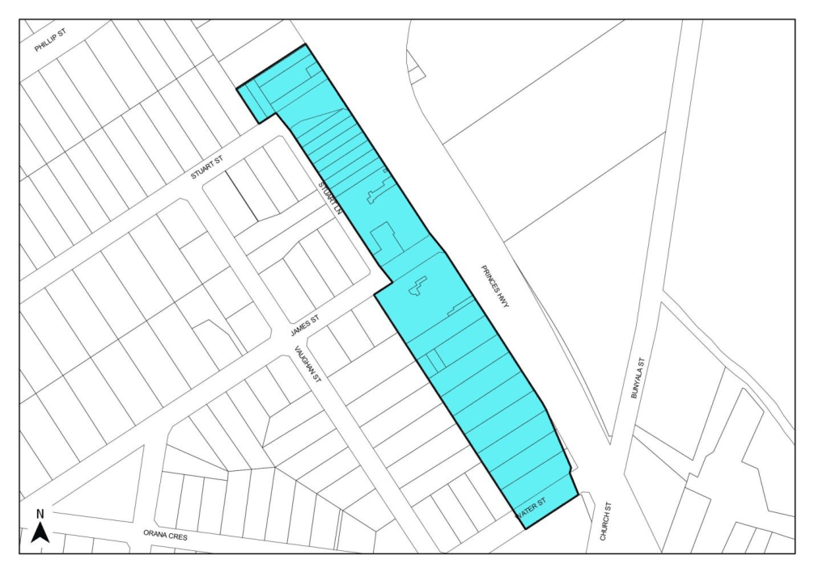
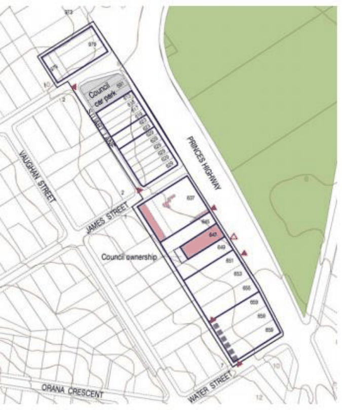

#### 7.2.2 Blakehurst Local Centre (King Georges Road and Princes Highway)

> [Picture on page 38: a picture, saved as a picture (images/part-07-business-precincts-page-38-3.gif, 150 dpi).]

Figure 11: Location Map

#### Existing Character

Blakehurst Centre is a shopping strip area along the Princes Highway at the major intersection with King Georges Road (Refer Figure 11). The centre is situated on the western side of the Princes Highway, opposite Todd Park and is dominated by fast moving traffic on a wide regional road. The mix of uses within the centre includes small service-type commercial uses together with specialist retail. There is a lack of food or supermarket outlets that might serve the local community.

Some residential accommodation is provided above ground level commercial. The built form is mixed in scale, form and presentation to the street and generally the centre lacks coherence and a sense of identity. The older shops are characteristic of a traditional retail strip. Setbacks and building heights vary, however recent mixed-use development introduces a six storey scale while maintaining the predominantly three storey street wall height.

The locality is difficult to access by traffic travelling south. Parking for some of the businesses is accessed from James Street, while a rear laneway between Stuart Street and James Street provides rear access to those properties. Apart from corner premises, the remaining

properties between James Street and Water Street have vehicular access from the Princes Highway.

Council previously considered creating rear lane access from the rear of No. 637 Princes Highway, to create rear lane access for the properties fronting Princes Highway, between James Street and Water Street. Part of this laneway has been created and is in the ownership of Georges River Council.

#### Desired Future Character

Blakehurst Centre’s position on the Princes Highway creates opportunities for commercial uses to benefit from the high visibility of their location. The locality will retain a mix of retail, service and commercial uses serving the local and wider community, with all new development of a high design standard to reflect the Highway presence.

Residential development should be set well back from the Princes Highway and acoustically treated to ensure that future residents enjoy a high level of amenity. In this locality, it would be more appropriate that the upper levels of buildings support commercial functions, and as such buildings should be designed to encourage this outcome.

Building design also needs to be responsive to the residential development behind, particularly between James Street and Water Street, where there is no rear lane access.

New development should retain a three-storey street wall height to the Princes Highway, with upper storeys setback from the Princes Highway. The development needs to step back along the rear of sites, particularly between James Street and Water Street to provide a transition to residential developments at the rear.

Where new development turns the corner from the Princes Highway into side streets it should also be designed to make an appropriate transition in scale and massing to the adjoining residential areas. Vehicular access to sites should be from Stuart Street, via Stuart Lane (where the rear lane already exists). For 655-659 Princes Highway, the determined DA includes a condition to require a service lane - easement or right of way on title so future development can use the service lane at the rear for service vehicles and general vehicular access only. For the sites Nos. 645-649 Princes Highway, vehicular access from the Princes Highway may be the only acceptable solution, subject to approval from the Transport for NSW.

#### Objectives

a) Encourage economically viable redevelopment in accordance with the requirements of Georges River LEP 2021.

b) Encourage the continuation of active frontages to the street by promoting retail/ commercial/ service uses at ground floor.

c) Incorporate flexible building design to encourage commercial development on upper levels.

d) Encourage new development of a high design standard that is appropriate in scale and mass to its location along the Princes Highway.

e) Where development wraps around the corner to side streets, ensure that the design addresses the street frontage and provides a transition to the adjoining residential development.

f) Encourage access to parking areas from side streets and rights of ways to the rear of developments.

g) Encourage development to provide basement parking on large amalgamated sites.

h) Discourage the creation of rear lane access between Water Street and James Street.

#### Controls

Amalgamation

1\. All sites are required to be amalgamated as shown in Figure 12:

> [Picture on page 40: a picture, saved as a picture (images/part-07-business-precincts-page-40-13.gif, 150 dpi).]

Figure 12: Site Amalgamation requirements

Vehicular Access

2\. Vehicular Access to properties fronting Princes Highway between Stuart Street and James St should be obtained from Stuart Lane.

3\. Vehicular Access to No. 659 Princes Highway is to be obtained from Water Street.

4\. Vehicular Access to Nos. 645-655 Princes Highway is to be obtained from the Princes Highway upon re-development of the site, subject to approval from the RMS/TfNSW.

5\. Any redevelopment of No. 659 Princes Highway should have a right of way covenant imposed to allow access from Water Street for any redevelopment of No 651-655 Princes Highway.
