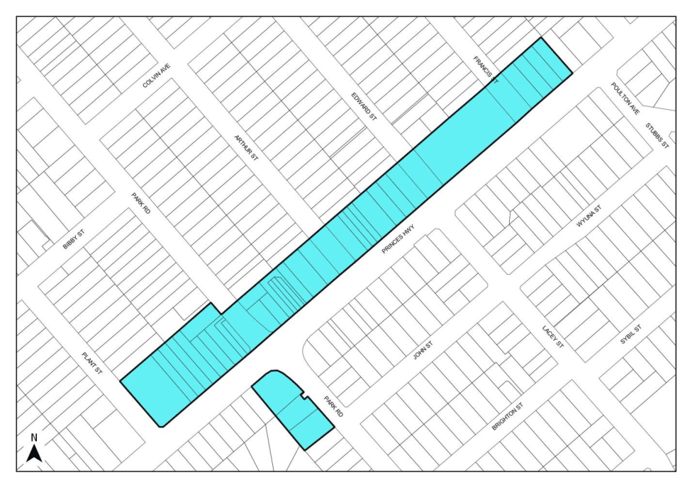
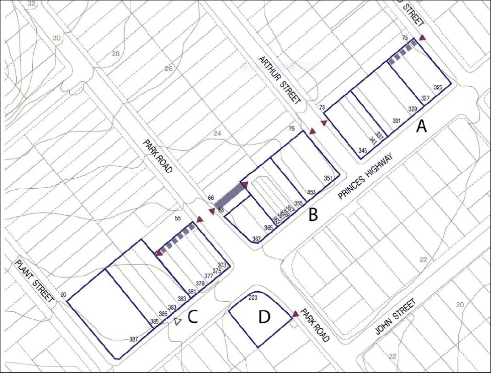
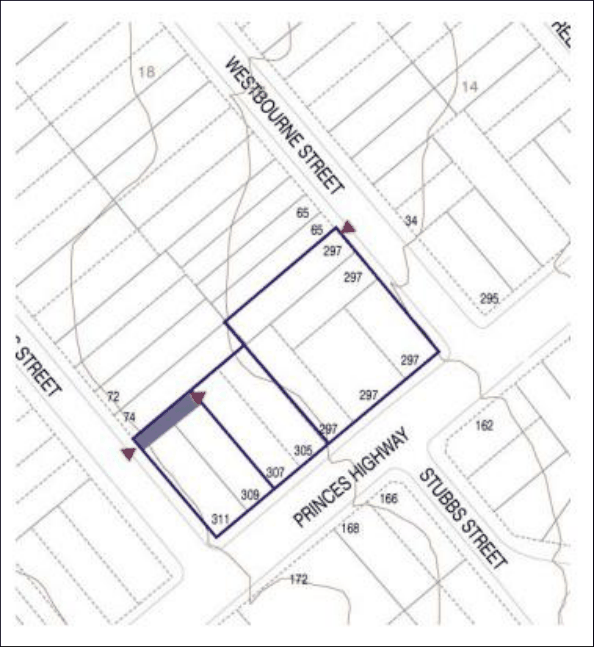

#### 7.2.3 Carlton and Kogarah Bay Local Centre (Princes Highway)

> [Picture on page 42: a picture, saved as a picture (images/part-07-business-precincts-page-42-2.gif, 150 dpi).]

Figure 13: Carlton Commercial Centre

#### Existing Character

Carlton Centre (refer to Figure 13) on Princes Highway is a shopping strip located on the north western side of the Princes Highway at the intersection of Park Road. The centre has high visual exposure due to its location on the Princes Highway and because the signalised intersection slows vehicular traffic.

Generally, the centre includes a mix of retailing, professional offices, service facilities, fast food/take away restaurant outlets and commercial uses, which generally serve the needs of the local and wider community. The centre contains a range of built forms and architectural styles reflecting the diversity of uses and the development of the centre over time. Building heights in this locality are generally one/two storeys, with some buildings having an overall height equivalent to a three-storey building, due to the higher floor to ceiling heights and parapet.

The centre includes a two storey building on the southern side of Park Road, which contains a mix of retail/service type uses. Parking for this development is situated to the rear of the development, in a car park owned by Council. This is accessed from Park Road.

Much of the development in the centre has made provision for off-street parking with a considerable number of businesses able to obtain access to that parking from a road other than Princes Highway.

#### Desired Future Character

The centre is expected to continue to provide a mix of retail, service and commercial outlets serving the local and wider community, with all new development of a high design standard to reflect the Highway presence. New developments will be characterised by retaining a two-storey street wall height to the Princes Highway. Building heights in the centre should provide a transition to the existing low-density residential area at the rear.

#### Objectives

a) Provide high quality retail, commercial and residential development to serve the needs of the community.

b) Encourage the continuation of active frontages to the street by promoting retail/commercial/service uses at ground floor.

c) Improve the public domain through street planting, furniture and paving upgrades.

d) Ensure development is of a scale and design that retains the amenity of neighbouring residents.

#### Controls

Site Amalgamation

1\. All sites are required to be amalgamated as shown below in Figures 14 and 15.

> [Picture on page 44: a picture, saved as a picture (images/part-07-business-precincts-page-44-1.gif, 150 dpi).]

Figure 14: Amalgamation Requirements

> [Picture on page 45: a picture, saved as a picture (images/part-07-business-precincts-page-45-1.gif, 150 dpi).]

Figure 15: Amalgamation Requirements

Parking and Vehicular Access

2\. Vehicle access should be obtained from side streets and rear laneways.

3\. Off-street parking to be provided for any new development underground or at the rear of the properties.

4\. No part of the basement is to be elevated above ground level fronting Princes Highway.

5\. Where a basement is provided this is not to protrude more than 1.0m above natural ground level.

6\. Rear lane access is encouraged from secondary streets and is not required where entire block or half block is amalgamated and where no site is isolated/without vehicular access from secondary street.

7\. Any redevelopment of No. 297 Princes Highway must provide vehicular access from Westbourne Street.

8\. Vehicular access to No. 305-311 Princes Highway must be provided from Francis Street, via a minimum 6.0m right-of-way to be created with the redevelopment of these lots.

9\. Access to the existing right of way behind No. 305-311 must be retained in any future development. Council will condition any redevelopment of No. 309-311 to ensure that the right of way is maintained at no cost to Council. This will also be applicable to No. 307 where this site is not amalgamated with No. 305 Princes Highway.

10\. Vehicular access to Nos. 329-331 Princes Highway is to be from Edward Street via a right-of-way to be created with the redevelopment of Nos. 325-327 Princes Highway.

11\. Vehicular access to Nos. 337-345 Princes Highway is to be from Arthur Street. If all of the sites are not amalgamated in accordance with Council’s requirements, then Council will require a 6m dedication to the rear of the properties, upon re-development to provide vehicular access to the rear of all the sites.

12\. Vehicular access to Nos. 355-363 Princes Highway is to be No. 68 Park Road (the existing Council owned laneway).

13\. Where Nos. 355-363 Princes Highway are not amalgamated in accordance with Council’s requirements, then Council will require a 6m dedication to the rear of the properties, upon redevelopment to provide vehicular access to the rear of all the sites.

14\. Any re-development of No. 373 Princes Highway is to maintain vehicular access from Park Road.

15\. Council may consider consolidated access via one (1) entry point to Nos. 383-387 Princes Highway, upon re-development of the site, subject to approval from the TfNSW.

Pedestrian Entry

16\. From Princes Highway and side streets (where appropriate).
