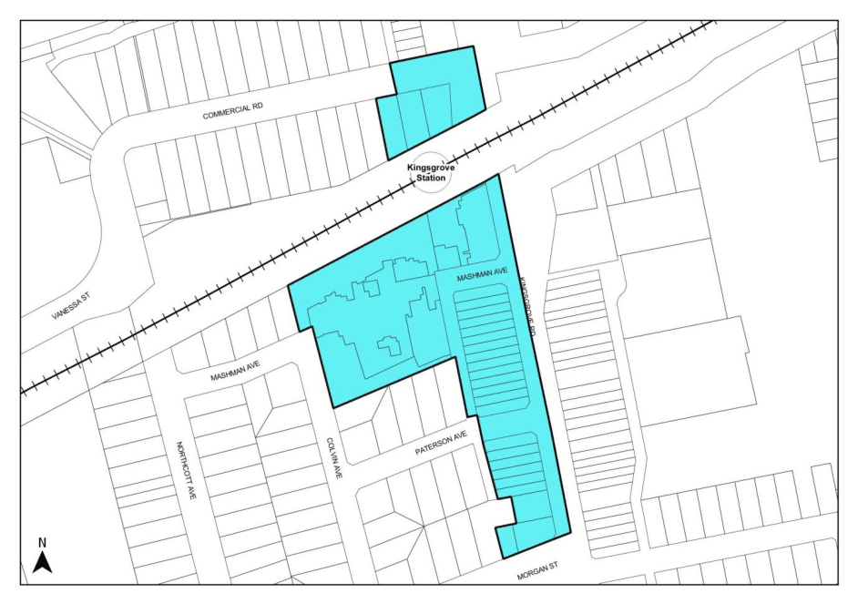

#### 7.2.4 Kingsgrove Local Centre (Kingsgrove Road)

> [Picture on page 47: a picture, saved as a picture (images/part-07-business-precincts-page-47-2.gif, 150 dpi).]

Figure 16: Location Map

#### Existing Character

Kingsgrove Road is the focus of the Centre which forms the boundary with Bayside Council, with the western side of the road being within Georges River LGA (Refer Figure 16). The Kingsgrove Road is generally characterised by a double storey retail/commercial development with a four story mixed use development beyond Mashman Avenue. The local centre is well served by public transport with Kingsgrove Railway Station and major bus routes and provides a broad range of retail and commercial services. The local centre is anchored by Woolworths located within the Pottery site, and supplemented by a broad range of retail and commercial services. There is significant residential within the precinct, mostly attributable to shop top housing within the Pottery development. In line with a number of other centres, car parking is an important issue impacting the development of additional retail.

The allotments to the north of the railway station (1-5 Commercial Road) are in a single consolidated ownership and consist of a 3 to 4 storey office development  with no retail shopfronts These allotments are consistent with the subdivision pattern of its locality at Commercial Road adjoining the industrial area. The allotments on the southern side of the railway station are primarily in separate ownership. With the exception of the Pottery Site, the southern portion of the Centre features a fine grain quality, consisting of one and two storey older building stock attributed to the narrow subdivision pattern. These sites are serviced by a laneway to the rear and are physically separated from adjacent residential dwellings.

#### Desired Future Character

The Kingsgrove Local Centre is expected to maintain its viability and become an attractive centre through improvements to the public domain and the public/private interface. New development needs to be integrated with characteristic elements of the local shops as sites are consolidated and redeveloped.

The pedestrian environment will be attractive with awnings, active uses, street tree planting and furniture and paving upgrades. Mixed use development (which includes residential) will provide passive surveillance, resident interaction and address the street. Site consolidation and redevelopment will provide through-site pedestrian links or arcades that provide rear access to laneways and public car parking areas.

#### Objectives

a) Encourage high quality architectural design.

b) Improve the public domain through street planting, furniture and paving upgrades.

c) Provide high quality retail, commercial and residential development to serve the needs of the surrounding local community.

d) Ensure development is of a scale and design to maintain the amenity of neighbouring residents.

e) Ensure any future development provides active ground floor uses.

f) Provide open space and pedestrian links through redevelopment of sites.

#### Controls

Amalgamation

1\. Consolidation and redevelopment of sites along Kingsgrove Road is encouraged. Such development will need to address the elevation to Mashman Lane as well as Kingsgrove Road.

Pottery Site

2\. The Pottery development is to continue to provide pedestrian and cycle access connecting the eastern and western sides of Mashman Avenue.

3\. The large area of open space in the centre of the Pottery development is to be retained as it provides a visual link between both sides of Mashman Avenue.

4\. Any development within the Pottery Site is to comply with the Conservation Management Plan Fred A Mashman Pty Ltd St George Pottery 11 Mashman Avenue Kingsgrove dated February 2005.

Parking and Vehicular Access

5\. Parking for the new development is to be accommodated underground.

6\. Vehicle access for any redevelopment of a site fronting Kingsgrove Road from Morgan Street to Mashman Avenue is to be from Mashman Lane.

7\. Redevelopment of No. 2 Patterson Avenue Kingsgrove (Lot 56/DP19078) is to include a 2.5m land strip to be dedicated to Council.

Through site links

8\. Public through-site pedestrian accessways are to be provided connecting Kingsgrove Road to Mashman Lane.

9\. The public through-site pedestrian accessway is to be a minimum of 8m wide.

10\. All pedestrian links are to have appropriate levels of illumination. Separate and clearly distinguish between pedestrian accessways and vehicle accessways.

11\. Pedestrian accessways are to have a minimum two storey height where they pass beneath a building.

12\. Council may consider the relaxation of the above controls depending on the quality of public area provided and the merits of the particular application.
