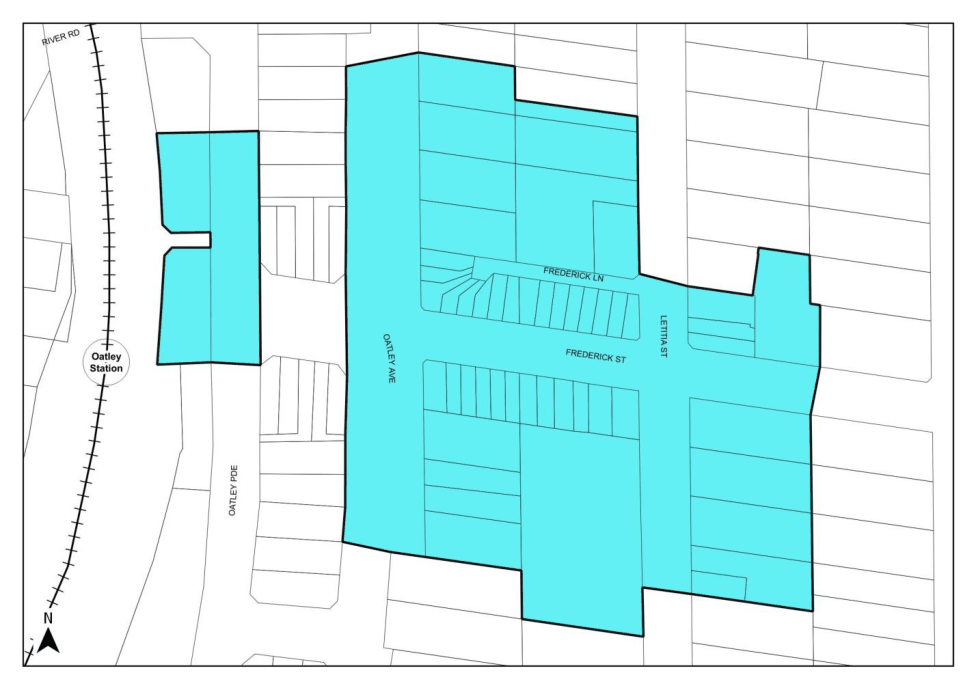
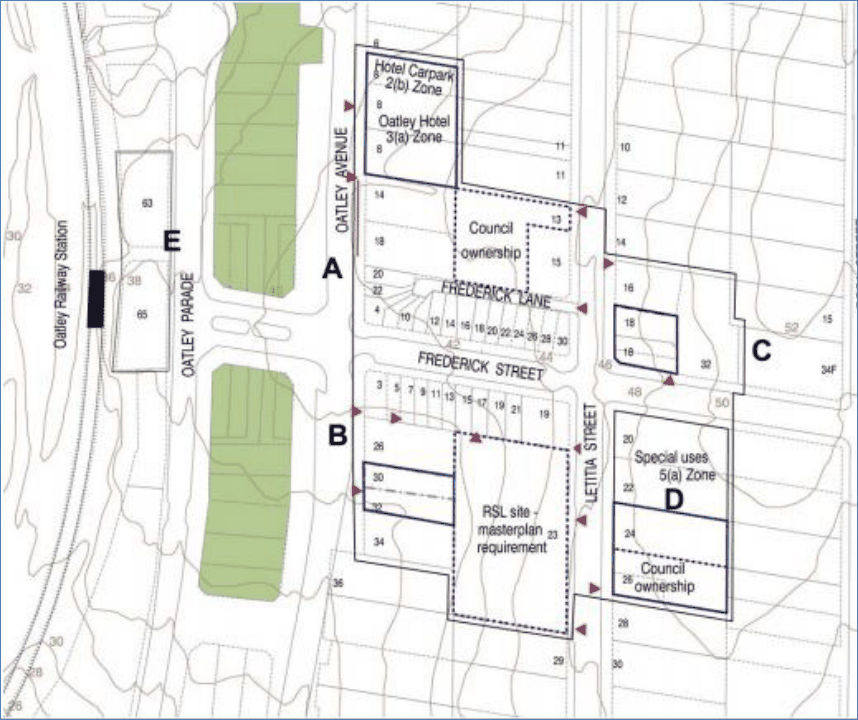

#### 7.2.5 Oatley Local Centre (Frederick St)

> [Picture on page 50: a picture, saved as a picture (images/part-07-business-precincts-page-50-2.gif, 150 dpi).]

Figure 17: Oatley Local Centre

#### Existing Character

Oatley centre retains an attractive village character due to the scale of development and the use of materials within it. The traditional ‘main street’ of the Oatley Commercial Centre is located on Frederick Street, which terminates at the railway station (see Figure 17).

The Oatley Commercial Centre accommodates a range of retail and commercial activities, which serve the needs of the local community. Service and community-related uses include banks, a Post Office and Oatley RSL Club.

There are also some commercial/retail uses situated on the periphery of the Oatley commercial centre, adjacent to Oatley Railway Station. These sites are known as No. 63 and No. 65 Railway Lands and current uses include a service station and a small group of shops.

The existing height and scale of development within the Oatley Commercial Centre is two (2) storeys. The development has high floor to ceiling heights and parapets, with active uses at ground floor and commercial above. Some residential development above the ground floor contributes to the diversity and liveliness of the locality.

The sloping topography has resulted in older buildings typically stepping down the slope, breaking up their massing on the streetscape. The traditional built form has resulted in a

strongly defined street edge along Frederick Street, with active frontages to the retail, breaking down in more recent developments to set back or internal courts edged by shops. Newer development in the centre does not respond as effectively to the changes in topography, which has resulted in buildings designed with entries ramped/stepped above the kerb line.

Vehicular access to the commercial development on the northern side of Frederick Street is provided to the rear, via Frederick Lane. Much of the parking within the centre is on-street, however there is also a Council car park situated on the northern side of Frederick Lane, with access from Letitia Street.

Development adjoining the centre is predominantly older style three-storey residential flat buildings.

#### Desired Future Character

The consistent low-scale built form and consistent use of materials that gives Oatley its village character; needs to be retained.

Given the location of the centre adjacent to a railway station together with the range of uses and facilities; encourages additional residential uses within the Oatley Centre. The locality has a mix of retail/commercial uses with residential development above ground floor.

On Frederick Street, buildings need to respond to the fall in topography and upper levels should provide a consistent frontage. Development along Frederick Street should incorporate awnings to provide a consistent streetscape and provide weather protection for users of the centre.

New development adjacent to the railway line needs to be constructed to a height and scale that is consistent with the rest of the Centre. In this regard, new development on land adjacent to the railway line needs to retain a two-storey street wall and incorporate materials and finishes consistent with the main shopping street. Where possible; vehicular access and off-street parking needs to be located to the rear of sites and/or at basement level.

#### Objectives

a) Retain the main street village character of the Oatley commercial centre through appropriate design and built form.

b) Provide consistency in design and materials to ensure that future development in the Centre maintains the village character.

c) Encourage the continuation of active frontages to the street by promoting retail/ commercial uses at ground floor.

d) Ensure that any re-development on sites adjacent to the railway station are consistent in scale with the remainder of the Oatley Commercial Centre.

e) Encourage residential development in the commercial centre core on upper levels to provide additional housing opportunities in the centre, close to the railway line.

f) Provide additional opportunities in the Centre for off-street parking to supplement existing parking.

#### Controls

Amalgamation

1\. All sites are required to be amalgamated as shown below in Figure 18.

> [Picture on page 52: a picture, saved as a picture (images/part-07-business-precincts-page-52-8.gif, 150 dpi).]

Figure 18: Amalgamation Plan

Vehicular Access

2\. Vehicle access is to be obtained from side streets and Frederick Lane and from consolidated entries on Oatley Avenue where no other opportunities exist.

3\. Vehicle access is not permitted on Frederick Street.
