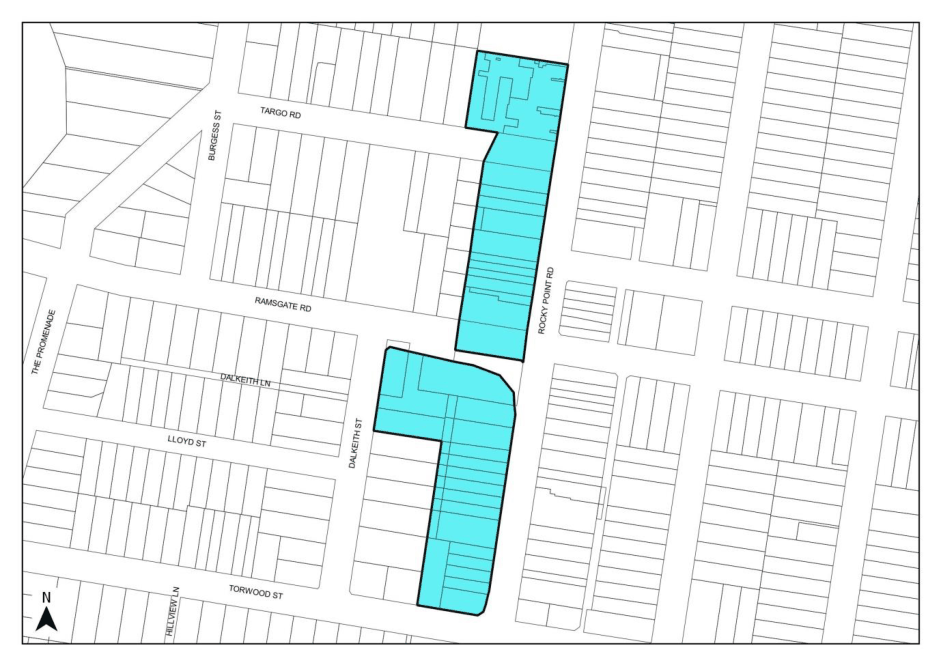
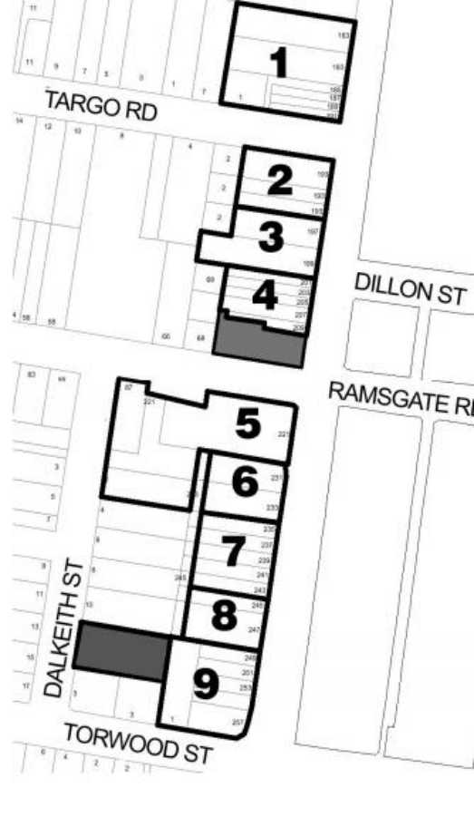
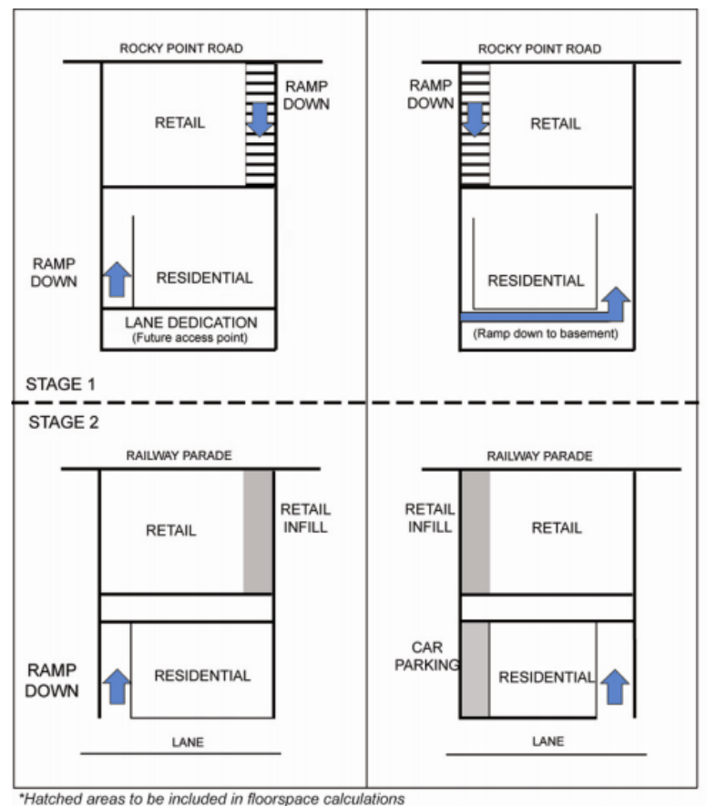

#### 7.2.6 Ramsgate Centre Local Centre (Rocky Point Road)

> [Picture on page 53: a picture, saved as a picture (images/part-07-business-precincts-page-53-2.gif, 150 dpi).]

Figure 19: Ramsgate Centre

#### Existing Character

Ramsgate centre is located along Rocky Point Road and is split between Georges River and Bayside Councils (Figure 19). The centre benefits from excellent exposure due to its frontage to Rocky Point Road and is served by bus services. A broad range of retail and commercial services are provided within the centre including the Intersection Tavern at the corner of Ramsgate and Rocky Point Roads. Recent mixed use developments, for example at the corner of Targo and Rocky Point Roads have created a significant portion of residential floor space in the form of a six storey development with retail/ commercial at the ground and residential use at the upper levels. On-site car parking is provided at the rear of the premises through an informal access easement. Car parking is an important issue impacting the development of additional retail. Medium and low density residential uses adjoin the Centre.

The allotments within the centre are in multiple ownership. The block between Ramsgate Road and Torwood Street has the Ramsgate car park laneway; separating the commercial zone from the residential use at the rear and providing access to the Ramsgate car park.

#### Desired Future Character

The Ramsgate Centre will maintain its viability and become an attractive centre through improvements to the public domain and the public/private interface. New development needs

to be integrated with characteristic elements of the local shops as sites are consolidated and redeveloped. New development will be integrated with the surrounding environment by considering pedestrian, bicycle, vehicle and visual links to the street and open space networks and provide adequate parking, drainage, services and facilities.

Reinforce the strong linear element of Rocky Point Road by generally encouraging a 4 storey street wall to define the street line. The pedestrian environment will be attractive with awnings, active uses, street tree planting, furniture and paving upgrades and minimisation of overhead wires on significant streets. Mixed use development (which includes residential) will provide passive surveillance and active street frontages that address the street. Site consolidation and redevelopment will provide through-site pedestrian links or arcades that connect Rocky Point Road to the rear streets and public car parking areas. These laneways are wide enough to accommodate a small number of coffee tables, as a pedestrian/shopping refuge from the noise of Rocky Point Road. Buildings will be orientated and sited to maximise northern sunlight to internal living and working areas and take advantage of potential views from the centre.

#### Objectives

a) Promote high architectural quality in buildings.

b) Improve the public domain through street planting, furniture and paving upgrades.

c) Provide high quality retail, commercial and residential development to serve the needs of the surrounding local community.

d) Ensure that the development is of a scale and design that protects the amenity of neighbouring residential areas.

e) Ensure any future development provides active ground floor uses.

f) Provide open space and pedestrian links through redevelopment of sites.

g) Encourage site amalgamations for facilitating appropriate development.

h) Enhance opportunities for pedestrians and cyclists to move safely within the public domain.

#### Controls

Amalgamation

1\. Consolidation and redevelopment of sites along Rocky Point Road is encouraged (Refer Figure 20). The heritage items within the Centre need to be considered as an integral part of any future proposed development. Refer to Section 7.1.9 of this DCP in relation to Site Isolation and Amalgamation requirements.

> [Picture on page 55: a picture, saved as a picture (images/part-07-business-precincts-page-55-1.gif, 150 dpi).]

Figure 20: Site Amalgamation Requirements

Temporary Access ways

2\. A key feature of ensuring the success of the centre is the creation of laneways to provide service access to the rear of the Rocky Point Road frontage. Because of the multiple land ownerships involved, it will be difficult to facilitate an appropriately phased implementation process. Developments must therefore be able to go ahead without the completion of the full laneway (Refer Figure 21).

3\. Where temporary access is proposed from Rocky Point Road, it is envisaged that developments will either provide a temporary ramp from Rocky Point Road to their basement car parking area, or create a temporary access-way to the laneway dedication at the rear of the property.

4\. These temporary access ways can ultimately be converted into either retail/commercial floor space or car parking. Where temporary access ways are provided, the area

identified as the temporary access way (which may at a later stage be transferred to floor

area) is to be included in the floor space calculations.

5\. In designing a development with temporary access, it is important that the façade design to Rocky Point Road caters for this temporary access and encourages the sharing of temporary access ways.

> [Picture on page 56: a picture, saved as a picture (images/part-07-business-precincts-page-56-6.gif, 150 dpi).]

Figure 21: Example of a temporary accessways

Rear lanes

6\. New rear lanes should be introduced where appropriate to buffer existing low scale residential development from higher, denser mixed use developments. In particular, there is potential for:

i. Providing rear lane access for the properties fronting Rocky Point Road, between Targo Road and Ramsgate Road and continuing the rear lane access between Ramsgate Road and Torwood Street.

ii. Rear lane access between Targo Road and Ramsgate Road and Torwood Street is to be a one-way movement (southern direction) to facilitate easy movement onto Rocky Point Road and discourage movement back onto the residential (side) streets. This will be supported with traffic calming measures.

iii. Provide a minimum 5m wide rear lane between Targo and Ramsgate Road.

iv. Provide a minimum 5m wide rear lane behind Nos. 249-257 Rocky Point Road and No.1 Torwood St.

Parking and Vehicular Access

7\. Encourage the use of public transport and ensure that any parking for new development is to be accommodated underground; with full retention or replacement of existing publicly owned car spaces.

8\. Vehicle access for any redevelopment of a site fronting Rocky Point Road to be consolidated.

Site specific

#### Drainage easement requirements for Nos. 197-199 Rocky Point Road

a) A 1.5m drainage easement is to be provided at cost to the developer to drain water from the proposed laneway to Rocky Point Road.

b) The easement shall be created in favour of Kogarah Council and the Construction Certificate cannot be issued until the easement has been prepared by a Registered Surveyor and has been lodged with the Land Titles Office for registration.

c) Access to the easement and the piped system shall be provided. For commercial and residential buildings the applicant shall demonstrate to Council’s satisfaction that suitable access for maintenance and/or replacement of the piped system can be achieved. Additional conditions will be placed on any development consent for the site to ensure that the easement is provided and suitably maintained.
