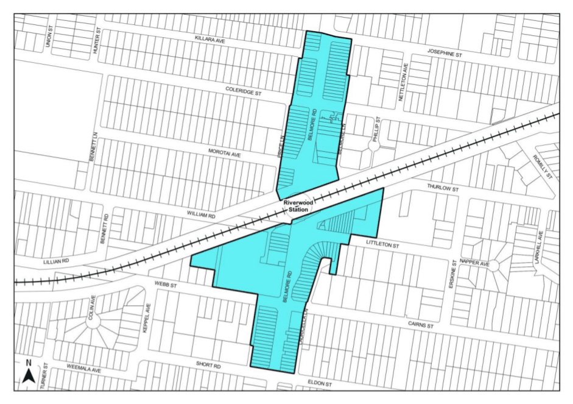
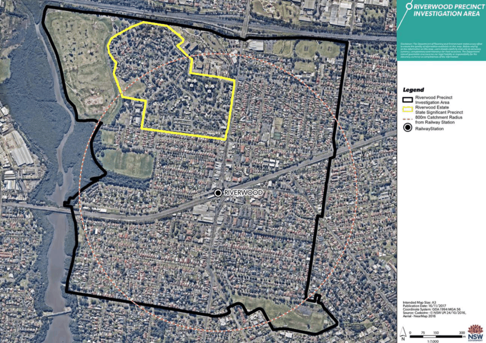

#### 7.2.7 Riverwood Local Centre (Belmore Road)

> [Picture on page 58: a picture, saved as a picture (images/part-07-business-precincts-page-58-2.gif, 150 dpi).]

Figure 22: Riverwood Town Centre

#### Existing Character

Belmore Road Riverwood (refer to Figure 22) is considered the strongest local centre in Georges River, particularly in terms of providing local retail services to meet the daily and weekly needs of its residential catchment. Vacancy rates are low and the commercial rents are currently affordable.

The major asset in the Local Centre is the Riverwood Plaza Shopping Centre, anchored by Coles, Woolworths and Aldi supermarkets. However the centre suffers from competition from the stronger performing Roselands Shopping Centre (60,000sqm retail floor space) which has just been expanded and refurbished.

Riverwood precinct provides the greatest employment provision of any of the E1 Local Centres. Considering its size the precinct provides a moderate level of residential attributable to mixed use developments and some shop top housing.

The centre generally consists of one and two storey older building stock with a recent 5 storey shop top development. The majority of shops are built on narrow lots but there are some larger sites such as Riverwood Plaza Shopping Centre. The centre is physically divided in two by Riverwood station and the bridge over the railway line. The north-south axis of Belmore Road combined with low scale buildings provides the centre with good natural

light throughout the day. There is good pedestrian amenity and comfort with wide footpaths, consistent paving, and street landscaping.

The centre offers good exposure from passing foot and vehicle traffic from within the Riverwood town centre. In line with a number of other centres, car parking is an important issue impacting the development of additional retail. Residential densification in the broader area would support greater retail demand.

Generally high demand for residential uses exists. Additionally, some reasonable development potential exists within large sites (including council car parks). Permitting greater residential yields leverages off the existing rail infrastructure and provides the opportunity and incentive for landowners to provide developments that provide greater amenity while maintaining, and likely improving the retail offering.

There is limited employment generating uses outside retailing, personal services and small business services, as well as limited dining options.

Riverwood Precinct Investigation Area

Riverwood Local Centre is contained within the Riverwood Precinct Investigation Area. The boundary of the precinct is illustrated by the black line in Figure 23 below.

> [Picture on page 59: a picture, saved as a picture (images/part-07-business-precincts-page-59-17.gif, 150 dpi).]

Figure 23: Boundary of the Priority Precinct

The planning for this wider Precinct will ensure that planning for this area is coordinated by the NSW State Government, Georges River Council and Canterbury/Bankstown Council.

Infrastructure such as schools, parks, community facilities, public transport and road upgrades will also be delivered within the Precinct to support the future community needs.

Riverwood Estate State Significant Precinct

The Riverwood Precinct Investigation Area is separate from the State Significant Precinct (SSP) for the Riverwood Social Housing Estate. The Riverwood Estate Social Housing Estate is located within the Canterbury-Bankstown LGA. The boundary of the Estate is illustrated by the yellow line in Figure 23 above.

The Riverwood Estate currently has 994 social housing dwellings on over 30 hectares of government-owned land. In late 2019, the Minister for Planning and Public Spaces announced a new approach to precinct planning in NSW. This included a change of approach to planning for Riverwood Estate.

In collaboration with Land and Housing Corporation (LAHC), City of Canterbury Bankstown will now take the lead in planning for Riverwood Estate.

#### Desired Future Character

Riverwood has developed into a vibrant and attractive centre catering to the diverse needs of its community. An integration of appropriate retail and commercial development needs to be encouraged with housing, improving street surveillance and after hour activity. Significant improvements to the public domain and the public/private interface with awnings, active uses, street tree planting and furniture and paving upgrades will create a vibrant centre. Mixed use development (which includes residential) will provide passive surveillance and resident interaction. Site consolidation and redevelopment will provide through-site pedestrian links or arcades that provide rear access to laneways and public car parking areas.

Belmore Road is the focus of the Riverwood Centre through the:

• Promotion of a co-ordinated verandah for the entire road frontage in the Centre

• Limiting individual retail frontage

• Fostering an improved mix of uses

• Retaining the important role of public transport

• Enhancing pedestrian amenity

• Provision for commercial and residential development of an appropriate scale and mass

• Creation of a memorable identity through the provision of verandahs for each building along the entire road

• Establishment of building depth controls to ensure high quality building and external spaces, including verandahs.

#### Objectives

a) Promote high quality architectural design.

b) Ensure that the development is of a scale and design with a consistent streetscape, compatibility of building form, and a high level of environmental amenity.

c) Improve the public domain through street planting, furniture and paving upgrades.

d) Provide high quality retail, commercial and residential development to serve the needs of the surrounding local community.

e) Ensure any future development provides active ground floor uses.

f) Provide open space and pedestrian links through redevelopment of sites.

#### Controls

Amalgamation

1\. Maximum street frontage for individual commercial sites along Belmore Road is 25m.

Setbacks

2\. Development along Belmore Road that has dual access to rear laneway is required to provide a 1m setback to the laneway. This 1m setback is required to be dedicated to Council to allow for lane widening to improve pedestrian amenity and traffic management.

Verandahs

3\. Verandahs can extend from the first storey to the third storey of a building and are not permitted on the fourth storey.

4\. Verandah design must conform to uniform building and verandah alignments, internal verandah divisions, heights, materials and balustrading.

5\. Verandah enclosure will only be permitted through the use of shutters integrated with the design of the building. Enclosure by glass will not be permitted.

6\. Base plates for the verandah must not protrude above footpath level.

7\. Verandah levels must fall to the building and all stormwater down pipes must be recessed into the building façade.

8\. The provision and operating cost of verandah lighting is the responsibility of the building owner. Lighting is to be recessed into the underside frame of the verandah or wall mounted on the building.

9\. Canvas blinds along the outer edge of verandahs at street level can be used to provide sun shading to the east and west facades.

Through Block connections

10\. Arcades should be located in mid-block locations and provide a clear sightline from one end to the other, for surveillance and accessibility.

11\. Arcades are to have a minimum width of 3m, clear of any obstruction, except for connections through shops.

12\. Retail frontages are to be maximised along arcades.

13\. Natural lighting and ventilation of arcades is highly desirable.

14\. Pedestrian safety and the security of adjacent businesses, particularly at night, should be considered in the design of through block connections.

15\. Public use of through block connections is to be available at least between the hours of 6.00am and 10pm daily.

16\. Arcades must have a minimum floor to ceiling height of 4m.

17\. Council may consider the relaxation of the above controls depending on the quality of public area provided and the merits of the particular application.

Shop fronts

18\. Shop fronts must be glazed.

19\. Solid roller shutter doors of any kind are not permitted on shop fronts. Council may consider an open grill design where warranted for security purposes.

Landscaping and Open space

20\. Lower level rooftop areas and courtyards in the centre of blocks are to be landscaped.

21\. A minimum of 600 mm of soil is to be provided above basement structures for landscaping.

22\. Where direct access to ground level private open space is not available, provide at least one balcony, terrace, verandah, or deck for each dwelling.

23\. The primary above ground open space area should be accessible from a family room, lounge, dining room or kitchen, and be predominantly north, east or west facing, to ensure it is useable as an outdoor living space.

24\. Smaller secondary above ground open space area are also encouraged, such as balconies adjacent bedrooms, screened external clothes drying balconies adjacent laundries and bathrooms.

25\. Above ground open space should overlook the street or rear garden to protect the privacy of occupants and neighbours.

26\. Street footpaths are to be finished in accordance with Council’s requirements.

Vehicular access and loading dock

27\. Belmore Road can not to be used to provide vehicular access to a site.

28\. Car parking and loading dock provision is to comply with Section 3.13 - Parking, Access and Transport of this DCP.

29\. Vehicular access is to be from existing crossings or from rear lanes/streets.
