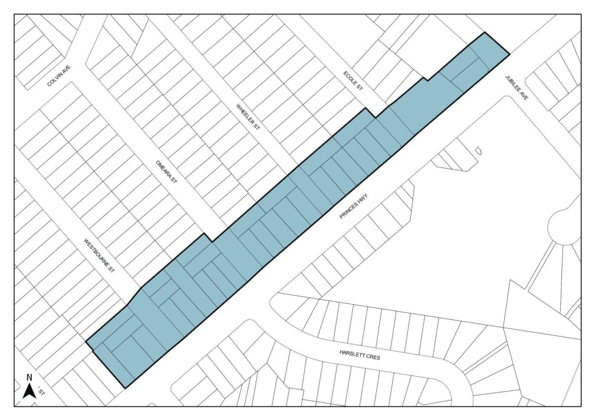

#### 7.2.8 Enterprise Corridor (Princes Highway, Carlton)

> [Picture on page 63: a picture, saved as a picture (images/part-07-business-precincts-page-63-2.gif, 150 dpi).]

Figure 24: Enterprise Corridor, Carlton

#### Introduction

This section applies to the Enterprise Corridor located along the Princes Highway corridor in Carlton between Carlton Local Centre and Kogarah Town Centre (Figure 24), formerly zoned B6 Enterprise Corridor prior to 26 April 2023. This section of the DCP should be read in conjunction with Section 7.1 - General Commercial Controls. Where any inconsistency exists, the controls in this section will prevail.

Existing buildings are of varied architectural form and style and generally range from one to two storeys in height.  Princes Highway is a major arterial road which significantly compromises the amenity of the area, particularly for any residential component of development. Appropriate building design, construction and internal layout can reduce traffic effects on occupants. The Princes Highway Corridor aims to encourage opportunities for business and retail development that are suited to high exposure locations while ensuring that the Carlton Local Centre and Kogarah Town Centre remain the focus for business and retail activity.

The purpose of this zone is to promote businesses along main roads and encourage a mix of compatible business, office, light industrial and some residential uses while reinforcing the corridor as a commercial/ employment precinct.

#### Desired Future Character

This location allows businesses to benefit from high visibility and good access to public transport and is intended to provide lower cost employment and business start–up opportunities and buffer residential land from high traffic volumes.

The built form in this zone requires a large floor plate capable of accommodating a range of employment uses, to be provided at ground floor with residential development above stepped up and away from the Highway frontage.

These design controls aim to ensure that new development provides separation from the existing residential development to the rear and will provide for a street wall fronting the Princes Highway, with residential above stepping down to the west away from the Highway frontage.

#### Objectives

a) Ensure development is flexible, adaptable and robust enough to cater for a variety of future light industrial, business uses and residential uses.

b) Ensure the environmental and streetscape amenity of surrounding streets and adjoining properties is protected.

c) Provide increased building separation where there is a transition to a lower density residential zone or a heritage item.

d) Ensure development can cater for service vehicles without adverse impact on the ingress and egress of building users or the existing traffic network.

e) Avoid retail uses (other than those permitted under the LEP) along the Princes Highway Enterprise corridor and to ensure separation of the Carlton and Kogarah centres.

#### Controls

Building Siting and Layout

1\. Development must respond to topography, views and sight lines.

2\. Avoid vehicular access to properties from Princes Highway. Provide vehicular access to properties from secondary roads and rear lanes. The location and means of access to customer car parking should be clearly visible to passing motorists.

3\. Developments are to avoid locating vehicle driveways adjoining residential zoned properties without a landscape buffer or suitable acoustic insulated fence. Loading docks must be enclosed to minimise noise and amenity impacts.

4\. Building layout must avoid any potential for overlooking or overshadowing of adjoining residential zoned properties.

5\. Developments must locate any potential noise sources away from any adjoining residential uses.

Building Form and Design

6\. Encourage development that is compatible with the existing streetscape and future scale of the adjoining area.

7\. Encourage buildings that are appropriate to the local context including massing, bulk, scale and façade detail.

8\. Encourage interesting and diverse roof design that reflects the local character and context.

9\. Building elements such as windows, doors, recessed walls and other architectural features should be used to minimise large expanses of blank walls and glazed areas.

10\. Encourage suitable design and construction of buildings to minimise noise and amenity impacts arising from proximity to the Princes Highway.

11\. For sites adjoining residential uses, encourage appropriate setbacks and building design to minimise overshadowing and overlooking.

12\. Encourage opportunities for deep soil planting areas at Princes Highway. Planting is to soften the built form.

13\. The façade modelling of a development should utilise large expressed elements to relate to passing motorists and articulate the key components of the building such as entries, showrooms and the like. Finer detail expressing environmental control, individual tenancies and building levels should be used to add richness to the architectural design.

14\. Signage must be integrated into the overall façade design.

15\. Sun shading is to be provided appropriate to orientation for glazed portions of the facade.

16\. Showrooms are to have a minimum floor to ceiling height of 4.0m and preferably higher.

Side Boundary Setbacks

17\. Zero side setbacks are permissible along Princes Highway frontage where adjoining E1 zoned land.

Rear Boundary Setbacks

18\. Minimum 6m setback from a rear boundary between ground floor level and up to four storeys.

19\. Upper level setbacks are 9m above four storeys.

20\. Side and rear boundary setbacks adjacent to a lower density residential zone for the purposes of visual separation, privacy and transition:

i. Minimum setback of 9m from the boundary between ground level and up to four storeys.

ii. Upper level setbacks are 12m above four storeys. Note: A reduced side or rear setback may be permitted where permitted by Part 3F of the NSW State Government’s Apartment Design Guide.

Note: Private open space and balconies must comply with part 4E of the NSW State Government’s Apartment Design Guide.

Public Domain Interface

21\. Encourage improved pedestrian amenity and vibrancy of the area through landscaping and interesting and/or active street level uses.

22\. Encourage landscaping within rear setbacks and street trees along Princes Highway.

23\. Car parking should preferably be located:

a. At the rear of building away from the street frontage.

b. Behind the front building line.

c. Within a basement car parking structure.
