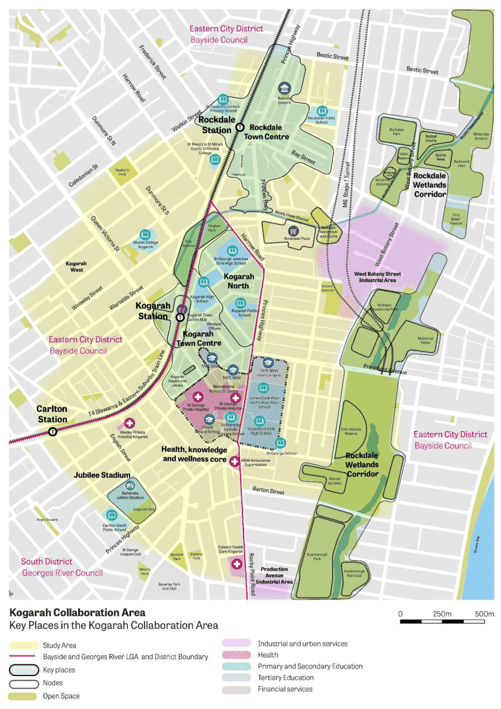
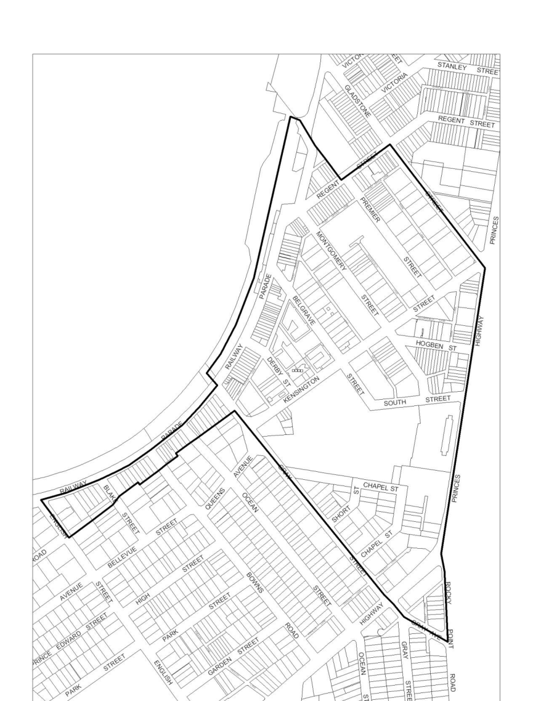

#### 8.1.2 Application of this Part

This part applies to land that is within the boundaries of the Kogarah Town Centre as shown in Figure 2 below.

This Part must be read in conjunction with the other parts of the Georges River Development Control Plan (GRDCP) 2021.

> [Picture on page 4: a picture, saved as a picture (images/part-08-1-kogarah-strategic-centre-page-4-1.gif, 150 dpi).]

Figure 1: Kogarah Collaboration Area

> [Picture on page 5: a picture, saved as a picture (images/part-08-1-kogarah-strategic-centre-page-5-1.gif, 150 dpi).]

Figure 2: Kogarah Town Centre Boundary
