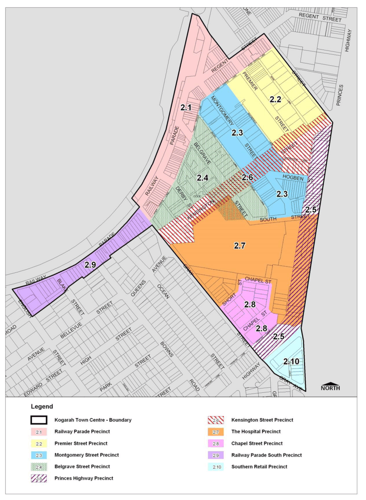

#### 8.1.4 Local Precinct Character Statements

This section sets out in detail the existing character, the desired future character and specific controls for each of the ten precincts within the town centre (refer to Figure 3). Development is to address the desired future character and specific controls.

#### 8.1.4.1 Railway Parade

#### 8.1.4.2 Premier Street

#### 8.1.4.3 Montgomery Street

#### 8.1.4.4 Belgrave Street

#### 8.1.4.5 Princes Highway

#### 8.1.4.6 Kensington Street

#### 8.1.4.7 The Hospital

#### 8.1.4.8 Chapel Street

#### 8.1.4.9 Railway Parade South

#### 8.1.4.10 Southern Retail Precinct

> [Picture on page 8: a picture, saved as a picture (images/part-08-1-kogarah-strategic-centre-page-8-1.gif, 150 dpi).]

Figure 3: Ten Precincts of Kogarah Town Centre
