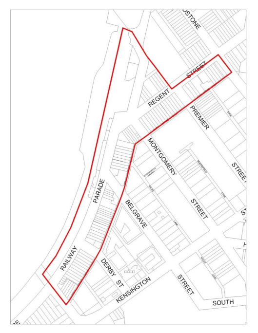
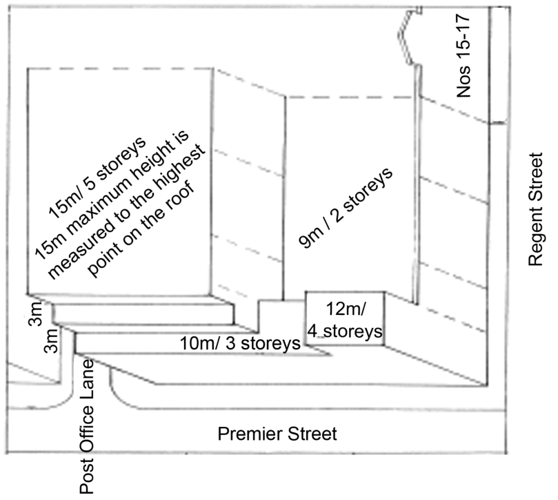
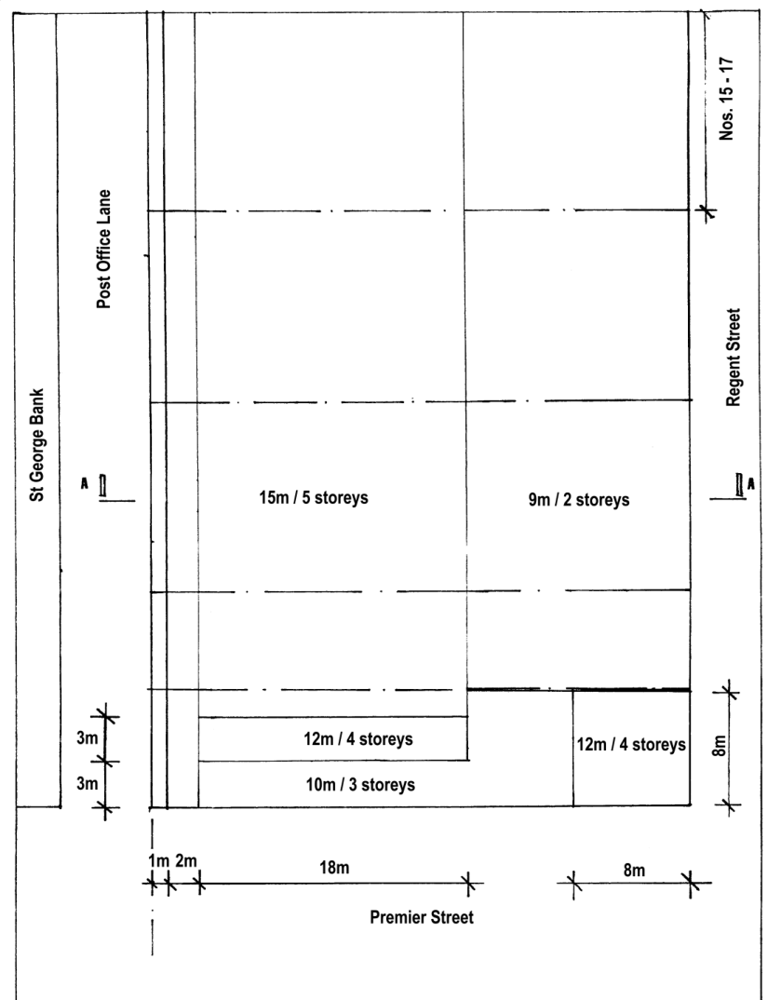
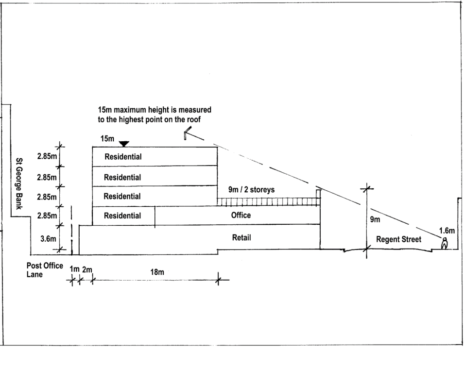

## 1. Railway Parade Precinct

> [Picture on page 9: a picture, saved as a picture (images/part-08-1-kogarah-strategic-centre-page-9-2.gif, 150 dpi).]

Figure 4: Railway Parade Precinct

#### Existing Character

Railway Parade is a key precinct in the formation of Kogarah Town Centre’s identity. Together with Regent Street, it forms a traditional main street through the town centre, creating a small scale village character.

The activities in the main street are augmented by the railway station and bus interchange. As the arrival point for public transport users, the first impressions of Kogarah are formed in the Railway Parade / Regent Street shopping area.

As well as the railway station entry to the town centre, a sense of arrival is gained at the northern end of Regent Street, at the crest of the hill, near the intersection of Premier Street. Another point of arrival is the open space of H.V.Evatt Reserve on the western side of Railway Parade near the intersection of Gray Street.

The 19th and early 20th century, two and three storey street frontage buildings near the railway station create a cohesive main street.  The sense of enclosure and activity near the station is lost further to the south, where the street opens out into H.V.Evatt Reserve.

Railway Parade is sunny for most of the day, as it is oriented north and south.  The small scale buildings, the distinctive corner buildings, continuous awnings and street tree planting

combine to create a pedestrian scale environment with a high degree of visual interest and amenity.

#### Desired Future Character

Railway Parade will continue to be one of the main streets for the Kogarah Town Centre with a pedestrian scale environment with a high degree of visual interest, activity, amenity and connections to the laneway network. It will have reduced speeds to promote safety at key interfaces with the station, schools and park edge at Hogben Park and along the T4 Eastern Suburbs and Illawarra train line. Located along Railway Parade will be retail, community and other active uses. The Kogarah heavy rail, bus and metro interchange will open the two sides of Kogarah and improve movement and access between the east and west sides of the train line. There will be an improved interface of square facing the Kogarah Town Shopping Centre (above the train station) with the station square set at the same level as the surrounding streets. Pedestrian activity will be prioritised by creating dedicated High Pedestrian Activity Areas (HPAA) to support the future of the area as a major transport hub and interchange between heavy rail and mass transit and the projected influx in population and workforce. Lanes will be upgraded to create a better address for buildings and enhance streets and lanes with public domain improvements. The Precinct will be greened through tree planting in accordance with Council’s Tree Management Policy (and its Appendix 1 – Tree Planting).

#### Controls

1\. The two storey wall height to Railway Parade is to be retained, in keeping with the established precinct character.

2\. Street level frontages in new developments along Railway Parade and Regent Street are to be activated with restaurants, cafés and outdoor eating, contributing to the vibrant activity of the main street precinct.

3\. Existing lanes are to be upgraded to create a better address for buildings and improve the public domain.

4\. A cohesive streetscape is to be created by addressing the street with:

a. Continuous awnings;

b. Continuous parapets;

c. Vertical proportions.

5\. Development on Post Office Lane (to the rear of shops) is to complement the form, scale and character of the shop buildings fronting Railway Parade and Regent Street. Development should not be visible from the western footpath of Railway Parade or Regent Street.

6\. Corners are to be defined with prominent, geometric building forms.

7\. The principal vehicular access including car park entries or exits is to be provided from side streets and Post Office Lane.

8\. Heritage buildings are to be protected and enhanced with appropriate maintenance, restoration and paint colour schemes.

9\. The facade composition, proportions and materials of new buildings are to relate to adjacent heritage buildings.

10\. New development is to be appropriate in scale, materials and finishes to the existing traditional retail strip character, with shopfront openings activating the street and highly articulated facades and variety in parapet treatments enlivening the streetscape.

11\. Any redevelopment of the former Post Office should be preceded by the preparation of a Conservation Management Plan and the proposed floor space for this site would not exceed the existing floor space.

12\. Redevelopment of the other heritage sites and the sites adjoining them must consider and respond to the heritage items in accordance with the Local Environmental Plan.

13\. Heights are to comply with Table 1:

| Heights |  |  |
|---|---|---|
| Maximum | Option 1 – Mixed Use | Option 2 – Commercial/Retail |
| Street wall height | 7.8m fronting Railway Parade to the top of the parapet or balustrade |  |
| Building height to the lane | 1 storey with upper levels setback |  |

Table 1: Heights

14\. Setbacks are to comply with Table 2:

| Setbacks |  |  |
|---|---|---|
| Minimum | Option 1 – Mixed Use | Option 2 – Commercial/Retail |
| Ground and first storey level setback | Zero setback/ build-to line on Railway Parade and the ‘return’ to side streets |  |
| Upper level setback (above the second storey) | Minimum 6m (to the face of the building, no including any balconies) 10 m (3 storeys) |  |
| Setback to Post Office Lane | 3 m |  |

Table 2: Setbacks

15\. Redevelopment of the sites at Nos.19-31 Regent St, must comply with the setbacks in diagrams 5, 6 and 7.

16\. Redevelopment of the sites at Nos.120-126 Railway Parade is subject to the provision of a minimum 6m wide, fully public and open pedestrian link between Railway Parade and Post Office Lane, connecting with O’Keefe Lane. The pedestrian link is to create a clear

physical and visual connection from the main retail strip to Kogarah Library and the Town Square, via O’Keefes Lane.

17\. Retain or reinstate traditional fascia lines on original shopfronts and integrate them with new development.

18\. Provide continuous awnings along the full frontage of buildings on Railway Parade.

19\. Design buildings on Post Office Lane to enliven and activate the rear lane.

20\. A single or double car space may be provided at the rear of the sites, where it does not limit the potential for safe and comfortable pedestrian access from Post Office Lane (to the residential component of the building), and where the visual impact of the parking is minimised either through landscaping or through screening vehicles with moveable doors.

21\. Justification for the provision of no on-site parking for Commercial and retail development only in this precinct is based on the following:

a. The Railway Parade precinct is adjacent to a major transport node, being Kogarah Railway Station.

b. The uses along Railway Parade will be utilised by workers/residents already in the Kogarah Centre and it is considered that the number of additional trips generated will be minimal.

c. To facilitate economically viable redevelopment of smaller sites (without the need for amalgamation).

d. The controls promote the upgrading of Post Office Lane, with development fronting the lane having an active frontage combined with public domain improvements. This activation would be compromised if on-site parking to sites is required.

> [Picture on page 13: a picture, saved as a picture (images/part-08-1-kogarah-strategic-centre-page-13-1.gif, 150 dpi).]

Figure 5: Axonometric of Nos.19-31 Regent St

> [Picture on page 14: a picture, saved as a picture (images/part-08-1-kogarah-strategic-centre-page-14-1.gif, 150 dpi).]

Figure 6: Site Plan Nos. 19-31 Regent St

> [Picture on page 15: a picture, saved as a picture (images/part-08-1-kogarah-strategic-centre-page-15-1.gif, 150 dpi).]

Figure 7:  Section AA of Nos.19-31 Regent Street
