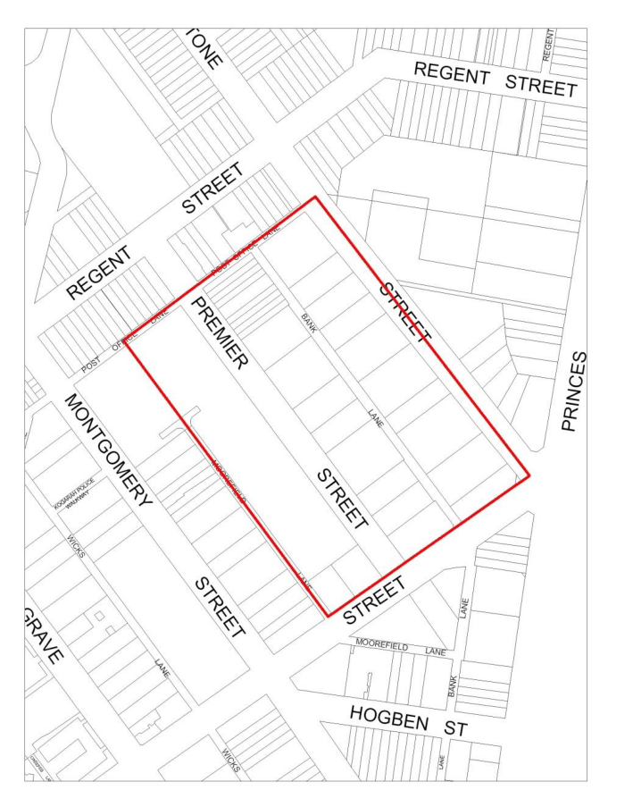

## 2. Premier Street Precinct

> [Picture on page 16: a picture, saved as a picture (images/part-08-1-kogarah-strategic-centre-page-16-2.gif, 150 dpi).]

Figure 8: Premier Street Precinct

#### Existing Character

The two sides of Premier Street differ significantly (Figure 8).  The Westpac Bank building separates the residential area to the north of the town centre.

The Westpac Bank building is monolithic and considerably taller than the northern side.  The bank fronts Montgomery Street (Montgomery Street Precinct) and therefore contains blank facades to Premier Street built to the street alignment with little relieving landscape.

The Westpac Bank building has adequate infrastructure potential to support additional uses including a newly renovated interior, stand-out atrium to attract businesses and partners, meeting rooms and an auditorium. Westpac’s innovation space known as ‘The Hive’ is in the offices and enables the bank to test and develop ideas for new products and services for its

12 million-plus customers, contributing to the presence of innovation in the Collaboration Area.

At the midpoint, along the Premier Street edge of the block, there is a wide driveway and the entry to the community hall and training facilities.  Angle parking for the bank adds to the dominance of the cars on this side of the street.

The northern side of the Premier Street and Gladstone Street consist predominantly of medium to high density residential. The Regent Street end of Premier Street contains heritage listed two-storey terraces and single storey terraces.

#### Desired Future Character

The mixed use of the Precinct will be maintained but softened through tree planting. Medium to high density residential development will be located on the north-eastern side of Premier Street and the southern side of Gladstone Street. Along Premier Street commercial uses such as small offices, retail and home offices will be encouraged in the ground level of residential buildings.

#### Controls

1\. The north-eastern side of the Premier Street is to be addressed with either commercial ground level frontages built to the street alignment or fully residential buildings set back a minimum of 3m from the street alignment.

2\. New development is to address the street with major facades, building entries and substantial planting within setbacks on the north-eastern side of the street.

3\. The heritage items at the Regent Street end of Premier Street are to be protected and enhanced.  Future adjacent development is to be sympathetic to heritage items, particularly in terms of scale and siting.

4\. The safety of Moorefield Lane is to be improved by providing unlocked access from Montgomery Street to Premier Street, through the lobby of the staff training centre of the Westpac Bank building.
