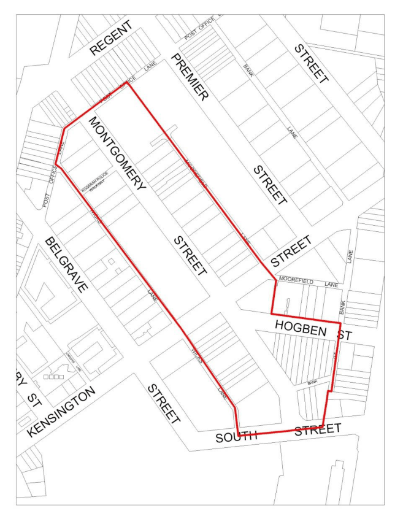
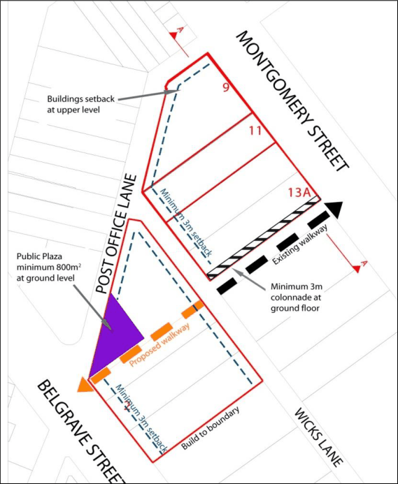

## 3. Montgomery Street Precinct

> [Picture on page 18: a picture, saved as a picture (images/part-08-1-kogarah-strategic-centre-page-18-2.gif, 150 dpi).]

Figure 9: Montgomery Street Precinct

#### Existing Character

Montgomery Street is a key precinct (Figure 9) in the formation of Kogarah’s identity.  Its intersection with Railway Parade at the railway station places it in the heart of the town centre.  Montgomery Street has a main street, small scale shopping character near its intersection with Railway Parade.

Further to the east, Montgomery Street contains a range of larger scale commercial, public and institutional buildings.

The Westpac Bank building is a prominent monumental building near a geographic highpoint in the town centre.  Its character contrasts with the surrounding context of the adjacent small scale shops and legal terraces.  Its smooth surface finish reinforces its bulky, monumental nature within a setting of small scale, highly textured streetscape buildings.

The courthouse, police station and solicitors’ offices form a small legal precinct.  The location and quality of the public buildings and professional terraces in this group contribute significantly to the character of the street.  The public role of the courthouse and the professional offices contribute to the range of building uses in the area and should be maintained.

Retail and commercial buildings, with some residential, are located on the north side of Montgomery Street, close to Kensington Street.  Few buildings take the opportunity at the ground level to provide street level activities.  There is potential for increased pedestrian activity along Montgomery Street.

The TAFE site, opposite, is at present a large institutional building adjoining a carpark and does not contribute to the urban spatial quality of the street.

The intersection of Kensington and Montgomery Streets is poorly defined, except for the office building on the north west corner.  The day surgery building on the south east corner, while of a good architectural quality, is too small to emphasise and enclose the space of the corner.

Montgomery Street from Kensington Street to South Street is predominantly low density residential, with a heritage building and TAFE building on the eastern side. An under-utilised park, named Edith Blake Reserve, is adjacent to the hospital’s methadone clinic. Montgomery Street is well terminated by the main entrance to St George Private Hospital.

#### Desired Future Character

Montgomery Street will be the flagship street for the area and will be a major mixed use and active street, with retail, commercial and medical/civic uses with active frontages along its length. The street will have pedestrian priority and will change in character and design to accommodate the emergency access needs of the Hospital. The Precinct will provide opportunities for quality food and beverage uses and night time activity. The intersection of Kensington Street and Montgomery Street will be emphasised by building design, reinforcing Kensington Street as the major north-east, south-west boulevard in the town centre. Buildings will address the street, at the station end of Montgomery Street up to the TAFE building, with small scale retail and commercial development at ground level. Buildings will address and enclose Edith Blake Reserve with buildings built to the alignment of the streets and the lane fronting the park. Wicks Lane will be upgraded to create a better address for buildings and enhance the public domain of streets. The Precinct will be greened through tree planting.

#### Controls

1\. New buildings along the southern side of Montgomery Street between Kensington and South Street, will address the street with buildings having the lower three or four-storeys built to the proposed building alignment.

2\. The scale of the heritage building on the corner of Hogben Street and Montgomery Street is to be respected with complementary adjacent development.

3\. The heritage buildings at 22-28 Montgomery Street which are opposite the Courthouse are to be retained and any taller development set back 15m from the street frontage. Structures forward of 15m may be considered by Council only if they are shown to protect the heritage and enhance the urban design quality of the street.  In any case, no higher structure should be allowed forward of 9.3 metres.  In relation to such structures, applicants shall be required to show how both external and internal heritage features are protected by the design.

4\. A pedestrian link adjacent to the courthouse, from Belgrave Street to Moorefield Lane is to be created.

5\. Pedestrian amenity in the form of continuous awnings along retail and commercial frontages is to be provided.  A diverse range of canopies, awnings, balconies, bay windows and signs will assist in creating a colourful and visually rich townscape character.

6\. Car park entries or exits are to be located on rear lanes.

7\. The street wall height on Montgomery Street is to be consistent with the Police Building (12m).

8\. A minimum 3m setback to Post Office Lane and Wicks Lane is required.

9\. The front setback on Montgomery Street is to match existing Police Station Building (built to boundary).

10\. A fully public and open pedestrian through site link of minimum 6m width between Montgomery and Belgrave Streets on the alignment of the existing connection adjacent to the Police Station (western side), and linking to the proposed public plaza at the intersection of Belgrave Street and Post Office Lane is to be provided.

11\. A minimum 3m setback to the existing pedestrian path between Montgomery and Wicks Lane is required for legibility and weather protection.  This can be in the form of a colonnade.

12\. Upper levels of buildings are to be setback to articulate the building along Montgomery Street and Post Office Lane.

> [Picture on page 21: a picture, saved as a picture (images/part-08-1-kogarah-strategic-centre-page-21-1.gif, 150 dpi).]

Figure 10: Building Setbacks

13\. Continuous awnings are to be provided along Montgomery Street (Figure 10).

14\. A continuous colonnade is to be provided with a minimum width of 3m, adjacent to the existing pedestrian walkway between Montgomery Street and Wicks Lane.

15\. Clear lines of sight and unimpeded access along pedestrian links to public streets and plazas are to be provided/retained.

16\. On Montgomery Street, visually break up the building mass both vertically and horizontally is required, for example with building bays, openings and entries.
