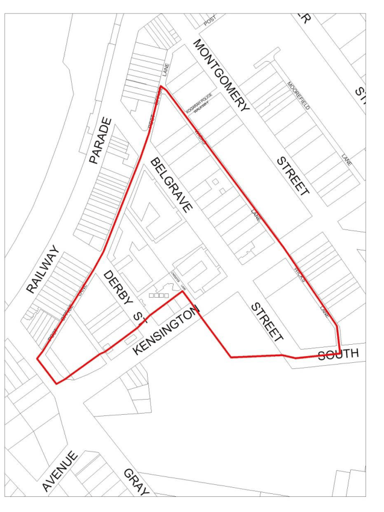

## 4. Belgrave Street Precinct

> [Picture on page 22: a picture, saved as a picture (images/part-08-1-kogarah-strategic-centre-page-22-2.gif, 150 dpi).]

Figure 11: Belgrave Street Precinct

#### Existing Character

Belgrave Street is an important pedestrian route from the Railway Station to St George Hospital (Figure 11).  It is a civic street, containing public buildings such as the community aid and information centre, the Town Square, library, church and the St George Hospital.

The Kogarah Town Square is a unique space within the town centre. The square can accommodate special gatherings or festivities of up to 1000 people. Its low rise built edges allow sun into the square year round while shade is proved at its edges with colonnades and awnings.

The Town Square Development provides residential uses, the Kogarah library and a range of retail and commercial uses at the ground floor facing Belgrave Street and the Town Square.

Belgrave Street is given a formal, cohesive character by extensive streetscape works.

#### Desired Future Character

Belgrave Street will be a green, vibrant pedestrian priority main street for the Kogarah Town Centre, providing a direct link to the hospitals as the southern anchor, leveraging its civic uses and supporting pedestrian desire lines from the hospitals to the station. A small public plaza at the intersection of Belgrave Street and Post Office Lane will provide additional civic open space within the Town Centre.

Post Office and Wicks Lanes will provide a finer grain pedestrian network for the Kogarah Town Centre and will facilitate activation, street art and night time activity.

#### Controls

1\. Development is to address Belgrave Street with active frontages, awnings and street trees to increase pedestrian amenity between Railway Parade and the new entry to the St George Hospital as indicated by the Hospital Masterplan.

2\. Development is to be set back from Post Office Lane to allow redevelopment on both sides of the lane, while maintaining privacy between buildings and pedestrian amenity in the lane.

3\. The intersection of Kensington and Belgrave Streets is to be emphasised with buildings which address the corner.

4\. Adjacent development is to consider and respect the two storey heritage buildings on the corner of Railway Parade and Gray Street (6-14 Gray Street). Development on Gray Street should relate with vertical proportions and frontage articulation.

5\. Minimum 3m setbacks to Post Office Lane and Wicks Lane. Street Aligned for commercial and residential must be setback on Belgrave Street.

6\. Upper levels of the building are to be setback to articulate the building along Montgomery Street, Belgrave Street and Post Office Lane.

7\. Provide clear lines of sight and unimpeded access along pedestrian links to public streets and plazas.

8\. Provide a public link minimum 6.0m in width between Wicks Lane and Belgrave Street to create a continuous pedestrian link between Montgomery Street and Belgrave Street.

9\. Align the new pedestrian through-site link on axis with the existing walkway, terminating at the corner of Belgrave Street and Post Office Lane.

10\. On Montgomery Street and Belgrave Street, visually break up the building mass both vertically and horizontally, for example with building bays, openings and entries.
