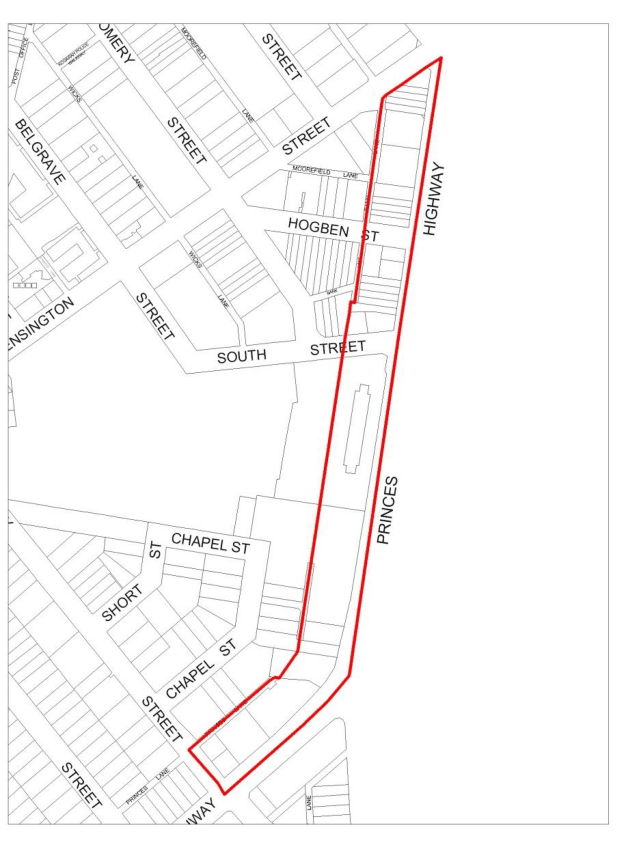

## 5. Princes Highway

> [Picture on page 24: a picture, saved as a picture (images/part-08-1-kogarah-strategic-centre-page-24-2.gif, 150 dpi).]

Figure 12: Princes Highway Precinct

#### Existing Character

This precinct (Figure 12) comprises a range of building uses, including medical, showrooms, commercial offices, high density residential, a residential aged care facility, a church and school.

The most distinctive buildings are the St George Private Hospital and the church.  The width of the Princes Highway means that large monumental buildings such as the Private Hospital are not out of scale.

The Private Hospital is a significant landmark for Kogarah on the Princes Highway, signifying the location of a major St George Regional Institution.

Recent apartment buildings at the corner of Kensington St and Princes Highway identify as a gateway into Kogarah when approaching from President Avenue.

The existing highway is dominated by cars, with some landscaped setbacks softening the streetscape, however the precinct lacks good pedestrian amenity.

#### Desired Future Character

The Princes Highway will be local connector and seam that joins east and west, including Rockdale and Kogarah town centres and the health, knowledge and wellness core. It will have regular, high quality and safe crossing points, supported by reduced vehicle movements in particular segments of the corridor and increased pedestrian priority achieved by the introduction of stages of the M6 over time. Development along the Princes Highway will include a range of offices, showrooms, medical uses and residential development. Public domain activation within the side streets of the Princes Highway will have created retail pockets. A major new entry into Kogarah will have been created with the extension of President Avenue to Kensington Street. The public domain of the Princes Highway will have uniformity with paving types and paving width and will provide for tree planting.

#### Controls

1\. High quality corner buildings are to be provided at the new intersection of Princes Highway and President Avenue, to signal arrival at Kogarah town centre from President Avenue and the Princes Highway.

2\. Heritage buildings are to be respected in adjacent redevelopment.

3\. The pedestrian amenity of the Princes Highway is to be improved via awnings and substantial planting in building setbacks.
