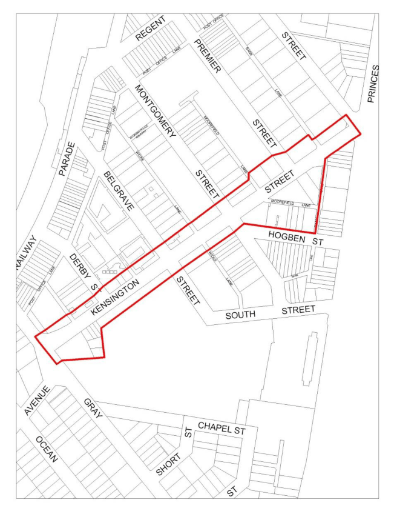

## 6. Kensington Street Precinct

> [Picture on page 26: a picture, saved as a picture (images/part-08-1-kogarah-strategic-centre-page-26-2.gif, 150 dpi).]

Figure 13: Kensington Street Precinct

#### Existing Character

Kensington Street is the only north-east to south-west street linking Gray Street to the Princes Highway (Figure 13).  It is located on the highest point in the town centre, near the intersection of Derby Street and gradually descends towards the Princes Highway.

It has a major role in the Kogarah Centre.  However, its existing character is inconsistent and often lacking in streetscape quality and amenity.

This is partly due to the fact that it has many streets crossing it, with buildings tending to face cross streets, presenting a side or minor façade to Kensington Street.

#### Desired Future Character

Kensington Street will provide a main frontage to the St George Public Hospital and is the interface that stitches the hospital campus into the Town Centre, providing services for a

variety of street users and activities, including buses and vehicles moving east-west across the wider Collaboration Area. Kensington Street will be a major connector to the hospital from the south and across the Town Centre feeding the streets that lead into Kogarah train station. It will support pedestrian desire lines east west and have safe crossings and connections to President Avenue and East towards Botany Bay. The street will also be an important suburban connector from the southern suburbs accessing the Kogarah Town Centre and a key street providing access to the Jubilee Stadium Precinct. A range of uses will exist along Kensington Street, including commercial offices, residential, medical and public buildings.

#### Controls

1\. Active street frontages are to be provided, with retail, commercial offices, home offices and public uses.

2\. Major facades, building entrances and substantial tree planting are to address the street.

3\. Intersections of cross streets within the Precinct are to be emphasising with corner buildings having taller elements on the corner, building entrances and geometric corner elements.

4\. Pedestrian amenity and linkages are to be provided from one side of Kensington Street to the other, with street awnings, street trees and pedestrian kerb crossings.
